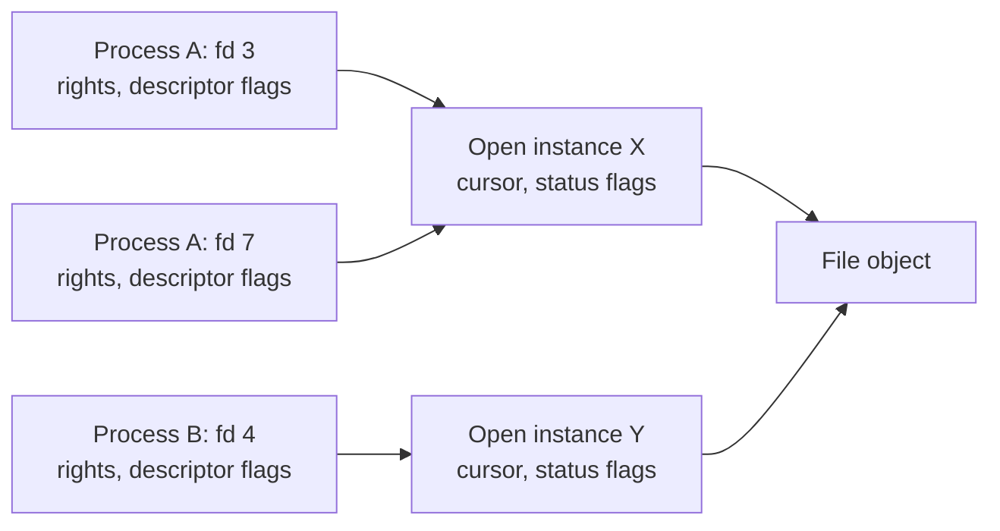

# Native Object Kernel Contract

Status: first-slice semantic decisions approved, 2026-11-04; later service and
reflection contracts remain proposals. **Not an implemented or frozen binary ABI.**

The agreed implementation order is descriptors, console, and a read-only initrd
VFS first; hosted services follow. This document owns the shared semantics.
The [VFS](object_oriented_vfs_spec.md), [ELF](elf_interface_spec.md), and
[shell](os1-shell-language-first-draft.md) documents are profiles of it. The
[refreshed May review](2026-05-10-unified-os-api-architecture-review.md) records
risks, changed recommendations, and acceptance gates. Definitions also appear
in the [glossary](../GLOSSARY.md#descriptors-native-objects-and-interface-proposals).

“Must” below describes a requirement on the proposed implementation, not a
claim about today's kernel. Operation names and symbolic errors are semantic
names; syscall numbers, layouts, numeric rights, and error values must be pinned
in reviewed UAPI headers with the first implementation.

## Approved decisions — 2026-11-04

The following six decision groups are approved for the console/initrd milestone.
Their numbers identify the approval groups, not the sections of this document.

| Decision | Approved direction |
| --- | --- |
| 1. Descriptor ABI | Process-local nonnegative 32-bit indices with reuse; per-entry rights/flags; attenuation; duplicates share open instances; close releases one entry while accepted work retains references; distinct errors and progress results. |
| 2. Ownership and synchronization | Entries own open-instance references; open instances own objects; accepted operations retain references. Use atomic reference counting and an acyclic ownership graph initially. Validate rights and retain under table synchronization; invoke operations and destroy objects outside table/scheduler locks. |
| 3. Blocking and teardown | A blocked request retains its object, registration, and valid buffer/address-space borrow. Readiness and registration prevent lost wakeups; completion and teardown prevent access to freed state. Exit stops admission, detaches/cancels waits, and quiesces outstanding accesses before freeing memory. Single-source blocking first; wait-many later. |
| 4. Process startup | Explicit child descriptor maps and granted root/cwd/standard-stream entries; one bounded versioned argument/environment/bootstrap record; complete child initialization before publication; transactional exec and close-on-exec; one user thread per process initially. |
| 5. Initial interfaces | Descriptor lifecycle/flags/atomic replacement, byte I/O, seekable input, directory open/enumerate, and bounded basic information. Fixed records and common authorization/dispatch; each object implements only supported interfaces. Internal C++ inheritance/function tables are not the userspace ABI. |
| 6. Namespace and I/O | Explicit directory capabilities, separate lookup/enumeration rights, immutable initrd, bounded byte paths, no links or parent traversal initially; independent opens have independent cursors, duplicates share them; cursor advancement follows successful delivery including partial progress. |

Numeric assignments, record layouts, finite limits, startup encoding, exact
lock placement/order, and reference-counter mechanics remain implementation
specification work. The approved semantics must be preserved while resolving
those details. Approval neither implements these facilities nor approves every
later hosted-service, reflection, or event proposal. Acceptance tests remain
required before claiming runtime conformance.

## 1. Scope and design decisions

Keep one process resource table and a small set of native interfaces. Files and
consoles are objects with supported operations and granted rights; future
processes or services need not pretend to be byte streams. POSIX functions can
project suitable objects through the same descriptor numbers.

| First-slice direction approved on 2026-11-04 | Reason and consequence |
| --- | --- |
| One fd-shaped descriptor table | One close, duplication, inheritance, and teardown path; stale integers remain possible after slot reuse. |
| Separate descriptor, open instance, and object | Duplicates share stream position while keeping independent rights and descriptor flags. |
| Fixed, versioned interface records first | Proves real I/O without requiring reflection, a recursive value format, or a kernel class registry. |
| Capability-relative namespace lookup | Acquiring a child is an explicit authority check; enumerating names cannot grant child handles. |
| Native creation defaults to close-on-exec | Prevents accidental persistence through image replacement; POSIX wrappers must request their different defaults explicitly. |
| Explicit child grants | A child gets a selected resource set, not the parent's entire table or an ambient global namespace. |
| Hosted calls and queued events later | Gives transport, cancellation, and provider failure their own acceptance gate. |

These choices replace the earlier recommendation to bootstrap the kernel with
universal properties, typed values, and `Collection` traversal. Properties,
methods, and events remain useful interface descriptions in userspace. They
are not three mandatory kernel operations for every resource.

The first slice excludes writable filesystems, links, mounts, mmap, device
control, sockets, PTYs, fork, multithreaded user processes, hosted RPC, and a
shell language implementation. Bounds and authority still apply in this
single-user phase. A future credential policy can restrict capability issuance;
it cannot silently turn an unprivileged descriptor into an administrator.

## 2. Terms and ownership

| Term | Meaning in this proposal |
| --- | --- |
| Object | Resource identity, supported operations, and resource state. An initrd file node and the console device are examples. |
| Open instance | A reference to an object plus state belonging to one opening, such as a cursor and status flags. It is shared by duplicates. |
| Descriptor entry | A process-owned reference to an open instance, with granted rights, descriptor flags, and (for directories) a descendant-grant ceiling. |
| Descriptor / fd | Nonnegative signed 32-bit process-local index into that table. It is neither an address nor a globally unique identity. |
| Capability | A kernel-enforced reference plus its authority. Knowing a path, PID, interface name, or fd from another process is not a capability. |
| Runtime reference | A language value owning or borrowing a local value or descriptor. The runtime must distinguish those cases. |
| Process | An execution and address-space lifetime; holding a process reference does not keep its threads running. |
| Operation | Later: one accepted asynchronous action with a persistent terminal result. It is not a process group. |
| Supervisor | Later: an explicit policy owner for starting, stopping, or restarting provider processes. |

A second `open` creates a fresh open instance. Duplication and an explicit child
grant retain the existing open instance. Kernel references held by an in-flight
operation are additional owners; they are not exposed descriptor entries.
Use atomic reference counting for this first slice. Entry references, accepted
operation references, and open-instance-to-object references form an explicitly
acyclic ownership graph. Back-links used by registries or wait queues must not
create uncollectable owning cycles; their non-owning links need synchronized
removal before the referenced storage is freed. A reference can be retained only
from a live owner or under the protection that prevents removal; incrementing a
counter through a stale pointer is not safe acquisition. Final release destroys
outside table and scheduler locks. Exact counter ordering and new lock placement
must be reviewed against the existing SMP synchronization contract. Reference
counting alone does not define later service supervision or cycle collection.

## 3. Descriptor lifecycle

### Lookup and reuse

Descriptor slots may be reused after close. Operations must validate the index,
acquire a reference to the open instance, and snapshot the entry's rights under
the table's synchronization before dropping that protection. No operation may
retain a bare table-entry pointer or later resolve an asynchronous request by
its original fd number. Lookup linearizes either before removal, obtaining the
old reference, or after removal, observing an invalid or newly allocated entry.

Thus close/reuse cannot redirect an already accepted read to a different file.
It can redirect a **new** call made with a stale integer. Runtime owned-reference
wrappers invalidate on close and must not promise generation protection that
the integer ABI does not provide. Borrowed descriptors cannot outlive their
owner. Internal wait registrations and later request IDs need their own stable
identity; fd numbers are unsuitable for that purpose.

### Close and teardown

`close(fd)` removes exactly one entry and makes its number reusable. A bad fd
returns `BAD_DESCRIPTOR`; successful removal returns success even if final
resource cleanup is deferred. Do not retry close after successful removal.
Closing a descriptor neither cancels an accepted operation nor kills a process.
A blocked console read may finish through its pinned reference; process exit
must explicitly detach/cancel its wait registrations before reclaiming memory.

Close cannot hold the descriptor-table lock across destruction, provider code,
user copying, or a blocking wait. Exit stops new operations, detaches waits,
removes entries, and releases references through an ordered cleanup path.
Address-space teardown waits until any operation that uses that address space
has stopped using it. The first slice must reject unsupported concurrent
user-thread creation rather than assume this remains safe when threads arrive.

### Single-source blocking and cross-CPU completion

An accepted blocking operation retains its open instance and owns a stable wait
registration, completion state, and buffer/address-space borrow until it stops
using them. Descriptor close/reuse never changes the retained target. The request
must not sleep while holding the descriptor-table lock.

Readiness checking and registration must share synchronization with the producer,
or recheck under that synchronization before sleeping, so a readiness change
between check and sleep cannot be lost. A notification prompts observation of
authoritative state; it is not permission to access storage after teardown.
Completion and cancellation coordinate one terminal request transition and one
cleanup path. Removing a waiter from a queue is insufficient if a wakeup path
already holds it: teardown must wait for, or otherwise safely retain storage
through, those outstanding accesses before reclaiming request/thread memory.

Process exit closes admission, detaches or cancels waits, and quiesces outstanding
object, thread, and user-memory accesses before reclaiming their owners. Wait
registration and wakeup paths must preserve the scheduler's cross-CPU locking
rules. The implementation must document lock order and the handoff between queue,
request, and scheduler ownership. General multi-source registration and public
wait-many are deferred; the first slice uses single-source blocking operations.

### Duplication and flags

Native `duplicate(source, requested_rights, descriptor_flags, descendant_ceiling)` allocates a new
entry referring to the same open instance. It requires `DELEGATE`; requested
rights must be a subset of the source rights. Unknown bits and attempted
amplification fail, with no new entry. Rights are immutable on an existing
entry in v1; attenuation creates a new one. A directory's requested descendant
ceiling must also be a subset of the source ceiling; non-directories have none.
Shared status changes require the
applicable interface right and affect all duplicates.

`CLOEXEC` belongs to the descriptor. The initial native default is set.
`NONBLOCK`, where supported, belongs to the open instance. Read-only file and
directory cursors also belong to the open instance. Unsupported status flags
are rejected, not silently retained for hypothetical future use.

An explicit replacement operation used for redirection must atomically pin the
source and replace the target. Failure preserves the target; self-replacement
must have a defined no-op or error result in the UAPI. A close-then-duplicate
sequence is not that operation. A POSIX adapter supplies POSIX `dup`/`dup2`
defaults rather than changing the native defaults.

## 4. Authority and bootstrap

V1 names these rights: `READ`, `WRITE`, `SEEK`, `ENUMERATE`, `LOOKUP`, `INSPECT`,
`EXECUTE`, and `DELEGATE`. Only rights meaningful for a given interface may be
granted. Supported features are separate from permissions. Metadata discovery
never grants access; `INSPECT` reports bounded identity/interface information,
not arbitrary process memory, device registers, or other principals' handles.

Directory descriptor grants carry an immutable descendant-grant ceiling in
addition to rights on the directory itself. This ceiling belongs to the entry,
not the shared open instance: attenuation must not affect other aliases.
An open succeeds only when requested child rights fit
**all** of the starting directory's ceiling, any traversed policy boundary,
and the target provider's allowed rights. Failure is explicit; an open cannot
silently return a less capable handle than requested. A derived directory
cannot widen the inherited ceiling. Every operation creating a directory entry
(open, duplicate, or child grant) validates its requested ceiling. If that entry
lacks `DELEGATE`, `DELEGATE` is also removed from its effective descendant ceiling,
and this restriction propagates to all derived directories. Opening `.` cannot
restore delegation removed from the grant. Retaining other rights in a ceiling
intentionally permits granting them to children, even when the directory's own
interface uses different rights. `ENUMERATE` reveals names/limited metadata;
`LOOKUP` permits resolution. Neither implies the other or unrestricted child
rights. The VFS profile defines the concrete immutable-initrd policy.

Trusted boot setup creates the initial console and initrd-root grants. A child
receives only explicitly mapped descriptors and a bounded startup record naming
its root/cwd and standard streams. Root/cwd are ordinary granted directory
references, not magical integers or an alternative table. Native `os` is a
runtime facade over that context. An absolute-path helper uses its supplied
root; it cannot reopen a more powerful global root. Replacing an image does not
reset or increase authority. A pathname, UID field, or claimed role sent by a
caller cannot substitute for a kernel-validated grant.

V1 delegation is duplication or an explicit spawn grant. General IPC handle
transfer is deferred. A namespace listing or metadata payload carries no
ambient authority. Closing an issuer's copy does not revoke copies already
granted. V1 has no general revocation operation; policy requiring revocation
must not be advertised until a resource-specific contract exists.

## 5. First-slice interfaces and boundary rules

| Interface / operation | Contract |
| --- | --- |
| Byte input / `read` | Requires `READ`; returns bytes transferred, zero at end of input, or an error before progress. Empty console input blocks or returns `WOULD_BLOCK` under `NONBLOCK`. |
| Byte output / `write` | Requires `WRITE`; returns bytes accepted. Console output acceptance does not guarantee physical display or durable storage. |
| Seekable input / `seek` | Requires `SEEK`; checked signed displacement and nonnegative resulting offset; shared with duplicates. Console seek returns `UNSUPPORTED`. |
| Directory / `open_at` | Requires `LOOKUP`, explicit child rights, flags, and a descendant ceiling for directory results; resolves relative to a pinned directory capability and creates a new open instance. |
| Directory / `read_directory` | Requires `ENUMERATE`; bounded records with names and kind hints, not child descriptors. Cursor belongs to the open instance. |
| Basic object information / `query_info` | Requires `INSPECT`; a fixed versioned record of kind, supported interfaces, and limits, with no recursive schema. |
| Descriptor / close, duplicate, flags | Table semantics above. Closing an owned descriptor needs no additional right. |
| Image launch / spawn, exec | Requires executable input authority and explicit startup context; publication rules below. |

Names do not require a separate syscall for every row. The first UAPI should
choose the smallest dispatch surface that implements them; a generic call
with unbounded variants is not a prerequisite. Unsupported interface, bad
descriptor, and denied right are distinct failures. Do not probe a device or
run provider code just to discover whether a call is authorized.

The first reviewed UAPI must define fixed-width layouts, structure sizes and
versions, reserved-zero fields, error numbers, and a finite descriptor-table
limit. All count/offset arithmetic is checked before allocation or access.
Unknown flags, unsupported versions, nonzero reserved fields, embedded path
NULs, and oversized records fail without side effects. Kernel outputs initialize
all bytes, including padding. No raw user address may outlive its owned
syscall/address-space borrow or cross an address-space boundary. A parked
synchronous read may retain a destination address only with that ownership and
teardown synchronization; a returned object identity never contains a pointer.

User buffers are borrowed only for the syscall's lifetime. Work that survives
the call must own a bounded copy or an explicitly retained resource. Operations
may return short counts. On failure after progress they report that progress,
not a negative error implying nothing happened. Zero-length I/O validates the
descriptor, interface, and rights but does not dereference the buffer. EOF is
not `WOULD_BLOCK`. An oversized count must not overflow the signed result;
the UAPI must specify its maximum accepted transfer and bounded chunking.

For initrd reads and directory enumeration, cursor advancement equals bytes or
complete records successfully delivered. Concurrent calls through duplicates
must serialize cursor selection, copying, and commit without holding a spinlock
across faultable copies or sleeping. A zero-progress user-copy failure leaves
the cursor unchanged. Console input requires reservation/commit or a validated
copy path so failed delivery does not silently consume input. Console writes
copy each bounded chunk before making that chunk visible; already emitted
bytes cannot be rolled back. These requirements are implementation acceptance
tests, not permission to invent a second user-memory lifetime model.

## 6. Namespace profile

`open_at` takes a relative byte path and an explicit directory. Absolute paths
are runtime sugar selecting the granted root and removing the leading slash.
There is no implicit global-root lookup in the native primitive. V1 bounds a
path to 4096 bytes excluding a terminator, and a component to 255 bytes. Empty
paths and embedded NULs fail; repeated separators and `.` are accepted, `..`
is rejected, and a trailing separator requires a directory. `/` in the runtime
helper denotes `.` relative to its granted root. Names are byte strings with
no Unicode normalization or case folding. The VFS profile owns archive
validation and directory-record encoding details.

V1 supports only immutable directories and read-only regular files constructed
from validated initrd entries. Links, mount traversal, and mutation return
`UNSUPPORTED`; they cannot fall back to a less constrained resolver. An open
reference pins its resource independently of the pathname. A future mutable
namespace must define lookup linearization, rename/unlink, and traversal races
before enabling those features. `children: Collection<T>` is an optional
runtime adapter over lookup/enumeration, not an alternate resolver.

## 7. Process creation and image replacement

The first slice preserves the present one-user-thread-per-process execution
model. No new hosted-object lifecycle is smuggled into ordinary executable
launch. Initial standard descriptors 0/1/2 are real entries: input with `READ`,
output/error with `WRITE`, plus explicitly chosen inspection/delegation rights.
Closing one makes future calls on that slot fail until it is explicitly reused.
No syscall may route numbers 0/1/2 to the console after their entries are gone.

A native spawn request contains an executable reference with `EXECUTE`, bounded
argv/envp, a finite source-to-child descriptor map, and root/cwd selections from
that map. Every source is pinned and checked for `DELEGATE`; target numbers
are unique and rights and directory descendant ceilings cannot increase.
Each directory grant specifies its ceiling and obeys the delegation rule above.
Source entries are not moved. The map
is applied to a new table, so cycles such as parent 1 -> child 2 and parent 2 ->
child 1 are unambiguous. No unspecified parent entries are inherited. Child
flags are explicit; `CLOEXEC` governs later image replacement, not the initial
spawn load. The startup-record format and aggregate argument limits must be
reviewed with the UAPI before the VFS/launch milestone is complete.

Construct the image, stack/startup record, descriptor table, process ownership,
and final saved thread frame before making the child runnable or returning its
identity as usable. A failure before that point releases all newly acquired
references/pages and leaves the parent's table intact. Scheduler publication
is the final step. The loader must consume the already-open executable object;
it must not reopen the pathname through an unrestricted initrd shortcut. Image
loading reads checked explicit offsets in the immutable backing object and
does not change the executable open instance's shared cursor.

Exec prepares a replacement image and startup state before changing the current
image or descriptors. Failure preserves the original image and descriptor
flags/references. Its commit installs the new image, detaches `CLOEXEC` entries,
and preserves other entries with their rights and shared open instances.
Root/cwd in the replacement startup record must name surviving entries; invalid
selections fail during preparation. All fallible allocation/validation occurs
before commit. Deferred destruction can occur after it; failure there must not
be reported as a recoverable exec failure with the old image still running.

Migration of today's pathname-only `spawn`/`exec` needs an explicit compatibility
wrapper using the caller's granted root and documented standard descriptors.
It must not retain a privileged initrd lookup bypass. POSIX fork and complete
POSIX startup compatibility are outside this slice.

## 8. Later hosted-service contract

This section constrains the next stage; it does not authorize implementation
before a concrete channel/envelope UAPI and failure tests are reviewed.

A program image, running process, service endpoint, and asynchronous Operation
are distinct. `spawn` starts an ordinary program. `start_service` starts a
provider with an explicit supervisor and startup grants. `connect` acquires an
endpoint through an authorized publisher. Local library loading stays within
the caller's process and is neither operation.

A service is connectable only after an authenticated READY handshake confirms
initialization and compatible interfaces. Constructor failure, startup timeout,
or provider exit before READY fails startup and cleans up unpublished resources.
Publication does not transfer supervision automatically; a supervisor change
is explicit. Last client close releases a connection, not an instruction to kill
the provider. Parent exit, shutdown, restart, and orphan handling follow the
supervision policy, independently of endpoint reference counts. A retained
dead endpoint reports peer closure; restart cannot silently rebind it to a new
provider generation.

### Classes and class-controlled construction

A class is a versioned construction contract implemented by an approved binary;
a binary can export more than one class. Class identity, interface identity,
artifact revision, provider-process identity, and object-instance identity are
distinct. A class exposes a bounded construction-argument schema and the
interfaces of its result. Metadata describes this contract; it does not execute
or replace the class's construction code.

**Selected semantics (2026-11-04): the class implementation decides what object
to return.** The ordinary caller invokes the class with optional arguments and
receives an object reference or an error. There are no caller-selectable fresh,
shared, singleton, or reuse modes. The class may allocate a fresh instance,
return a singleton, select a cached instance, or use a pool, within its granted
authority and documented behavioral contract. Identity-sensitive behavior must
be documented, but metadata need not prescribe the implementation's allocation
strategy. A new client descriptor does not imply a new underlying object.

The public construction hook runs for each accepted construction request and may
return an existing object. This is a **factory operation** in the protocol/C++
binding: a static function returns a result/proxy. An ordinary C++ instance
constructor initializes only a newly allocated implementation object; it cannot
return a different existing object. Reusing an instance does not automatically
run that instance initializer again. Provider-process startup is separate from
both the public construction hook and per-instance initialization.

Construction accepts optional typed arguments with schema-defined defaults,
required fields, limits, and errors. Keep three inputs separate:

- **Object arguments:** per-request values interpreted by the class's construction
  hook. The class defines their effect when selecting an existing object.
- **Process environment:** an explicitly selected bounded string environment
  for a newly started provider; not rewritten for each construction request.
- **Capability grants:** explicit startup grants or later attached references,
  validated independently of argument strings. A path or numeric fd in arguments
  does not grant access.

An explicit compatibility adapter may translate selected environment strings
into constructor arguments, with documented parsing and precedence. The native
API does not equate these mechanisms or implicitly inherit the caller's
namespace. When returning an existing object, class code must define whether
arguments select an instance, configure a client session, validate compatibility,
or fail. Reconfiguring shared state is allowed only as an explicit part of the
class contract under the required authority; reuse is not an implicit reset.

### Shared instances and service activation

A singleton has a class-defined scope. A static object in one provider process
is not automatically system-wide. Cross-process acquisition needs an authorized
class endpoint that reaches the same implementation/registry. A service manager
can locate and activate that provider, supervise it, and enforce deployment
policy. The class code still decides whether a construction request allocates
or returns an existing object. The kernel supplies references, transport, and
process isolation; neither the kernel nor a regular caller selects the class's
allocation strategy.

`objects.create(class_ref, arguments)` invokes that construction hook and may
activate its provider on demand. It is distinct from ordinary `spawn`, explicit
provider `start_service`, and `connect`, which only acquires an already-ready
endpoint. A class reference is an authorized construction capability, not a
pathname that permits arbitrary service registration. Inspecting its metadata
executes no construction code.

For shared state, the class/runtime registry must use a manager-authorized realm,
class identity, approved implementation revision, and class-defined instance key.
The class supplies selection/compatibility logic; callers cannot choose a realm
or override reuse through generic creation options. A realm is a sharing/security
domain, not an unchecked string. System-wide scope and privileged initial
configuration require deployment authorization. The first ordinary caller cannot
choose the executable, provider environment, or elevated startup grants merely
by reaching an uninitialized service first. Multi-identity sharing waits for a
trusted credential model.

The runtime can offer class implementations a race-safe `get_or_create` helper.
For each selected key it reserves a `CREATING` entry, runs initialization outside
registry locks, and publishes `READY` only after successful initialization and
protocol validation. Concurrent requests for that key do not receive a partially
initialized object. Each request still executes the class's argument validation,
authorization, and selection logic. Initialization failure cleans up owned
resources and has an explicit outcome/retry policy. Recursive acquisition of the
same in-progress key fails rather than deadlocking; broader activation cycles
need dependency/deadline handling. Quotas bound entries, waiters, and results.

Provider readiness means its class endpoint can accept construction requests;
object readiness means the selected instance has finished initialization. A
one-object provider may combine the handshakes initially. A ready provider can
still fail a particular construction request. Construction must not force a new
process for every call; multiple objects per process are a later hosting profile.

Every returned reference is separately authorized for the acquiring caller.
Reusing an object never copies another client's broader rights or shutdown
authority. The class may return per-client sessions backed by common state.
Whether two clients observe common mutable state is an interface contract, not
an inference from a reused PID or matching descriptor numbers.

The registry may retain an instance independently of client references. Eviction
removes that retention/discovery entry; it does not retarget live references to
a replacement object. Instance release and provider-process shutdown remain
separate protocols. A pool must not recycle an instance into another client's
session while old references still authorize access to its previous contents.

The shared provider's Supervisor belongs to its manager. Closing a client,
client exit, or a client deadline does not terminate shared work needed by other
clients. Manager-owned idle shutdown is explicit lifecycle policy. Late/discarded
construction replies release client grants; bounded request identity/result
retention must address retry ambiguity. A construction hook may have effects,
so automatic retry is not safe merely because it is named `create`. A crash ends
that provider/object incarnation. Old endpoints stay closed; restart creates a
new generation and implies neither exactly-once initialization nor persistence.
Upgrade/coexistence policy must be explicit; changing a binary or registry entry
cannot redirect existing endpoints.

Start with the private one-object service and typed arguments. Add class-controlled
shared activation after capability attachment, registry concurrency, supervision,
authorization, argument/reuse, and crash tests exist. The
[C++ examples](cpp-bindings-and-object-creation.md) illustrate this model; they do
not add it to the first descriptor/VFS milestone.

### Calls, values, and authority

Use bounded messages with protocol version, stable interface/operation IDs,
request identity, connection/provider generation, payload length, and a separate
attached-capability list. A numeric fd in payload bytes is just data. The kernel
validates message bounds, endpoint rights, and attached-reference transfer;
generated userspace codecs validate method-specific fields. No recursive class
registry or interpretation of arbitrary language objects belongs in the kernel.
The transfer protocol must reserve all destination entries and make acceptance
atomic; sender retention/move rules must be explicit before enabling transfer.

Interface identity, major compatibility, additive optional members, and unknown
operation behavior must be specified together. Reusing an ID for an incompatible
meaning is forbidden. ELF symbols and C++ object layouts are not wire identities.
Properties are getters with optional explicit setter operations; setting an
object-valued property does not mutate the returned object's contents. Each
setter defines validation and atomicity. Remote read-modify-write syntax is
rejected unless mapped to a specified atomic operation.

### Completion, cancellation, and notifications

An accepted asynchronous Operation progresses once from pending to a terminal
success, failure, or confirmed cancellation. Its terminal status remains
queryable while the Operation reference is held. A cancellation request is
separate from confirmed cancellation; completion may win the race. Closing a
reference and expiration of a caller's wait are not proof that side effects
stopped. After an uncertain transport failure the caller may have an unknown
outcome; automatic replay is forbidden unless the operation is idempotent or
uses a documented deduplication protocol. At-most-once dispatch alone cannot
promise exactly-once effects or reliable delivery of the reply.

Wait registration must atomically check state and arm the waiter, or recheck
under the same synchronization, so completion cannot occur between the check
and sleep unnoticed. Terminal state is authoritative even if a notification is
lost. Timeouts use an explicit monotonic clock and unit, with checked deadline
arithmetic; the existing TSC helper is not yet that public contract.

Events enqueue bounded records; no kernel/provider cross-process callback or
nested synchronous language callback is part of the baseline. Each stream must
state ordering and whether it is lossless, coalesced, or lossy. Lossy queues need
a sticky, queryable overflow indication and sequence/generation information so
clients can resnapshot. A terminal result cannot exist only in a lossy event.
Reliable bulk results need a backpressured stream or explicit result retrieval.

Queue owners must bound bytes, records, subscriptions, outstanding requests,
and retained results. Queue shutdown detaches its subscriptions; the later
profile must choose whether shutdown is explicit or triggered by the last
user-visible owner, independently of internal pins. Closing one duplicated
queue descriptor must not shut down the other owners' queue. Unsubscribing
prevents future enqueue, while already queued records may remain and must carry
an unambiguous subscription identity. Subscription delivery cannot implicitly
grant target control or keep a provider executing. The ownership graph and
teardown order must be tested for source/queue/subscription cycles before this
feature ships. No unbounded producer allocation is permitted.

## 9. Errors, compatibility, and extensibility

The first UAPI uses machine-readable status codes and transfer counts; runtime
exceptions are wrappers. Bad descriptor, unsupported interface, denied right,
invalid input, exhausted resources, would-block, and end of input have distinct
semantics. Later service errors distinguish transport/admission failure,
provider-declared failure, cancellation, and unknown outcome. Optional bounded
diagnostic text is not a discriminator and may omit sensitive details. No
arbitrary serialized exception object or unbounded nested cause tree is needed.

The POSIX adapter shares descriptors and open instances, translating supported
operations and errors. It must document gaps: no fork, signals, writable VFS,
symlinks, mounts, or complete terminal behavior in v1. Native close-on-exec and
delegation defaults are intentional; compatibility wrappers select their own
flags and request sufficient grants explicitly. Do not claim full POSIX
conformance from fd-shaped indices.

Later writable files, memory mappings, device removal, credential changes,
revocation, and shared-memory queues each need resource-specific lifetime and
ordering rules. For example, a mapping pins backing state independently of its
source descriptor, and device power control requires driver quiescence, not
just a `WRITE` bit. Leave those interfaces unavailable until their contracts
are testable.

## 10. Implementation gates

The [review acceptance matrix](2026-05-10-unified-os-api-architecture-review.md#implementation-sequence-and-acceptance)
is the test plan. Two milestones form the first vertical slice:

1. **Descriptors and console:** fixed UAPI/error vocabulary, table references,
   rights, duplication/flags, real standard entries, partial-I/O behavior, wait
   teardown, and process publication/exec cleanup regressions.
2. **Initrd VFS and launch:** validated immutable namespace, bounded lookup and
   enumeration, independent opens/shared duplicates, root/cwd grants, executable
   references, bounded startup arguments, explicit child maps, and no loader
   authority bypass.

Hosted services are the next milestone, gated on a separate concrete wire and
supervision profile. Reflection and generated bindings should be grown from
these exercised interfaces. Neither a polished catalog nor passing unrelated
boot tests establishes that these contracts have been implemented.
