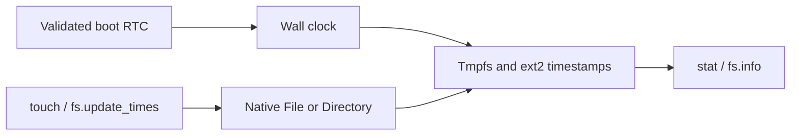

# Filesystem timestamps and touch — 2026-11-08

This record preserves the plan and validation for native File and Directory timestamps.
The [timestamp ABI](../../native-api/abi/filesystem-times-abi.md) defines current behavior.
The shell uses these methods for complete create-or-update `touch` behavior.
Permissions, links, explicit date input, and time-zone configuration remain outside this stage.



## Requirements and impact

GOALS sections “Native system interface,” “Storage and filesystems,” and “Terminal-first operating system” define the affected requirements.
ARCHITECTURE sections “Filesystem metadata and user traversal” and “Performance measurement clock” define the existing subsystem boundaries.
The Native API index separates implemented ABI profiles from proposals.
The accepted shell file-utility profile defines `touch` as creation followed by access-time and modification-time updates.

| Area | Impact and controls |
| --- | --- |
| Scope | Deliver one bounded timestamp profile through native objects and shell aliases. |
| Boot and platform | Read the RTC once after AP startup. Honor the FADT RTC absence flag. Leave BootInfo unchanged. |
| Memory and isolation | Add fixed-size records and one mutation right. Validate sizes, field masks, payloads, and user pointers. |
| Concurrency | Read the wall clock atomically. Advance it only on BSP ticks. Keep existing namespace and backend locking. |
| Interfaces | Add File/Directory methods and resource controls. Preserve the existing 64-byte metadata record. |
| Runtime | Measure boot time, common shell work, QEMU CPU time, allocator use, image sizes, and timestamp I/O. |
| Validation and documents | Test the clock, native authority, mutation behavior, persistence, BIOS, UEFI, SMP, and unchanged existing utilities. |

## Contract

Use UTC Unix-epoch nanoseconds with explicit validity bits.
Tmpfs retains nanoseconds; ext2 stores whole seconds in its existing inode fields.
The RTC initializes wall time; BSP scheduler ticks advance it independently of IPC deadlines.
This first clock has no synchronization service and can drift.
Firmware must store UTC in the RTC.

`times` returns access, modification, and metadata-change times.
`set_times` accepts access and modification field selections and sets them to one current-time sample.
The kernel owns metadata-change time.
A separate `SET_TIMES` right authorizes mutation.
Existing bindings do not gain new authority automatically.

Creation initializes all three times when the clock is available.
Writes and truncation update modification and metadata-change times.
Namespace changes update parent modification and metadata-change times.
Rename also updates the moved object's metadata-change time.
Ordinary reads do not update access time.

`touch` creates a missing regular file or updates an existing file or directory.
It preserves file bytes and uses native IPC for timestamp mutation.
`fs.update_times` requires an existing object.
`fs.ensure_file` preserves existing timestamps.
A failed timestamp update can leave a newly created file; report the error without replaying creation.

Unavailable clocks make explicit current-time updates fail without timestamp mutation.
Ordinary I/O remains available and preserves existing times when the clock is unavailable.
Initrd reports unsupported timestamp fields.
The initial ext2 profile treats zero timestamp fields as unknown.

## Sequence and acceptance

1. Implement bounded RTC decoding and wall-clock state.
2. Add timestamp records, authority, native methods, and backend behavior.
3. Add shell helpers and timestamp display.
4. Test invalid input, reduced authority, retained Operations, unavailable clocks, and normal mutation paths.
5. Verify ext2 timestamps and contents after an independent reboot.
6. Run affected host tests and the complete firmware smoke matrix.
7. Compare the candidate with the merged pager baseline under identical settings.
8. Obtain independent adversarial review and resolve blocking findings.
9. Commit, push, and open a new PR with validation evidence.

Physical hardware validation remains pending.
The complete ASD-STE100 dictionary is unavailable; manual language review cannot certify full compliance.

## Implementation and review

PRs 37 and 38 merged before this branch started.
The baseline is main commit `e0a7552d90973eae7e75058e3276aa2a0aa0fcad`.
Its source tree matches the retained baseline build at `3ce2af9dba37600ea20ca6d044b695a11164ad31`.
The implementation branch is `codex/filesystem-timestamps`.

The first independent review found that shared user-helper masks incorrectly required SET_TIMES for ordinary operations.
A real guest regression reproduced ACCESS under the complete previous namespace ceiling.
The correction restores existing masks and requests timestamp authority only for explicit timestamp work.
The corrected regression passes on BIOS and UEFI.
A second independent review accepted the code correction and identified an ambiguous directory statement in the shell proposal.
The revised text distinguishes `fs.ensure_file` from directory-capable `touch`.

The initial kernel configuration omitted the cross-toolchain option and failed before compilation.
A fresh configuration with the documented toolchain succeeded.
An automatic approval review rejected a formatting cleanup that rebuilt modified files from HEAD.
The replacement cleanup backed up current files and verified token equality before removing whitespace-only changes.
No implementation changes were lost.

## Validation commands

```sh
cmake -S . -B build/filesystem-timestamps -G Ninja \
  -DCMAKE_TOOLCHAIN_FILE=cmake/toolchains/x86_64-elf.cmake \
  -DCMAKE_BUILD_TYPE=Debug -DOS1_KMEM_DEBUG=ON -DOS1_QEMU_DEBUGCON=ON
cmake --build build/filesystem-timestamps -j8
cmake --build build-host-tests -j8
ctest --test-dir build-host-tests --output-on-failure
ctest --test-dir build/filesystem-timestamps --output-on-failure
cmake -S . -B build/filesystem-timestamps-diagnostic -G Ninja \
  -DCMAKE_TOOLCHAIN_FILE=cmake/toolchains/x86_64-elf.cmake \
  -DCMAKE_BUILD_TYPE=Debug -DOS1_KMEM_DEBUG=ON \
  -DOS1_QEMU_DEBUGCON=OFF -DOS1_USB_KEYBOARD_DIAGNOSTICS=ON
cmake --build build/filesystem-timestamps-diagnostic -j8
ctest --test-dir build/filesystem-timestamps-diagnostic --output-on-failure \
  -R '^os1_smoke_usb_keyboard_'
```

Host checks cover calendar encoding, invalid dates, unavailable time, rights, malformed payloads, user-pointer faults, and repeated Operation results.
Backend checks cover timestamp updates, preserved bytes, noatime reads, rename, move, removal, and ext2 inode reload.
Guest checks cover aliases, strict scripts, existing directories, restricted grants, and persistent content and timestamps after reboot.
The guest timestamp checks use a fixed UTC RTC date and four virtual CPUs.
`e2fsck -fn` validates the written ext2 image.

## Resource comparison

Both builds use Debug mode, KMEM_DEBUG, QEMU_DEBUGCON, GCC 11.2, and CMake 4.4.5 on macOS arm64.
QEMU 11.1.3 uses TCG, q35, four CPUs, and 128 MiB RAM.
BIOS uses bundled SeaBIOS.
UEFI uses `/opt/homebrew/share/qemu/edk2-x86_64-code.fd` and fresh copies of `edk2-i386-vars.fd`.
Each workload alternates baseline and candidate for three trials per firmware.

```sh
python3 -B tests/scripts/measure_shell_context.py \
  --baseline build/pager-handoff/artifacts \
  --candidate build/filesystem-timestamps/artifacts \
  --output build/timestamp-evidence/shell \
  --qemu /opt/homebrew/bin/qemu-system-x86_64 \
  --code /opt/homebrew/share/qemu/edk2-x86_64-code.fd \
  --vars /opt/homebrew/share/qemu/edk2-i386-vars.fd
```

Repeat with `--workload timestamps` and output directory `build/timestamp-evidence/timestamps` for the touch workload.
The shell workload performs ten echo/cat/ls cycles, synchronization, and allocator inspection.
The timestamp workload creates two files, performs 20 touches on each, synchronizes, and inspects the allocator.
The baseline touch only ensures existence; the candidate also updates timestamps.
This comparison measures the added behavior, not equal guarantees.

A deterministic host workload compares identical ext2 operations with the optional clock disabled and enabled.
It uses the same four-MiB fixture and counts successful 4096-byte block writes once per configuration.

| Operation | Clock disabled | Clock enabled | Absolute change | Relative change |
| --- | --- | --- | --- | --- |
| Create regular file | 6 | 7 | +1 block | +16.67% |
| Write one byte | 7 | 7 | 0 blocks | 0% |
| Rename | 1 | 3 | +2 blocks | +200% |
| Truncate | 5 | 5 | 0 blocks | 0% |
| Remove regular file | 6 | 7 | +1 block | +16.67% |

Ordinary reads cause no timestamp writes.
The unchanged optional-clock path provides the comparison for these deterministic I/O counts.
`Ext2.TimestampMutationAndWriteCost` records the counts in `build/timestamp-evidence/ext2-io.log`.

| Artifact or allocation | Baseline bytes | Candidate bytes | Absolute change | Relative change |
| --- | --- | --- | --- | --- |
| UEFI kernel ELF | 521376 | 526672 | +5296 | +1.02% |
| BIOS kernel ELF | 389376 | 393472 | +4096 | +1.05% |
| Initrd | 90112 | 91136 | +1024 | +1.14% |
| UEFI ISO | 4337664 | 4345856 | +8192 | +0.19% |
| BIOS image | 1474560 | 1474560 | 0 | 0% |
| Test disk image | 34603008 | 34603008 | 0 | 0% |
| Allocated ext2 image blocks | 319488 | 323584 | +4096 | +1.28% |

Kernel text grows by 4096 bytes; aligned data and BSS remain 32768 and 180224 bytes.
The BIOS kernel remains below 409600 bytes, and initrd remains below 163840 bytes.
`build/timestamp-evidence/artifacts.json` records artifact hashes and sizes.

## Final check results

All 496 host tests pass in 12.76 seconds.
All 58 corrected normal-profile checks pass in 368.06 seconds.
All three corrected keyboard diagnostic checks pass in 10.42 seconds.
The dedicated corrected timestamp checks pass on BIOS and UEFI in 11.57 seconds.
The full suite includes those checks and uses four CPUs for filesystem persistence cases.

Evidence resides under `build/timestamp-evidence/`.
`host-tests.log`, `full-final.log`, and `diagnostic-final.log` contain complete suite summaries.
`rights-before-test.log` contains the reproduced authority failure; `rights-after-test.log` contains both passing firmware checks.
Changed Markdown links, Python syntax, whitespace, and selected secret patterns pass their checks.
No physical-hardware validation is claimed.

## Runtime results

All 24 measurement boots completed.
The following values are medians from three alternating trials per firmware and workload.

| Workload | Firmware | Metric, seconds | Baseline | Candidate | Absolute change | Relative change |
| --- | --- | --- | --- | --- | --- | --- |
| shell | BIOS | Boot | 0.440977 | 0.438774 | -0.002203 | -0.50% |
| shell | BIOS | Commands | 0.690368 | 0.692854 | +0.002486 | +0.36% |
| shell | BIOS | QEMU CPU | 1.236082 | 1.244951 | +0.008869 | +0.72% |
| shell | UEFI | Boot | 1.938651 | 1.934020 | -0.004631 | -0.24% |
| shell | UEFI | Commands | 0.260041 | 0.261342 | +0.001301 | +0.50% |
| shell | UEFI | QEMU CPU | 2.253607 | 2.237794 | -0.015813 | -0.70% |
| timestamps | BIOS | Boot | 0.439298 | 0.444142 | +0.004844 | +1.10% |
| timestamps | BIOS | Commands | 0.731343 | 0.762331 | +0.030988 | +4.24% |
| timestamps | BIOS | QEMU CPU | 1.323085 | 1.376858 | +0.053773 | +4.06% |
| timestamps | UEFI | Boot | 1.932494 | 1.929214 | -0.003280 | -0.17% |
| timestamps | UEFI | Commands | 0.290321 | 0.299753 | +0.009432 | +3.25% |
| timestamps | UEFI | QEMU CPU | 2.234376 | 2.224832 | -0.009544 | -0.43% |

The common shell workload changes by +0.36% on BIOS and +0.50% on UEFI.
The complete touch workload changes by +4.24% on BIOS and +3.25% on UEFI.
Touch now performs native timestamp mutation and persistent inode writes, which the baseline omits.
These short TCG trials do not establish physical-hardware performance or a speed improvement.
No numerical latency requirement was specified.
Both boot staging limits remain satisfied.

Allocator counts match between revisions in every trial.
Both workloads start with 166 slab pages and end with 168; the revision difference is zero pages, or 0%.
Live allocations change from 2332 to 2333 for shell work and to 2334 for timestamp work in both revisions.
No allocation failures occur; their relative difference is undefined because the baseline is zero.
Runtime rows and serial logs reside in `build/timestamp-evidence/shell/` and `build/timestamp-evidence/timestamps/`.

## Final independent review

The third independent review reports no findings.
It covers the complete diff, authority correction, directory documentation, benchmark logic, and recorded evidence.
The reviewer independently recalculated all runtime medians and differences from the 24 measurement rows.
Both earlier findings are resolved.
The review was read-only and did not execute project code.
