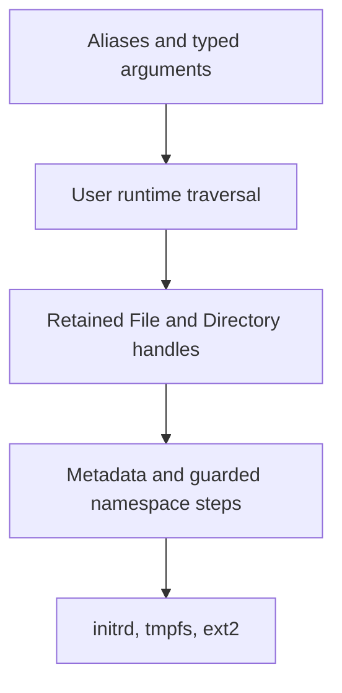

# Filesystem metadata and traversal implementation — 2026-11-07

This stage adds metadata, bounded traversal, recursive copy/removal, `find`, and `du`.
PR #35 was merged at `e1581d64fb8a64181f9de86713166061fd585293` before this work.



## Scope and contracts

- Add `stat` / `fs.info` and `df` / `fs.space` with structured native results.
- Add `find` / `fs.find` with `name` patterns and `kind` filters.
- Add `du` / `fs.usage`, with allocated bytes by default and `logical:true` as an alternative.
- Add `cp -r` and `rm -r`, with equivalent `recursive:true` parameters.
- Keep timestamps, text utilities, paging, permissions, and links outside this stage.

Identities are nonreused tokens within one boot, qualified by a filesystem token.
They remain stable across rename and retained-object lifetime.
They are not authority and do not survive reboot.
Metadata identifies unsupported fields explicitly.
Tmpfs accounting measures allocated data pages; ext2 accounting includes inode block allocation.
Initrd exposes logical sizes but does not claim separate physical allocation for each archive entry.

Traversal uses retained handles and explicit cursors.
Each namespace step checks a generation under the namespace guard.
A concurrent namespace change stops traversal, including changes outside the selected tree.
Own successful mutations return the new generation.
Content writes do not form a snapshot; concurrent file-content changes remain possible.
No namespace lock remains held between user calls.

Traversal stays within its starting filesystem and never follows future symbolic links.
Copy rejects a destination inside its source tree.
Removal rejects namespace roots and mount points.
The initial bounds are 16 directory levels, 4096 visited objects, and 4096 path bytes.
Errors report completed objects and bytes; earlier effects remain.
A failed result delivery after mutation does not permit automatic replay.

## Impact assessment

Relevant requirements are GOALS “Terminal-first operating system,” “Native system interface,” and “Storage and filesystems.”
ARCHITECTURE “Native objects and OS services” and “Typed process context and shell bindings” define subsystem boundaries.
The Native API index distinguishes this implemented extension from accepted future designs.
The accepted [file utility profile](../../shell/file-utilities.md) defines command behavior.

| Area | Assessment |
| --- | --- |
| Scope | Keep traversal in the user runtime; provide small native metadata and namespace primitives |
| Boot and platform | Shared kernel growth affects both boot paths and BIOS staging limits; no firmware or driver changes |
| Memory and isolation | Bound traversal storage; retain handles; validate rights, pointers, record sizes, identities, and allocation failures |
| Concurrency | Serialize namespace steps; reject stale generations; preserve backend locking and retained-object removal rules |
| Interfaces | Add versioned records and resource controls; preserve existing method IDs and layouts |
| Runtime resources | Measure image sizes, shell footprint, boot/workload CPU, and allocator state against the merged baseline |
| Validation and documents | Add host contract tests and guest smokes; cover both boot paths, SMP, persistence, errors, and cleanup |

## Validation plan

Use the existing Debug cross build with `OS1_KMEM_DEBUG=ON` and `OS1_QEMU_DEBUGCON=ON`.
Use QEMU q35 with four CPUs and 128 MiB RAM for comparable measurements.
Preserve `build/typed-context` as the baseline and build the candidate separately.
Record toolchain versions, artifact sizes, repetitions, exact commands, and logs before completion.

Check metadata identity, allocation accounting, read-only filesystems, and denied authority.
Check mixed named/positional arguments, alias options, duplicate assignments, strict scripts, and redirected output.
Check deep trees, quotas, own-subtree copies, mount boundaries, stale traversal, partial failure, and retained ext2 objects.
Check persistent copies after reboot and clean ext2 metadata after synchronization.
Obtain a separate read-only adversarial review after checks.

The complete ASD-STE100 dictionary is unavailable in this environment.
Prose receives a manual consistency and sentence-length review; this does not certify full standard compliance.

## Results

Implementation and independent correction review are complete.
The branch is `codex/filesystem-traversal`.
The baseline commit is `e1581d64fb8a64181f9de86713166061fd585293`.
Its tree matches the tested PR #35 head `b7cf8d4c12180d4721a232796e53847120e07ce9`.
The candidate is the commit that contains this record; artifact hashes are saved with the local evidence.

### Checks

| Check | Result |
| --- | --- |
| Host tests | 463/463 pass after corrections |
| Full configured suite | 44/50 pass inside the sandbox; six socket checks cannot launch there |
| Socket checks with local access | 6/6 pass; all 50 distinct checks have passing evidence |
| Corrected traversal, typed shell, packaging | 5/5 pass, covering BIOS and UEFI |
| Interactive file regression | 4/4 pass on BIOS and UEFI after the redirection correction |
| Ext2 consistency | Four `e2fsck -fn` checks pass after writes and reboot/removal |
| Local documentation targets | 269 checked, zero missing after final index updates |
| Physical hardware | Unmeasured; boot the new image and exercise recursive operations on a test directory |

The socket failures report `Operation not permitted` while binding local QEMU monitor sockets.
They occur before guest execution and pass outside that sandbox restriction.
No test assertion was weakened.
The first new usage test incorrectly counted an empty file as one allocated block.
The corrected expectation counts two directory blocks and one file block: 12288 bytes.

Exact build and check commands:

```sh
cmake -S . -B build/filesystem-traversal -G Ninja \
  -DCMAKE_TOOLCHAIN_FILE=cmake/toolchains/x86_64-elf.cmake \
  -DCMAKE_BUILD_TYPE=Debug -DOS1_KMEM_DEBUG=ON -DOS1_QEMU_DEBUGCON=ON
cmake --build build/filesystem-traversal -j 8
cmake --build build-host-tests -j 8
ctest --test-dir build-host-tests --output-on-failure
ctest --test-dir build/filesystem-traversal --output-on-failure
ctest --test-dir build/filesystem-traversal \
  -R 'smoke_monitor_contract|smoke_no_uart|smoke_(ehci|usb)_failure' --output-on-failure
ctest --test-dir build/filesystem-traversal \
  -R 'tree_tools|typed_shell|program_packaging' --output-on-failure
ctest --test-dir build/filesystem-traversal \
  -R 'smoke_files(_disk)?_(bios|uefi)' --output-on-failure
```

Full, correction, and socket logs are retained under `build/filesystem-traversal-evidence/`.
Guest transcripts, writable test images, and consistency logs remain under `build/filesystem-traversal/artifacts/`.
Each shell test now has a separate artifact stem.

### Resource comparison

The host is Darwin arm64.
The cross compiler is GCC 11.2.0; QEMU is 11.1.3 with TCG, q35, four CPUs, and 128 MiB RAM.
Both builds use Debug, allocator diagnostics, and debugcon.
UEFI uses the Homebrew `edk2-x86_64-code.fd` and fresh `edk2-i386-vars.fd` copies.
BIOS uses QEMU's supplied firmware.
Each trial uses a fresh program disk.

Three alternating baseline/candidate trials ran for each boot path.
The workload performs ten echo/cat/list cycles, synchronization, and two allocator snapshots.
CPU time includes boot, workload, and QEMU shutdown.
Values below are medians in seconds.

| Measurement | Baseline | Candidate | Absolute difference | Relative difference |
| --- | ---: | ---: | ---: | ---: |
| BIOS boot | 0.414252 | 0.418770 | +0.004518 | +1.09% |
| BIOS workload | 0.661976 | 0.666883 | +0.004907 | +0.74% |
| BIOS QEMU CPU | 1.182644 | 1.193248 | +0.010604 | +0.90% |
| UEFI boot | 1.864288 | 1.873943 | +0.009655 | +0.52% |
| UEFI workload | 0.251666 | 0.260376 | +0.008710 | +3.46% |
| UEFI QEMU CPU | 2.183524 | 2.176276 | -0.007248 | -0.33% |

These short TCG trials do not establish a throughput improvement or physical-hardware timing.
They measure baseline overhead, not comparative recursive-command throughput; the baseline has no recursive command.
No latency threshold applies to this stage.
All trials start with 166 slab pages and 2331 live allocations.
They finish with 168 slab pages and 2332 live allocations.
Baseline/candidate differences are zero pages and zero live allocations, both 0%.
Allocator failure counts remain zero; their relative difference is undefined because the baseline is zero.

| Artifact or memory section | Baseline bytes | Candidate bytes | Difference | Relative difference |
| --- | ---: | ---: | ---: | ---: |
| Stripped BIOS kernel | 385280 | 389376 | +4096 | +1.06% |
| Kernel ELF | 515352 | 520640 | +5288 | +1.03% |
| Initrd | 73728 | 80896 | +7168 | +9.72% |
| UEFI ISO | 4315136 | 4329472 | +14336 | +0.33% |
| BIOS image | 1474560 | 1474560 | 0 | 0% |
| Shell ELF | 80680 | 88960 | +8280 | +10.26% |
| Kernel text/data/BSS total | 565248 | 569344 | +4096 | +0.72% |
| Shell text/data/BSS total | 313637 | 321237 | +7600 | +2.42% |

The BIOS kernel remains below its 409600-byte staging limit, with 20224 bytes remaining.
The initrd remains below its 163840-byte limit, with 82944 bytes remaining.
The bounded walker adds stack storage and a 4096-byte copy buffer, without persistent per-process allocations.
The tradeoff is larger shell and kernel images for native accounting and guarded recursive operations.

```sh
python3 -B tests/scripts/measure_shell_context.py \
  --baseline build/typed-context/artifacts \
  --candidate build/filesystem-traversal/artifacts \
  --output build/filesystem-traversal-evidence/timing \
  --qemu /opt/homebrew/bin/qemu-system-x86_64 \
  --code /opt/homebrew/share/qemu/edk2-x86_64-code.fd \
  --vars /opt/homebrew/share/qemu/edk2-i386-vars.fd
```

Raw measurements and hashes are in `build/filesystem-traversal-evidence/timing/measurements.json` and `artifacts.json`.

### Independent review

The first read-only review covered the complete diff, contracts, impact assessment, and available validation.
It found one P1 defect, two P2 defects, and two documentation conflicts.

| Finding | Verified correction and regression evidence |
| --- | --- |
| Recursive copy redirection could truncate its source | Reproduced with a regular file; protect retained sources and their descendants before truncation; BIOS/UEFI regressions pass |
| Metadata read file size before its backend lock | Read mutable sizes only inside backend callbacks; concurrent sparse-write/truncate host test passes |
| Tree tests reused typed-shell artifact names | Give tests distinct disk/log/firmware stems; both evidence sets remain present |
| Descendant-ceiling text contradicted authority checks | Specify parent LOOKUP/ENUMERATE and descendant INSPECT separately |
| First-stage guide still deferred implemented features | Limit deferred wording to text tools, timestamps, and paging |

A separate fresh-context correction review passed with no findings.
It reviewed all corrections and their interactions with the complete change.
Review coverage included authority, generations, identities, cleanup, bounds, partial failures, contracts, and recorded evidence.
Both reviewers performed static review without editing files or executing tests.
Formatting, Python syntax, local links, whitespace, and the secret scan also pass.
The complete ASD-STE100 dictionary remains unavailable; manual prose review does not certify full compliance.
