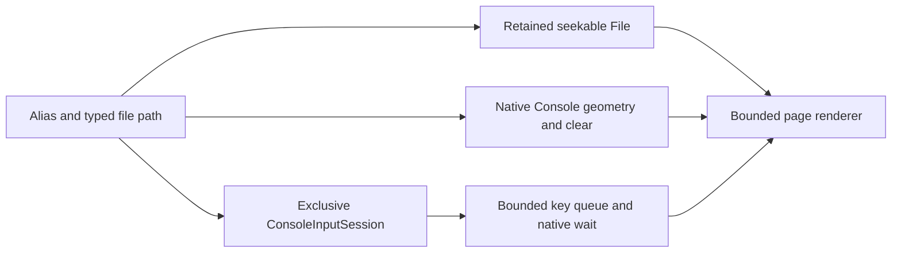

# Interactive pager — 2026-11-07

This stage adds `less` as an alias for `pager.show`.
It builds on PR #37, commit `bb48b1ec40b15b1d56a7575e3b9a00e0cba86d9e`, without merging that open PR.



## Scope and defaults

`pager.show` requires one positional String `path`.
`less` binds the same parameter and implementation.
Require interactive shell input and console-backed standard input/output; reject scripts and redirection before effects.
Space, Enter, and `f` advance one page; `b` returns one page; `q`, Escape, Ctrl-C, and Ctrl-D quit.
Search, follow mode, terminal scrollback, timestamps, permissions, and links remain deferred.

Retain the file handle throughout navigation.
Read bounded chunks and render printable ASCII with explicit wrapping.
Display control and non-ASCII bytes as `\xHH`; never interpret file bytes as terminal commands.
Use terminal dimensions from the native Console interface.
Backward navigation can rescan from the beginning; memory use stays bounded independently of file size.
Concurrent content changes do not provide a snapshot; errors can end the pager after partial display.

## Native console extension

Keep existing Console v1 members and records unchanged.
Add `geometry`, `clear`, and `acquire_input`.
Acquisition returns an owned ConsoleInputSession resource through the existing retained result-capability mechanism.
The session provides `try_read_key` and `release` through a kernel binding.
The initial session grants READ and INSPECT only; it cannot be delegated.
Native WAIT, WAIT_UNTIL, and WAIT_MANY accept the session resource and report key availability or release.

A single session owns console input at a time.
Reject acquisition while canonical input or a read reservation remains pending.
While owned, suppress echo and canonical reads; queue at most 64 raw bytes.
Queue overflow produces a RANGE error rather than silently accepting lost navigation input.
Explicit release or final resource destruction restores canonical input and discards pending session keys.

Wait pins, kernel bindings, and Operations retain session lifetime under existing rules.
No pointer or reusable ownership token crosses the ABI.

The pager closes its session and bindings on normal exit and all errors.
It clears the displayed page on normal exit; it does not restore previous screen contents.
Other console writers remain cooperative; this stage does not provide exclusive display ownership.
The kernel worker never blocks while waiting for a key.
Timer-driven native readiness checks wake the sleeping pager through the existing SMP wait path.

## Impact assessment

Relevant goals are GOALS “Terminal-first operating system,” “Kernel and userland separation,” and “Native system interface.”
ARCHITECTURE “Typed process context and shell bindings” and console/input sections define responsibilities.
The accepted utility profile requires bounded paging, input ownership, dimensions, and terminal recovery.
The Native API index separates these implemented extensions from future PTY and session proposals.

| Area | Assessment |
| --- | --- |
| Scope | User-space paging policy; small native console primitives; no general scripting or terminal emulator |
| Boot/platform | Shared kernel and shell growth affect BIOS and UEFI image limits; no firmware changes; PS/2 and USB decode pager quit keys |
| Memory/isolation | Bounded renderer and key queue; owned session result; rights checks; allocation and result-delivery cleanup |
| Concurrency | Input lock protects ownership and queue; IPC readiness takes input lock after IPC lock; producers never acquire IPC locks |
| Interfaces | Add Console members, session object/interface, and native session wait support; retain current records and method IDs |
| Runtime resources | Measure image sizes, shell footprint, common workload, and idle pager behavior against PR #37 |
| Validation/documents | Host renderer and native contract tests; BIOS/UEFI four-CPU smokes; cleanup, denied access, noninteractive rejection, and regression review |

## Validation procedure

Use `build/text-utilities` as the unchanged baseline and build the candidate in `build/interactive-pager`.
Use Debug, allocator diagnostics, debugcon, q35, four CPUs, and 128 MiB RAM.
Run host tests, BIOS/UEFI pager checks, relevant shell and IPC regressions, and the configured matrix.
Compare three alternating common-workload trials per firmware.
Measure an idle pager separately to verify that key waiting blocks instead of polling.
Record exact commands, sizes, timing, allocator evidence, and independent review findings before publication.

Physical-hardware results remain unmeasured until tested on a device.
The complete ASD-STE100 dictionary is unavailable; manual prose review does not certify full compliance.

## Review corrections

The first independent review found two P2 defects.
Keyboard drivers did not emit all documented quit bytes; serial injection had bypassed those decoders.
A readiness race evaluated the independently locked input queue twice before waking a native waiter.

Host regressions reproduced USB Ctrl-C/Escape decoding failures and the erroneous WOULD_BLOCK wake result.
A PS/2 QEMU regression reproduced the Ctrl-C timeout.
The corrections add the missing key conversions and retain one readiness selection per wake decision.
The regression tests remain in the host suite and keyboard-driven pager checks.
The fresh correction review reported no findings.
It covered the complete diff, correction interactions, ABI contracts, cleanup, typed binding, rendering, tests, impact assessment, and final evidence.
Both original P2 findings have failing reproductions and passing regression coverage.
All substantive findings are resolved.
The reviewer made no edits and ran no code; test conclusions use the supplied logs.

## Build and test commands

The baseline is the unchanged `build/text-utilities` artifact set at `bb48b1e`.
The candidate is the `codex/interactive-pager` branch based on that revision.
Both normal builds use Debug, allocator diagnostics, and debugcon.

```sh
cmake -S . -B build/interactive-pager -G Ninja \
  -DCMAKE_TOOLCHAIN_FILE=cmake/toolchains/x86_64-elf.cmake \
  -DCMAKE_BUILD_TYPE=Debug -DOS1_KMEM_DEBUG=ON -DOS1_QEMU_DEBUGCON=ON
cmake --build build/interactive-pager -j8
cmake --build build-host-tests -j8
ctest --test-dir build-host-tests --output-on-failure
ctest --test-dir build/interactive-pager --output-on-failure
cmake -S . -B build/interactive-pager-diagnostic -G Ninja \
  -DCMAKE_TOOLCHAIN_FILE=cmake/toolchains/x86_64-elf.cmake \
  -DCMAKE_BUILD_TYPE=Debug -DOS1_KMEM_DEBUG=ON \
  -DOS1_QEMU_DEBUGCON=OFF -DOS1_USB_KEYBOARD_DIAGNOSTICS=ON
cmake --build build/interactive-pager-diagnostic --target os1_usb_image -j8
ctest --test-dir build/interactive-pager-diagnostic --output-on-failure \
  --no-tests=error -R '^os1_smoke_usb_keyboard_'
```

QEMU monitor tests require local socket access outside the restricted sandbox.
The initial 54-check run passed 48 checks and failed six because socket creation was denied.
Those environment failures do not establish kernel regressions.
The corrected profile adds two keyboard-driven pager checks.

## Artifact measurements

The host runs Darwin 25.6.0 on arm64.
The cross compiler is GCC 11.2.0; CMake is 4.4.5; QEMU is 11.1.3 with TCG.
Measurements compare the same build settings and fixed program-disk size.

| Artifact | Baseline bytes | Candidate bytes | Absolute difference | Relative difference |
| --- | ---: | ---: | ---: | ---: |
| BIOS kernel | 389376 | 389376 | 0 | 0% |
| UEFI kernel | 520640 | 521376 | +736 | +0.14% |
| Initrd | 86528 | 90112 | +3584 | +4.14% |
| ISO | 4335616 | 4337664 | +2048 | +0.05% |
| BIOS disk image | 1474560 | 1474560 | 0 | 0% |
| Shell ELF | 95184 | 99792 | +4608 | +4.84% |
| Shell text/data/BSS | 392078 | 395776 | +3698 | +0.94% |
| Shell BSS | 311760 | 311760 | 0 | 0% |
| Kernel text/data/BSS | 569344 | 569344 | 0 | 0% |
| Allocated program-disk blocks | 319488 | 319488 | 0 | 0% |

Aligned kernel segment totals remain unchanged; the kernel binaries are not byte-identical.
The BIOS kernel and initrd satisfy their 409600-byte and 163840-byte staging limits.
The pager adds bounded stack buffers and one global 64-byte key queue, without a per-file page index.
Backward navigation trades repeated reads and CPU work for constant navigation memory.
The program-test image remains 34603008 bytes: zero difference and 0% change.

## Runtime measurement procedure

The candidate revision is the commit that introduces this record.
Each guest uses q35, four CPUs, 128 MiB RAM, and a fresh or snapshot-backed program disk.
BIOS uses QEMU's supplied firmware.
UEFI uses `edk2-x86_64-code.fd` and a fresh `edk2-i386-vars.fd` copy from `/opt/homebrew/share/qemu/`.

Three alternating baseline/candidate trials run per firmware after build and regression processes finish.
The common workload performs ten echo/cat/list cycles, synchronization, and two allocator snapshots.
QEMU CPU time includes boot, workload, and shutdown.
Separate idle trials compare the candidate's shell prompt with an open pager, using three alternating two-second samples per firmware.
The host `ps` CPU counter has 0.01-second resolution; it includes all QEMU work.
Host wait tests establish blocking semantics independently of this coarse CPU measurement.

```sh
python3 -B tests/scripts/measure_shell_context.py \
  --baseline build/text-utilities/artifacts \
  --candidate build/interactive-pager/artifacts \
  --output build/interactive-pager-evidence/measurements \
  --qemu /opt/homebrew/bin/qemu-system-x86_64 \
  --code /opt/homebrew/share/qemu/edk2-x86_64-code.fd \
  --vars /opt/homebrew/share/qemu/edk2-i386-vars.fd
python3 -B tests/scripts/test_pager.py --measure-idle \
  --qemu /opt/homebrew/bin/qemu-system-x86_64 \
  --image build/interactive-pager/artifacts/os1.raw \
  --program-disk build/interactive-pager/artifacts/program-test-disk.raw \
  --log build/interactive-pager-evidence/idle-bios.log
python3 -B tests/scripts/test_pager.py --measure-idle \
  --qemu /opt/homebrew/bin/qemu-system-x86_64 \
  --image build/interactive-pager/artifacts/os1.iso \
  --program-disk build/interactive-pager/artifacts/program-test-disk.raw \
  --code /opt/homebrew/share/qemu/edk2-x86_64-code.fd \
  --vars /opt/homebrew/share/qemu/edk2-i386-vars.fd \
  --log build/interactive-pager-evidence/idle-uefi.log
```

## Validation results

All 486 host tests pass, including the two review regression tests.
All 56 configured normal-profile checks pass with local socket access.
All three keyboard diagnostic checks pass after rebuilding the corrected kernel.
The four pager checks cover BIOS/UEFI serial control and emulated PS/2/USB keyboard control.
They use four CPUs and verify tmpfs/ext2 pages, backward navigation, EOF, quit keys, aliases, invalid contexts, and restored input.

The initial host fixture retained bytes beyond its declared empty payload; envelope validation correctly rejected it.
The corrected fixture zeroes those bytes before submission.
An initial guest assertion assumed BIOS page height; UEFI reached EOF sooner with its larger geometry.
The corrected test accepts either second-page state and still verifies page contents and backward navigation.

Host tests cover short reads/writes, escaping, wrapping, empty files, truncation errors, long files, and stable page boundaries.
Native tests cover exclusive ownership, authority, overflow, allocation failures, abandoned results, failed delivery, cancellation, deadlines, and retained references.
A deterministic competing-consumer test reproduced the readiness race before correction.
Keyboard tests reproduced missing quit bytes before the decoder corrections.

Evidence remains under `build/interactive-pager-evidence/` and the two candidate artifact directories.
Physical-hardware behavior remains unmeasured; test the page display and quit keys on both PS/2 and USB hardware.
The host fixtures and QEMU checks do not establish physical behavior.
The complete ASD-STE100 dictionary is unavailable; manual language review does not certify complete standard compliance.

## Runtime measurement results

The table gives median seconds from three alternating trials per firmware.

| Measurement | Baseline | Candidate | Absolute difference | Relative difference |
| --- | ---: | ---: | ---: | ---: |
| BIOS boot | 0.432424 | 0.427679 | -0.004745 | -1.10% |
| BIOS workload | 0.673525 | 0.677903 | +0.004378 | +0.65% |
| BIOS QEMU CPU | 1.227935 | 1.224210 | -0.003725 | -0.30% |
| UEFI boot | 1.887526 | 1.884265 | -0.003261 | -0.17% |
| UEFI workload | 0.254247 | 0.259170 | +0.004923 | +1.94% |
| UEFI QEMU CPU | 2.187998 | 2.194099 | +0.006101 | +0.28% |

These short trials measure common-workload overhead, not pager throughput or physical-hardware performance.
This stage has no numerical latency requirement.
Both revisions use 166 slab pages before the workload and 168 afterward: zero difference and 0% change.
Live objects increase from 2332 to 2333 in both revisions; free slots are 481 before and 485 afterward.
Allocation failures remain zero; their relative difference is undefined because the baseline is zero.

### Idle comparison

The table gives median QEMU CPU seconds during approximately two-second idle intervals.

| Firmware | Idle shell | Idle pager | Absolute difference | Relative difference |
| --- | ---: | ---: | ---: | ---: |
| BIOS | 0.09 | 0.10 | +0.01 | +11.11% |
| UEFI | 0.30 | 0.30 | +0.00 | +0.00% |

The BIOS difference is one 0.01-second counter unit; these samples do not establish a performance regression or improvement.
The idle pager does not keep a CPU continuously busy in these samples.
Host wait tests and source review verify the blocking path; the measurement includes unrelated timer and display work.
Allocator failures remain zero in the common workload, and both boot image limits pass.
Backward rescan latency on large physical files remains unmeasured; bounded memory trades off against repeated I/O.

## Publication checks

Scoped clang-format runs cover changed C/C++ code; unrelated legacy formatting remains unchanged.
Whitespace checks, Python syntax checks, and 289 local documentation targets pass.
The secret scan found only ownership terminology and renderer identifiers; it found no credentials.

The PR is stacked on the open text-utilities PR #37.
Pull-request CI runs only when the target branch is `main`.
The stacked PR therefore has local validation evidence until retargeted.
Merge and retarget order remains a separate user decision.
