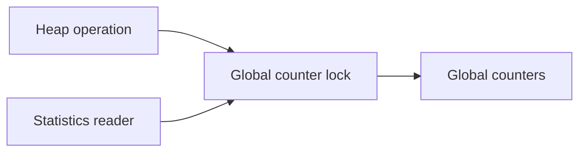

# SMP Synchronization Contract - 2026-04-29

Created: 2026-04-29. Updated against source: 2026-11-04 (console descriptor milestone).

## Current State

APs run per-CPU idle threads and user threads, install the shared IDT, take
local LAPIC timer ticks, and consume reschedule and TLB-shootdown IPIs. Per-CPU
run queues and load balancing are implemented. Process/thread registries,
physical allocation, console queues, and blocking paths have shared-state
synchronization; they are no longer collectively BSP-only.

This is the live synchronization contract carried forward from the original
pre-SMP plan. It records existing mechanisms and required ownership rules,
not a proof that every path satisfies them. The
[2026-11-03 review](../archive/reviews/2026-11-03-review.md) records the earlier child-publication defect and reclamation limits.
The [console milestone](../archive/native-api/2026-11-04-console-descriptor-implementation-plan.md) corrected publication ordering.
The [interrupt-return correction](../archive/kernel/2026-11-06-interrupt-return.md) masks local interrupts across direct scheduler handoff.
Generic reclamation and future shared-address-space changes still require separate lifetime evidence.

## Kernel Primitives

The synchronization declarations live in [smp.hpp](../../src/kernel/sync/smp.hpp):

- `Spinlock`: a named, non-recursive atomic lock with acquire/release semantics.
- `IrqGuard`: disables local external interrupts and restores the prior enabled
  state on destruction; it does not exclude another CPU.
- `IrqSpinGuard`: acquires the IRQ guard before the lock and releases the lock
  before restoring interrupts.
- `OS1_BSP_ONLY` and `OS1_LOCKED_BY(name)`: documentation annotations, both
  expanding to `[[maybe_unused]]`. They enforce neither affinity nor lock order.
- `KASSERT_ON_BSP()`: a runtime BSP assertion in freestanding debug builds. It
  is disabled in host tests and builds defining `NDEBUG`.

`WaitQueue` and `Completion` in
[wait_queue.hpp](../../src/kernel/sync/wait_queue.hpp) support block-I/O, child-exit,
and console-read blocking. Wake helpers detach waiters under the queue lock,
then release it before making threads runnable.

## Current Ownership

| State | Existing protection or ownership |
| --- | --- |
| Kernel heap statistics | `g_kmem_stats_lock` in `mm/kmem.cpp`. See [Kernel heap accounting](#kernel-heap-accounting). |
| Physical page allocation/free | `g_page_frames_lock`; allocator initialization remains BSP-owned. |
| Process registry and PID allocation | `g_process_table_lock` in `proc/process.cpp`. |
| Thread registry and TID allocation | `g_thread_registry_lock` in `proc/thread.cpp`. |
| Runnable links and queue length | The owning CPU's `runq.lock`; balancing acquires a pair in ascending CPU-ID order. |
| Console input queues | `g_console_input_lock`; hardware polling/input production remains BSP-owned. |
| Console API writes | `g_console_output_lock` protects `write_console_bytes`/`write_console_line` and the debug mirror. Input echo and terminal switching do not take that lock; terminal selection retains BSP ownership. |
| Platform discovery | BSP initialization of `g_platform`; device IRQ affinity remains BSP-first. Registry locks do not make device lifecycle or ACPICA calls generally concurrent-safe. |

Some registry and allocator globals still carry `OS1_BSP_ONLY` alongside real
internal locks. Read the mutation path rather than treating that marker as a
complete ownership description. CPU-local scheduler state, startup publication,
and shared object lifetime need their own rules in addition to these locks.

## Locking Order

Lock acquisition must follow this order. This remains a design rule; there is
no static or runtime lock-tier checker. Do not introduce a new lock outside this
order without updating this document first.

1. CPU-local interrupt state: acquire `IrqGuard` before taking any lock that can also be touched from an interrupt path.
2. Kernel stack mapping lock, then the physical memory allocator lock.
   The stack mapper can allocate page-table frames while it holds the stack mapping lock.
3. Virtual memory/address-space ownership locks.
4. Process table lock.
   Process descriptor-table locks follow this tier; do not nest two descriptor
   tables. Snapshot and pin parent grants before installing into a private child.
5. Thread table and scheduler/run-queue locks.
6. Wait/IPC/event queues.
7. Console input queue lock.
8. Terminal/display locks.
9. Platform/PCI/device-list locks.
10. Individual driver/device locks.

Rules:

- Never allocate physical pages while holding a driver/device lock.
- Never call into console or debug output while holding the process, thread, scheduler, platform, or allocator lock unless the path is explicitly panic-only.
- Never sleep or block while holding a spinlock.
- Never acquire a lower-numbered lock while holding a higher-numbered lock.
- Interrupt handlers may only take locks that are IRQ-safe and must do so under `IrqGuard`.
- When taking two run-queue locks, acquire them in ascending CPU-ID order and
  release them in reverse order.
- Detach waiters and release the wait-queue lock before taking an earlier-tier
  scheduler/run-queue lock to wake them.
- Locks protect data ownership; they do not replace lifetime rules. Process,
  thread, page-table, and device lifetimes still need explicit ownership transitions.

## Kernel stack lifetime

The kernel maps each thread stack before it publishes the thread.
The reaper removes the stack mapping after all CPUs leave the thread.

```text
Map stack -> Publish thread -> Leave thread -> Remove mapping -> Retire TLB entries -> Free frames
```

The IRQ-safe stack lock serializes changes to shared stack page tables.
The kernel releases this lock before it waits for TLB retirement.
All online CPUs acknowledge retirement before the kernel returns stack frames to the allocator.
A failed allocation removes any partial stack mapping and returns its data frames.

## Kernel heap accounting

The heap uses one IRQ-safe lock for global counter updates and snapshots.
Each large allocation, release, or failure updates its related counters together.



The counter lock is terminal. Release it before acquiring any other lock.
The cache count comes from a separate registry read.
A release clamps a counter at zero if subtraction would underflow.
Header and object validity checks still govern whether the allocator can release memory.

## Console Descriptor Lifetime

Descriptor lookup checks rights and pins an open instance under the process's
descriptor lock. Allocation, final reference release, provider calls, and user
copies happen after unlocking. Close removes one entry; it cannot retarget a
previously accepted operation. Open instances retain native objects with atomic
references. No object-to-descriptor ownership cycle is introduced.

A blocked console request owns its instance reference. The console wait lock
serializes registration, detachment, and cancellation. A detached completion
pins its thread with `io_pins` until its last access, preventing the BSP reaper
from releasing the thread or its address space. The waker defers while the
thread remains current on any CPU. `restore_thread` leaves the outgoing stack
and CR3 before publishing the next current-thread pointer. This is required
both for frame ownership and deferred reclamation. This milestone permits one
user thread per process and has no public unmap or external-kill operation.

Input reservation copies a prefix to kernel storage under the input lock. User
copy runs unlocked; successful delivery alone commits consumption. A producer
may append other lines while a reservation exists. Registration rechecks input
under the wait lock; BSP timer/IRQ service retries ready input, including a waiter
that had not yet switched away. No scheduler lock is taken under the wait lock.

## Child exit and collection

The BSP worker reaps dying threads and releases each child address space before it publishes the exit record.
The process table lock protects publication, parent links, and collection claims.

```text
Queue dying thread -> CPU handoff -> BSP worker releases resources -> Publish exit -> Collect record
```

The thread registry lock protects the list of dying threads.
The worker starts blocked. A BSP scheduler tick wakes it when the queue or a retry needs service.
The worker retries a thread if it is still current on a CPU or has an I/O pin.
After the last thread leaves all CPUs, the worker removes the thread record.
The reaper releases Buffer mappings and descriptors before it frees the user page tables and their root.
The child stays in the process table until its parent collects it or the BSP reaps the orphan record.

A waiter claims the exit record before it copies the status.
A failed copy releases the claim so a later wait can collect the same child.
Wait registration takes the process table lock before the queue lock.
Completion releases the queue lock before it takes the process table lock.
The worker checks the child wait queue after teardown.
If a waiter still runs on another CPU, the worker retries on a later BSP tick.
The wait syscall can collect an exit record that the worker already published.
The worker reaps published exit records that have no parent.
If parent collection orphans a published exit record, it requests another worker pass.
User processes have one thread. A private provider cannot call `waitpid`.
Its parent can collect the provider through `waitpid`.

## Publication And Reclamation Follow-Ups

The original migration to scheduled AP execution landed in May; it is recorded
in the [phased SMP plan](../archive/kernel/2026-05-05-phased-smp-enablement.md) and
[May review](../archive/reviews/2026-05-05-review-2.md). The remaining work is correctness under
that live runtime:

1. Child descriptor grants and the complete entry frame now precede enqueueing
   and the reschedule IPI. The post-publication rewrite has been removed; see
   [R1](../archive/reviews/2026-11-03-review.md#r1--p1-child-entry-state-is-rewritten-after-scheduler-publication).
2. Define address-space reclamation and invalidation completion before adding
   shared address spaces, COW, or public mapping operations.
   Exclusive Buffer loans already use acknowledged mapping retirement, as defined by the [Buffer ABI](../native-api/abi/buffer-loans-abi.md).
   That bounded protocol does not establish generic address-space reclamation for future concurrent VM operations.
3. Establish actual ACPICA serialization before concurrent AML or SCI/GPE
   expansion. The OSL currently has dummy locks and nonblocking semaphores.
4. Keep allocation and device operations outside incompatible locks; add
   lock-order assertions and focused cross-CPU tests as enforcement evolves.
5. Retain SMP balance/spawn/exec coverage and add a deterministic publication
   regression. Passing QEMU runs alone do not close the unresolved BIOS
   child-launch failure or prove every lifetime rule.

`KASSERT_ON_BSP()` failures in enabled builds remain correctness bugs, not
diagnostic noise. Remove an ownership assertion only after the replacement
contract is explicit and exercised.
