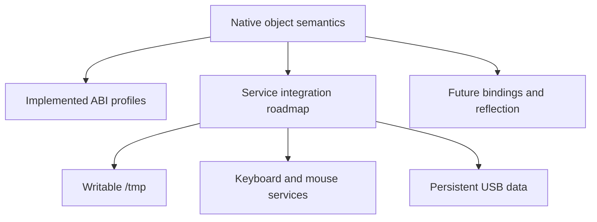

# Native API

The Native API is the shared object model for programs and OS services.
This index separates implemented interfaces from accepted direction and future proposals.
The former API draft collection became the maintained Native API topic on 2026-11-05.
This promotion changes their location and status reporting; it does not freeze the ABI.

## Authority and reading order

| Document | Authority and status |
| --- | --- |
| [Reflective OS hierarchy](object-hierarchy.md) | Option B selected on 2026-11-07; proposed service roots and discovery; bounded typed context is now implemented. |
| [Native object contract](object-contract.md) | Shared semantic direction. Its approved decisions and implemented subsets are identified explicitly. |
| [Service roadmap](roadmap.md) | Current gaps, dependencies, milestone acceptance, and deferred work. Proposed interfaces have no assigned ABI yet. |
| Implemented ABI profiles below | Exact current records, rights, limits, operations, and failure rules. UAPI headers and tests establish implementation evidence. |
| [VFS profile](vfs-contract.md) | Namespace semantics; immutable initrd and bounded writable `/tmp` implemented. The large object catalog remains illustrative. |
| [IPC design](ipc-transport.md) | Accepted transport direction and rationale. Bounded copied calls, events, sessions, and exclusive Buffer loans are implemented. |
| [Buffer ownership](buffer-ownership.md) | Exclusive loans implemented. Live readers, cooperative writers, and general permanent moves remain proposals. |
| [Parameter profile](parameter-schema.md) | Bounded constructor/method input schemas implemented. Broader reflective outputs and generated bindings remain proposals. |
| [ELF interface profile](elf-interface.md) | Offline metadata subsets implemented. General reflection, binding generation, and service discovery remain proposals. |
| [C++ examples](cpp-bindings.md) | Illustrative typed SDK and generation flow; links identify runnable handwritten examples. |
| [Shell language](../shell/language-proposal.md) | Future language proposal; distinct from the current command shell and implemented CLI parameter conversion. |
| [May API review](../archive/reviews/2026-05-10-unified-os-api-architecture-review.md) | Historical review with dated follow-ups. It does not override current ABI profiles or this status index. |

When a design example differs from an implemented ABI, the ABI profile describes current behavior.
The semantic contract guides extensions; it does not assign undeclared syscalls or numeric layouts.
Documents can contain proposals after promotion, provided their scope and status remain explicit.

## Implemented profiles

| Capability | Current contract |
| --- | --- |
| System synchronization and power control | [SystemControl ABI](abi/system-control-abi.md) |
| Filesystem timestamps and current-time mutation | [Timestamp ABI](abi/filesystem-times-abi.md) |
| Filesystem metadata, space accounting, and guarded traversal | [Metadata and traversal ABI](abi/filesystem-metadata-abi.md) |
| Typed environment, rooted navigation, and same-filesystem moves | [Startup and namespace extension](abi/initrd-vfs-abi.md#typed-environment-and-namespace-extension) |
| Kernel-hosted Console methods, geometry, exclusive input sessions, and retained Operations | [Kernel console IPC ABI](abi/kernel-console-abi.md) |
| Persistent ext2 over virtio/USB, disk executables, File/Directory `sync` | [Ext2 storage profile](../filesystems/ext2.md) |
| Kernel-hosted writable `/tmp`, mutation rights, resource results, quotas | [Temporary filesystem ABI](abi/tmpfs-abi.md) |
| Descriptors, rights, lifetime, console | [Console descriptor ABI](abi/console-descriptor-abi.md) |
| Immutable files/directories, launch grants, argv/environment | [Initrd VFS and startup ABI](abi/initrd-vfs-abi.md) |
| Sync/async copied calls, retained Operations, TextProcessor, offline `intf` | [Copied IPC ABI](abi/copied-ipc-abi.md) |
| Properties, volatile broadcast events, unsubscribe, typed Counter construction, deadlines | [Counter and events ABI](abi/counter-events-abi.md) |
| Capability transfer and scoped class-controlled singleton activation | [Shared activation ABI](abi/shared-activation-abi.md) |
| Independent session authority, admission budgets, wait-many | [Client sessions ABI](abi/client-sessions-abi.md) |
| Optional/compound/variant/enum inputs, defaults, descriptions, dot-based CLI | [Rich parameter ABI](abi/rich-parameters-abi.md) |
| Exclusive zero-copy request loans and reply Buffer outputs | [Buffer loans ABI](abi/buffer-loans-abi.md) |
| High-resolution measurement, separate from scheduling deadlines | [Measurement clock ABI](../kernel/measurement-clock-abi.md) |

The [approved object-handle model](object-contract.md#object-handles-and-interoperability) keeps one resource table for native and descriptor-compatible APIs.
The current encoding remains `fd`; general typed owning/borrowed C++ wrappers remain SDK work.

## Latest implementation

The [timestamp ABI](abi/filesystem-times-abi.md) adds native time inspection and current-time updates for `touch`.

The [text utility profile](../shell/text-utilities.md) uses existing native File and stream handles without a new ABI.
The [filesystem traversal record](../archive/shell/2026-11-07-filesystem-traversal.md) covers metadata, recursive commands, `find`, and `du`.

The [typed shell record](../shell/typed-context-plan.md) covers the first object-command stage and namespace extensions.

The [project review](../reviews/2026-11-06-review.md) assesses the merged service and storage baseline.
The [USB hardware record](../archive/filesystems/2026-11-06-usb-hardware-validation.md) records one physical persistence result.
The [temporary filesystem plan](../archive/filesystems/2026-11-06-tmpfs-implementation.md) records Directory/File integration, checks, measurements, and review.
The [kernel console plan](kernel-console-plan.md) records the preceding adapter slice.

## What remains

Console, `/tmp`, and ext2 support descriptor I/O and native copied IPC through the kernel provider adapter.
Initrd objects still use descriptor syscalls; hardware drivers use internal kernel interfaces.
The [roadmap](roadmap.md#shared-service-foundation) connects these paths through native service contracts.

Scoped service discovery, kernel Buffer borrowing, native device interfaces, and input recovery still need concrete protocols.
USB persistence is implemented; physical preserving updates and broader failure qualification remain pending.
Console bindings capture method-specific authority; each additional service needs its own policy.
Generated SDKs, `.so` bindings, a reflective shell, userspace drivers, and shared-memory rings are not prerequisites for those milestones.
Class code continues to select new or existing object instances; ordinary callers receive no creation-policy override.
