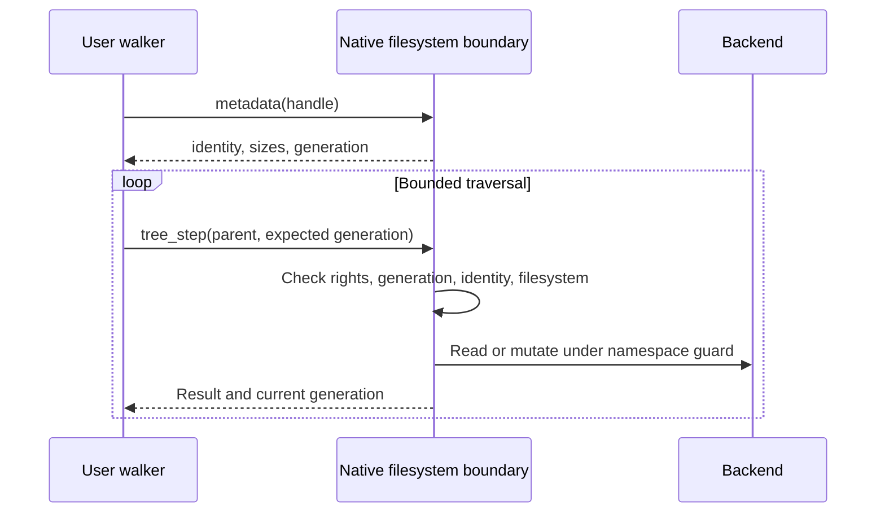

# Filesystem metadata and traversal ABI

This extension supplies common metadata and guarded namespace steps for native filesystem handles.
The user runtime implements recursive policy; the kernel validates each namespace step.

## Metadata and space

[`os1_metadata`](../../../src/uapi/os1/vfs.h) is a 64-byte record.
All integers use the current x86-64 little-endian ABI.

| Offset | Fields | Meaning |
| --- | --- | --- |
| 0 | `version`, `size` | Version 1, size 64; two u32 fields |
| 8 | `kind`, `valid` | Object kind and supported size fields; two u32 fields |
| 16 | `filesystem_kind`, `flags` | Backend ID and mount-root flag; two u32 fields |
| 24 | `filesystem_id`, `object_id` | Two u64 identity tokens |
| 40 | `logical_bytes`, `allocated_bytes` | Two u64 byte counts |
| 56 | `generation` | u64 namespace generation |

`valid` bit 0 identifies logical size; bit 1 identifies allocated size.
`flags` bit 0 identifies a mount root, including the initrd namespace root.
Backend IDs are 1 for initrd, 2 for tmpfs, and 3 for ext2.
Tokens are nonreused within one boot and remain stable across rename and retained-object lifetime.
Tokens do not persist across reboot and confer no authority.
The separate [timestamp ABI](filesystem-times-abi.md) provides times without changing this record.
Ownership, permissions, and links remain unsupported.

| Backend | Logical size | Allocated bytes |
| --- | --- | --- |
| Initrd | File length; zero for directories | Unsupported: archive entries share boot storage |
| Tmpfs | File length; zero for directories | Allocated file data pages; excludes kernel objects |
| Ext2 | Inode size, including directory data | Inode sector count times 512, including indirect blocks |

`os1_space` is a 48-byte record with version, size, backend ID, and validity as four u32 fields.
Four u64 fields follow: filesystem identity, total bytes, free bytes, and caller-available bytes.
Validity 1 means all space fields are supplied.
Tmpfs reports its data-page quota and remaining quota.
Ext2 reports block capacity and free blocks; available equals free because this profile has no credential-based reservation policy.
Initrd reports archive bytes with zero free and available bytes.
Space values are snapshots; node quotas and allocation failures can still prevent creation.

## Native methods and resource controls

| Interface | Method ID | Method | Required authority |
| --- | --- | --- | --- |
| Directory | 10 | `metadata` | `INSPECT` |
| Directory | 11 | `space` | `INSPECT` |
| File | 8 | `metadata` | `INSPECT` |
| File | 9 | `space` | `INSPECT` |

Methods accept an empty payload and return the corresponding record through a retained Operation.
Existing File and Directory methods and layouts remain unchanged.
Kernel provider bindings currently support tmpfs and ext2.
Initrd remains accessible through resource controls.

Resource controls 24 and 25 return the same metadata and space records for any filesystem handle.
Both require `INSPECT` and validate the output pointer.
Control 26 accepts the 384-byte `os1_tree_step` record.
Process-local descriptor numbers occur only at this syscall boundary, not inside transferable IPC payloads.

## Guarded tree steps

| Offset | Fields |
| --- | --- |
| 0 | Four u32 fields: `version`, `size`, `action`, `kind` |
| 16 | Four u64 fields: `generation`, `cursor`, `object_id`, `filesystem_id` |
| 48 | i32 `excluded_fd`; three u32 fields: `rights`, `descendant_rights`, `name_bytes` |
| 64 | 256 name bytes, zero-filled after the non-NUL name |
| 320 | Output `os1_metadata` |

Size is 384 for both tree-step versions.
Version 1 retains global namespace-generation checks.
Version 2 (`OS1_TREE_SCOPED_VERSION`) checks the input directory's generation.
The shell walker uses version 2.
Other metadata and space records retain version 1.
Names contain 1–255 bytes; mutation backends retain their existing 63-byte limit.
Names cannot contain NUL or slash, or equal `.` or `..`.
Set `excluded_fd` to -1 when no exclusion applies.
Output fields do not supply authority.

| Action | Value | Result and checks |
| --- | --- | --- |
| `next` | 1 | Return 1 with a child, or 0 at end; cursor orders nonreused object IDs |
| `open` | 2 | Return a new descriptor for the named child |
| `create` | 3 | Create exclusively; return a new descriptor |
| `remove` | 4 | Remove the named identity; return zero |
| `check` | 5 | Inspect a retained object and optional exclusion; return zero |

Every action requires `INSPECT` on its input handle.
`next` also requires `LOOKUP` and `ENUMERATE` on the parent descriptor.
Its descendant ceiling must include `INSPECT`.
Named actions require `LOOKUP`; creation and removal additionally require their respective mutation rights.
Opened rights and descendant ceilings cannot exceed the parent ceiling.
A parent without `DELEGATE` cannot grant `DELEGATE` to children.
Files cannot receive descendant ceilings.

`next` returns only children in the same filesystem as the parent.
Named steps reject a child from another filesystem.
A nonzero `filesystem_id` requires that exact parent filesystem.
A nonzero `object_id` requires that exact named child; removal requires a nonzero identity.
An exclusion handle requires `INSPECT` and must identify a file or directory.
The step rejects an excluded object, its descendants, and parent directories inside its subtree.
This check prevents recursive copies into the source tree.

## Concurrency and failure

The namespace guard serializes each step with create, remove, rename, and move publication.
No guard remains held across user calls.
A generation mismatch returns `OS1_ERR_CHANGED` (-24), without that step's mutation.
Only `check` permits generation zero to obtain an initial snapshot.
Successful own mutations return the input object's updated generation.

| Profile | Checked generation | Unrelated log creation or rotation |
| --- | --- | --- |
| Version 1 | Global namespace generation | Can stop any traversal; retained for existing callers |
| Version 2 | Input directory's immediate namespace, or retained file's name identity | Does not stop a different directory's traversal |

Version 2 changes the token after direct child creation, removal, rename, or move.
Rename and move also change the moved object's token.
Move changes both parent tokens. Removal invalidates the detached object.
The global counter supplies token values; version 2 compares the value stored on the input object.
An unchanged object starts with token 1.

For version 2, `generation` describes the input object.
The returned `metadata.generation` describes the selected child, or the input object for `check`.
Standalone metadata calls retain their global-generation meaning.
Callers must not mix tokens from these profiles.

The walker keeps separate source and destination tokens in each frame.
It updates only the affected parent token after its own mutation.
It initializes each child frame from the returned child metadata.
A directory change is detected when traversal next uses that directory.
This protects stale names without promising an atomic tree snapshot.
Changes in completed subtrees need not stop later steps in another directory.
Traversal inside either log directory still detects its entry replacements and rotation.

File contents are not a snapshot.
A retained file can change while the walker copies or measures it.
A file operation already in progress can finish before the next namespace step detects a change.
Backend locks continue to protect individual content operations and accounting snapshots.

Creation can succeed before descriptor installation or result delivery fails.
The syscall closes an undelivered descriptor, but does not undo a published creation.
Callers must not replay failed mutations automatically.
Native IPC creation remains available when retained result delivery is required.
Removal closes the walker's child handle before deleting its checked identity.
Other retained ext2 handles can still cause `WOULD_BLOCK`; tmpfs keeps unlinked objects alive until final release.

## Validation

Host tests cover identities, sparse allocation, indirect blocks, rights, stale names, mount pruning, and malformed records.
Guest tests cover aliases, strict scripts, recursive copy/removal, quotas, bounds, and reboot persistence.
The [implementation record](../../archive/shell/2026-11-07-filesystem-traversal.md) contains measurements and review results.
