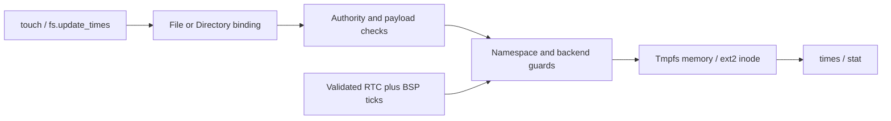

# Filesystem timestamp ABI

This profile adds timestamp inspection and current-time updates to native File and Directory objects.
It preserves the existing metadata record and file contents.



## Records

All integers use the current x86-64 little-endian ABI.
[`os1_file_times`](../../../src/uapi/os1/vfs.h) contains 40 bytes.

| Offset | Fields | Meaning |
| --- | --- | --- |
| 0 | u32 `version`, u32 `size` | Version 1 and size 40 |
| 8 | u32 `valid`, u32 `resolution_ns` | Valid fields and storage resolution |
| 16 | u64 `access_ns` | Last explicit access-time update |
| 24 | u64 `modify_ns` | Last content or directory-entry change |
| 32 | u64 `change_ns` | Last metadata change; not creation time |

Times use UTC Unix-epoch nanoseconds.
Validity bits are ACCESS=1, MODIFY=2, and CHANGE=4.
A clear bit means unknown or unsupported; callers must not interpret that field as a date.
Tmpfs reports nominal 1000000-nanosecond resolution.
Ext2 reports 1000000000-nanosecond resolution and stores whole seconds in existing inode fields.
Resolution does not establish clock accuracy.

`os1_set_times` contains 16 bytes: u32 `version`, `size`, `fields`, and `reserved`.
Version must be 1, size must be 16, and reserved must be zero.
Select ACCESS, MODIFY, or both in `fields`; zero and other bits are invalid.
Selected fields receive one current-time sample.
The kernel also updates CHANGE to that sample.
Explicit dates, birth time, and time-zone conversion remain deferred.

## Methods and authority

| Interface | Member | ID | Authority | Input | Output |
| --- | --- | --- | --- | --- | --- |
| Directory | `times` | 12 | INSPECT | Empty | `os1_file_times` |
| Directory | `set_times` | 13 | SET_TIMES | `os1_set_times` | Empty |
| File | `times` | 10 | INSPECT | Empty | `os1_file_times` |
| File | `set_times` | 11 | SET_TIMES | `os1_set_times` | Empty |

`OS1_RIGHT_SET_TIMES` is bit 11, value 2048; `OS1_RIGHT_ALL` is 8191.
Mutable objects support this right independently of content-write authority.
Bindings capture selected authority; existing restricted bindings do not acquire it automatically.
Ordinary file and directory helpers retain their previous rights requirements.
Only explicit timestamp helpers request SET_TIMES.
Retained Operations preserve existing execution and result rules.
Reading an Operation result again does not repeat the timestamp mutation.

Resource controls 27 and 28 provide equivalent `times` and `set_times` operations.
Control 27 requires INSPECT and a writable 40-byte output region.
Control 28 requires SET_TIMES and a readable 16-byte input region.
The kernel validates input before timestamp mutation.
Native IPC uses copied records and does not accept process-local descriptors in these payloads.

The namespace guard stabilizes the target during dispatch.
Tmpfs uses its filesystem lock; ext2 uses its existing serialized I/O guard.
A busy guard returns WOULD_BLOCK.
No new blocking syscall, lock nesting with IPC timers, or unbounded allocation is introduced.

## Backend behavior

| Operation | Timestamp effects |
| --- | --- |
| Create | Initialize ACCESS, MODIFY, and CHANGE when wall time is available |
| Nonempty write or append | Update MODIFY and CHANGE |
| Successful truncate | Update MODIFY and CHANGE, including unchanged length |
| Create or remove a directory entry | Update parent MODIFY and CHANGE |
| Rename or move | Update affected parents and moved-object CHANGE |
| Explicit `set_times` | Update selected fields and CHANGE |
| Read, inspect, enumerate, or seek | Preserve timestamps |

Ordinary reads use a noatime policy.
This avoids persistent metadata writes for content inspection.
Tmpfs retains timestamps while an unlinked object remains open.
Ext2 retains its existing prohibition on removal of retained objects.

Initrd reports validity zero and resolution zero.
It does not support SET_TIMES.
Ext2 treats stored zero timestamps as unknown in this first profile.
Ext2 accepts positive unsigned 32-bit epoch seconds; out-of-range current time cannot update timestamps.
The 64-byte metadata record and ext2 inode layout remain unchanged.

Explicit current-time updates return UNSUPPORTED when wall time is unavailable or outside the backend range.
They preserve existing timestamp fields in that case.
Ordinary I/O remains available and preserves existing times when the clock is unavailable.
New objects can then have unknown timestamps.
I/O failures retain existing ext2 failure and partial-progress rules.
Use native `sync` before shutdown when persistence is required.

## Wall-clock source

The BSP samples the legacy RTC after AP startup and before its scheduler timer starts.
The FADT RTC absence flag prevents legacy RTC access.
The FADT century index is used when valid; otherwise an absent index selects years 2000–2099.
Invalid nonzero indices make wall time unavailable.

The reader requires two matching calendar snapshots outside the update interval.
It validates battery status, SET state, encoding, date, and representable range.
It supports binary or BCD data and 12-hour or 24-hour time.
Retries are bounded to 4096 attempts.
The reader changes the CMOS index but never writes RTC data registers.
The kernel's post-AP NMI-enabled policy remains in effect.

Firmware must store UTC in the RTC.
The wall clock advances from BSP scheduler ticks after initialization.
Lost ticks, scheduling delays, and oscillator error can cause drift.
This profile has no NTP synchronization, clock-setting service, or local-time RTC conversion.
IPC deadlines and the high-resolution measurement clock retain their existing independent contracts.

Sources: [ACPI FADT definitions](https://uefi.org/specs/ACPI/6.6/05_ACPI_Software_Programming_Model.html) and
[compatible RTC register definitions](https://www.analog.com/media/en/technical-documentation/data-sheets/ds12885-ds12c887a.pdf).

## Shell mapping

`touch` accepts one positional or named `path` parameter.
It creates a missing regular file or updates an existing file or directory.
It preserves contents and sets ACCESS and MODIFY to now through native IPC.
`fs.update_times` performs the update without creating a missing object.
`fs.ensure_file` preserves existing timestamps.

```text
touch "/tmp/note"
touch path:"/note"
fs.update_times "/tmp/note"
stat "/note"
```

`stat` and `fs.info` show nanoseconds and storage resolution.
Unknown fields appear as `unsupported`.
Quoted examples work in both interactive and strict script modes.
Creation and timestamp mutation are separate operations.
If mutation fails after creation, report failure and retain the created file.

The [SystemControl ABI](system-control-abi.md) adds SYSTEM_CONTROL=4096. Filesystem descendant ceilings do not include this right.
