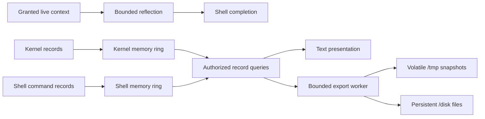

# Live context discovery and diagnostic logs

This proposal connects live context inspection with kernel and shell diagnostics for physical-device tests.
The user requested these capabilities on 2026-11-08 and accepted the defaults below.
The [memory log ABI](abi/memory-log-abi.md) defines the first implemented subset; discovery and export remain proposals.



| Topic | Definition |
| --- | --- |
| Discovery without activation | [Live context](#live-context) |
| Interactive navigation | [Completion](#completion) |
| Record capture and access | [Log objects](#log-objects) |
| Time and command correspondence | [Correlation](#correlation) |
| Storage failure containment | [Staged serialization](#staged-serialization) |
| Implementation order and acceptance | [Proposed slices](#proposed-slices) |

## Existing foundation

The [hierarchy proposal](object-hierarchy.md#reflection-and-child-discovery) already separates description, child enumeration, reads, and acquisition.
The [typed context](../shell/typed-context.md) supplies inherited plain data and separate resource grants.
The [fixed runtime profile](context-discovery.md) now implements live inspection and shell completion.
General provider reflection remains planned.

The kernel has a 256-record [event ring](../../src/kernel/debug/event_ring.cpp), protected by an IRQ spin guard.
Its records contain sequence numbers, scheduling ticks, CPU identity, process identity, and event arguments.
It does not record every API call or provide the proposed persistent log service.

The separate [boot-log mechanism](../hardware/boot-log.md) captures diagnostic output and can harvest retained RAM after a reset.
It has documented hardware and SMP limits. Keep this early-boot path available when ext2 or normal runtime export cannot operate.
The new service must not claim that filesystem logging replaces early-boot or fatal-fault capture.

## Live context

Discovery exposes only the caller's authorized, currently available context.
It must not construct objects, activate services, probe hardware, or invoke arbitrary property getters.
Interface metadata may describe a method that creates objects; discovery must not call that method.
An offline class catalog remains separate from live instance discovery.

Use bounded member descriptions with names, kinds, interface identities, schema references, and access information.
Member kinds distinguish child objects, data fields, properties, methods, and events.
Plain environment values support structural enumeration without creating service processes.
Existing local values may be inspected directly; remote values require an explicit authorized read.
A description or name does not grant access to its target.

Use generation-checked pages for mutable collections, with explicit stale-cursor and end-of-collection results.
Bound page size, traversal depth, request time, and retained references.
Detect repeated object identities because the hierarchy can contain shared references or cycles.
Unavailable children disappear or return an unavailable result; completion must not activate replacements.
Metadata must be safe for display and must not inject terminal control sequences.

A fixed authorized member table is the recommended first implementation.
Dynamic provider registration can follow without changing the shell's inspection protocol.
Discovery must distinguish an existing reference from a service name that requires explicit acquisition or activation.

## Completion

The OS provides reflection; the shell owns key bindings, filtering, and presentation.
The [fixed runtime profile](context-discovery.md#shell-controls) implements these keys independently of the shell expression grammar.

| Key | Action |
| --- | --- |
| Tab at an empty expression | Show available roots, including `os` and `process` when granted |
| Up or Down while the list is open | Select a candidate |
| Tab on an object | Insert its path and show its available members |
| Tab on a leaf | Insert its name and show its signature or type |
| Enter while the list is open | Accept the selected completion without executing the command |
| Escape | Close the list without executing anything |

Methods, properties, and events have distinct display markers.
Exploring an event shows its schema; it does not subscribe.
Exploring a property shows its type; it does not evaluate an arbitrary getter.
A later Enter with the list closed follows normal command execution rules.
Unavailable or slow providers must not prevent cancellation or ordinary line editing.
History navigation remains separate work; the current prompt supports editing at the line end.

## Log objects

Keep kernel records and shell records in separate bounded memory rings.
Use a common record envelope and compatible query filters, rather than one shared writable buffer.
The shell owns its command history; it must not gain permission to forge kernel records.
General context inheritance must not copy a shell's history into every child.

| Proposed object | Responsibility |
| --- | --- |
| `os.system.log` | Authorized kernel record queries and text output |
| `process.shell.history` | This shell's command records and text output; present only in the shell context |
| Export worker | Read authorized snapshots and write bounded files through existing File interfaces |

Propose `read` for bounded typed records and `print` for human-readable output to the selected stream.
Both accept optional filters, such as time range, severity, subsystem, process, and command identity.
Queries use sequence cursors and report overwritten records explicitly.
An output method must not invoke shell commands stored in records.
Text views must escape terminal control bytes and record delimiters from command text, device strings, and other untrusted fields.
Only typed records retain original bounded bytes; viewers must render them as data without interpreting control sequences.
Apply redaction before capture, so neither typed records nor text exports retain suppressed input.
Aliases such as `dmesg` and `history` can bind the corresponding `print` method.

Illustrative future commands follow; they are not current executable examples.

```text
os.system.log.print subsystem:"usb" level:"warning"
process.shell.history.print limit:20
os.system.log.print command_id:42
```

Capture system events, device identification, and API-call records through structured instrumentation.
An API record should identify the operation, caller, result, duration, and correlation identity without copying arbitrary request buffers.
Local object methods do not necessarily cross the kernel boundary; their tracing requires runtime instrumentation.
Document which call classes each tracing profile covers.

Two capture policies are possible:

| Policy | Benefit | Cost |
| --- | --- | --- |
| Normal events plus selected API tracing | Lower overhead and longer useful retention | An unselected successful call cannot be reconstructed |
| All instrumented API entries and completions | More detail during hardware diagnosis | Higher CPU cost, faster overwrite, and larger exports |

Recommend the first policy for normal boots and the second for explicit diagnostic boots.
This is a proposed default, not a rejection of comprehensive tracing support.
No bounded, nonblocking buffer can guarantee retention of every event under unlimited load.
Record loss counters and sequence gaps; reserve capacity for critical failures where practical.
Never capture passwords or arbitrary file contents by default.
Shell history needs an explicit suppression or redaction mechanism before commands can contain sensitive input.

Capture must not allocate memory, perform disk I/O, or wait for an export worker.
Start with a bounded global ring if its lock and interrupt latency meet measured limits.
Per-CPU rings are an alternative when measured contention requires them; they complicate ordering and export.
Neither option permits recursive logging while holding the ring lock.
Fault and NMI capture need a separate bounded fallback, or an explicit unsupported-context result.

## Correlation

Use a boot identity, stream identity, sequence number, monotonic timestamp, and clock quality in each record envelope.
Record wall-clock anchors separately, including validity and clock changes.
Early records must identify coarse or unavailable timing; they must not invent high-resolution timestamps.
The clock-read path must be safe in each supported capture context and across CPUs.
The [measurement clock](../kernel/measurement-clock-abi.md) is a foundation, not proof that its current locking fits every logging context.

Assign each shell command a command identity scoped to its boot and shell session.
Record command start, completion, result, cwd, and bounded command text.
Assign a request identity to each traced API operation.
Propagate correlation through child launches and asynchronous requests; completion keeps the originating identity.
Record parent relationships where commands or requests create additional work.

Correlation tags grant no authority and must not replace kernel-authenticated caller identity.
Child-supplied tags cannot establish trusted parentage without kernel validation.
The transport and launch ABI extensions need a separate design before implementation.
Timestamps alone establish approximate temporal correspondence, not causality.
These records support timeline reconstruction; they do not provide deterministic execution replay.
Debugging tools must not automatically execute recorded commands.

## Staged serialization

Memory remains the primary source even when an export destination fails.
The proposed locations keep diagnostic data separate from installed programs.

| Stage | Kernel log | Shell log | Persistence |
| --- | --- | --- | --- |
| Memory | Bounded kernel ring | Bounded shell-owned ring | Lost on power removal |
| `/tmp` | `/tmp/log/kernel.bin` | `/tmp/log/shell-<session_id>.bin` | Readable snapshots; still volatile |
| USB ext2 | `/disk/log/kernel-<boot_id>.bin` | `/disk/log/shell-<boot_id>-<session_id>.bin` | Best-effort persistence after successful write and synchronization |

Kernel stages are memory, `/tmp`, then USB. Shell serialization stages are `/tmp`, then USB, after memory capture exists.
Exports read ring snapshots directly; USB export must not depend on successful `/tmp` staging.
Use bounded retention across sessions and boots, with explicit byte, file-count, and reserved-space limits.
A dedicated log directory must not delete unrelated user files during retention cleanup.
File naming, directory growth, and rotation must respect the current bounded ext2 profile.

Use versioned binary frames with lengths, record counts, sequence ranges, and checksums.
A reader must reject malformed lengths and report incomplete or corrupt frames.
After a partial final frame, retain the preceding validated records and report the incomplete tail.
Checksums detect damage; they do not make ext2 metadata updates atomic or provide a journal.
Store image identity, build revision, boot mode, clock information, and enabled tracing policy with each exported boot record set.

Perform formatting and file writes outside capture locks in a bounded worker.
Use finite admission budgets, bounded retries, and existing device-failure containment.
Missing mounts, full disks, invalid filesystems, or unplugged devices must leave memory queries available.
Stop export after repeated failures and expose its status through the log object.
Prevent export-generated I/O traces from recursively requesting more exports; report failures with bounded counters.
Periodic flush and shutdown flush reduce exposure but cannot guarantee survival of sudden power loss.

A shell must finish or transfer its pending export before its ring is destroyed on normal exit.
If the shell crashes, unexported shell records can be lost; stronger recovery requires a separate retained history owner.
The first stage must report this limit rather than imply that every command survives a crash.

## Accepted defaults — 2026-11-08

The user accepted these defaults before implementation. Later slices implement export and retention.

| Setting | Normal boot | Diagnostic boot |
| --- | --- | --- |
| Capture | Lifecycle, device identification, warnings, errors, API failures, resource changes | All instrumented API entries and completions |
| Scheduler and individual IRQ tracing | Off | Explicit opt-in only |
| Kernel ring | 256 KiB | 1 MiB |
| Warning/error reserve | One eighth of the ring | One eighth of the ring |
| Shell history | 64 KiB per shell; 256 KiB aggregate | Same |
| Export staging | 64 KiB system-wide | Same |
| Record limits | Kernel 256 bytes; shell 2 KiB | Same |
| USB drain | Every 2 seconds or 32 KiB pending | Every 250 ms or 32 KiB pending |
| USB synchronization | Every 5 seconds with pending writes | Every second with pending writes |
| Background export ceiling | 64 KiB/s | 256 KiB/s |

Payload ceilings are 576 KiB normally and 1.3125 MiB diagnostically, excluding bookkeeping and `/tmp` files.
Allocate histories on demand; budget exhaustion disables that history without preventing shell operation.
Truncate oversized fields explicitly. Report overwrite and capture-loss counters.
Do not capture request buffers, file contents, or keystrokes by default.

`/tmp/log` uses at most 64 KiB: 32 KiB each for kernel and aggregate shell snapshots.
Refresh these snapshots only on explicit request.
`/disk/log` uses at most 4 MiB: 3 MiB kernel and 1 MiB shell.
Use at most 16 managed segments, each at most 256 KiB.
Retain at most four boots, subject to byte and file limits; remove the oldest managed segments first.
Stop extension below the greater of 2 MiB or 10 percent free filesystem capacity.

Errors request an early drain and sync, coalesced to at most once per second.
Shell exit exports pending history; shutdown and reboot drain logs before final synchronization.
After three consecutive export failures, suspend automatic export until explicit retry or a new mount.
These intervals are targets, not guaranteed power-loss windows.

## Proposed slices

Keep the existing input, storage, discovery, security, and networking priorities on the [roadmap](roadmap.md#remaining-priorities).
These additions provide a diagnostic foundation alongside those milestones.
The ordering below is a recommendation for discussion.

| Slice | Work | Acceptance |
| --- | --- | --- |
| 1 | Shared record envelope, memory rings, authorized queries, command correlation | Bounded capture, explicit loss, cross-CPU ordering rules, and command/request correlation tests |
| 2 | [Implemented fixed descriptions and completion](context-discovery.md) | Enumerate the granted hierarchy without activation; test stale pages, authority, cancellation, and hostile names |
| 3 | `/tmp` snapshots and bounded USB exports | Recover valid frames; test full disks, missing mounts, partial writes, rotation, and shell exit |
| 4 | Automated physical-device diagnostic bundles | Match kernel and shell records by build, boot, command, and request; preserve failure and loss evidence |

Memory logging should help diagnose reflection and input implementations before persistent export is required.
A discovery-first order is also coherent when interactive exploration has higher priority.
Do not make complete reflection a prerequisite for native keyboard and mouse services.

Before implementation, select capture defaults, ring budgets, retention limits, flush policy, and the initial correlation boundary.
Confirm the proposed object names, file locations, and completion keys.
Measure capture latency, interrupt latency, contention, overwrite rate, memory use, and export I/O against a comparable baseline.
Test UEFI, BIOS, SMP, no-disk operation, and physical USB failure separately.
A successful QEMU test does not establish physical-device behavior.

## Documentation impact and validation

This proposal supports GOALS “Native system interface,” “Terminal-first operating system,” and “Testability and observability.”
It extends the proposed hierarchy without changing implemented profiles.

| Area | Assessment |
| --- | --- |
| Project scope | Adds bounded diagnostic slices and preserves the OS/shell separation |
| Boot and platform | Preserves existing boot capture; proposes runtime export without changing either boot frontend |
| Memory and isolation | Specifies bounded rings, authorized views, separate ownership, and loss reporting; changes no allocation or rights |
| Concurrency | Identifies IRQ, SMP, asynchronous correlation, and export lifetime requirements; changes no locks or scheduling |
| Interfaces | Proposed names and records only; no syscall, startup layout, or wire-format changes |
| Runtime resources | No executable changes; runtime measurement is not applicable to this documentation task |
| Validation | Check source claims, local links, examples, and the complete diff; obtain independent review |

Baseline for source claims: `146c0c84498ceba6159e945451dfbd533f98357f`.
Validation on 2026-11-08: `git diff --check` passed; all 147 local document links and anchors resolved.
Source checks covered the event ring, observation records, measurement clock, typed context, and diagnostic boot-log limits.
Examples are proposed syntax and were not executed.
No kernel build, QEMU run, or hardware test is required solely for these document changes.
The full ASD-STE100 Issue 9 standard and dictionary were unavailable; review uses the repository's stated language rules.
