# C++ Bindings, Discovery, and Object Construction

Status: illustrative proposal, 2026-11-04. The APIs, headers, commands, wire
layouts, and SDK below are not implemented. These are short design examples,
not compilable examples for the current kernel. `checked()` propagates failures;
owned descriptor/proxy wrappers release their entries with RAII. The
[native contract](object-contract.md) owns semantics; this document
shows their C++ expression, including later reflection and service work.

For compiled first-slice C++ examples, see the [implemented VFS/startup ABI](abi/initrd-vfs-abi.md)
and `src/user/programs/ls.cpp`, `cat.cpp`, and `vfscheck.cpp`. The typed service
SDK and generated `.so` flow below remain proposals. For the implemented copied
IPC prototype, see [the concrete ABI](abi/copied-ipc-abi.md),
[ipccheck.cpp](../../src/user/programs/ipccheck.cpp),
[textprocessor.cpp](../../src/user/programs/textprocessor.cpp), and
[the shell image inspector](../../src/user/include/os1/image_inspection.hpp). These use handwritten bounded
records. The [Counter/events implementation](abi/counter-events-abi.md) adds
volatile runtime events, typed constructor records/CLI conversion, and deadlines.
See [counter.cpp](../../src/user/programs/counter.cpp) and
[countercheck.cpp](../../src/user/programs/countercheck.cpp). The general SDK below
remains illustrative. The [shared activation example](abi/shared-activation-abi.md#bootstrap)
now compiles a handwritten acquire helper and two independent Counter clients;
the class construction hook alone selects singleton reuse.

The [implemented bounded parameter profile](parameter-schema.md) extends the design to
optional, compound, enum and variant values, typed defaults, and standard descriptions
for both methods and constructors. A generated C++ binding should use the same
normalization/codec as the dot-based CLI; it bypasses only text parsing. No caller
syntax adds a fresh/shared creation-policy override. The
[original session plan](../archive/native-api/2026-11-05-client-sessions-and-parameter-plan.md) separates
shared object identity from independently authorized/budgeted client sessions.

## Handle ownership and current helpers

The [approved handle model](object-contract.md#object-handles-and-interoperability) keeps one process resource table.
A typed proxy owns or borrows a local handle; it does not expose a provider address or C++ vtable.
Owning references release entries; explicit duplication creates another owner under the existing delegation policy.
Borrowed references cannot outlive their owners.
General typed ownership wrappers remain proposed, and integer slot reuse remains possible.

The [Console helpers](../../src/user/include/os1/console.hpp) are implemented handwritten wrappers using integer handles and explicit close.
They provide `console_bind`, `console_request`, `console_write`, and `console_write_async`.
The [two-process example](../../src/user/programs/kernel_console_check.hpp) exercises retained completion and independent service authority.
These compiled helpers do not implement the general SDK shown below.

## 1. Listing a directory

Use an explicitly granted directory, open a separate enumeration instance, and
read bounded records. Names do not confer permission to open the listed files.

```cpp
void list_directory(os::Context& ctx)
{
    auto dir = checked(os::open_at(ctx.cwd(), ".", {
        .rights = os::Enumerate,
        .flags = os::CloseOnExec,
        .descendant_rights = os::None,
    }));

    os::DirectoryReader reader(dir);
    while (auto batch = checked(reader.next())) {
        for (const auto& entry : *batch)
            checked(ctx.stdout_stream().write_line(
                os::escape_filename(entry.name)));
    }
}
```

`DirectoryReader` owns a bounded buffer, validates complete records, and reports
end-of-directory as an empty optional. It handles `BUFFER_TOO_SMALL` within the
negotiated record-size limit, rather than allocating without a bound. This
example needs `LOOKUP` on cwd, an enumeration-capable descendant ceiling, and
write permission on stdout. The new descriptor owns an independent directory
cursor. See the [VFS profile](vfs-contract.md#4-directory-enumeration).

## 2. Constructing an object and processing data

`TextProcessorClass` is an authorized class reference obtained from the startup
context or a permitted class publisher. Its provider implements a construction
hook and the `TextProcessor` interface. The class code decides whether the hook
allocates an instance or returns an existing one; the caller has no allocation
or sharing mode to select.

```cpp
void process_data(os::Context& ctx, os::ClassRef text_processor_class)
{
    auto processor = checked(generated::TextProcessor::create(
        text_processor_class, {.locale = "C"}));

    auto first  = checked(processor.uppercase("hello"));
    auto second = checked(processor.uppercase("native objects"));
    checked(ctx.stdout_stream().write_line(first));
    checked(ctx.stdout_stream().write_line(second));
} // Releases this proxy; does not shut down a shared provider.
```

The optional arguments are typed construction data. The construction hook may
use them when creating or choosing an object; it documents their behavior on
reuse. They are not an implicit copy of process environment variables. There
are no `fresh`, `singleton`, `reuse`, or policy-override options on this call.

If the provider is inactive, its authorized service manager can start the binary
with configured grants/environment and wait for provider readiness. The class
hook then returns a fully initialized object endpoint. If already active, no
new program execution is required. Two calls through `processor` address the
same object incarnation. Calling `create` again may return a reference to that
same object or another one, according to the class implementation.

Ordinary `spawn` starts a process without promising an object protocol. Explicit
`start_service` starts a provider under its supervisor; class construction is a
separate operation. A client of a shared class gets no implicit right to stop
that supervisor. Private-provider teardown is performed by its explicit owner.

## 3. Discovering an interface dynamically

Live discovery returns bounded interface descriptions without invoking getters
or construction hooks. A known generated C++ binding can query compatibility
and bind directly. A later generic runtime can also build requests from schemas:

```cpp
auto description = checked(endpoint.describe());
auto iface = checked(description.find_interface("TextProcessor", 1));
auto method = checked(iface.find_method("uppercase"));

auto request = method.make_request();
checked(request.set("text", "hello"));
auto reply = checked(endpoint.invoke(iface.id(), method.id(), request));
auto output = checked(reply.get<std::string>("text"));
```

For this example, `uppercase` has bounded request and reply records containing
`text`. Names assist discovery; stable IDs and compatible layouts route calls.
The runtime checks types and encodes messages; the kernel enforces transport and
capability rules. A numeric descriptor in a record is not an attached capability.
Discovery itself must be authorized, size-limited, and treated as untrusted input.
It grants no permission to invoke methods. An unsupported or incompatible method
fails before the binding assumes its layout. Full schema-driven invocation is a
later extension; fixed generated bindings are the smaller initial step.

## 4. Extracting a canonical interface from a class binary

An exporter puts the public class/interface description in the optional
`.os.interface` artifact. The extractor reads it without executing the binary.
It cannot recover an arbitrary complete interface from machine code lacking that
metadata. A binary can describe several classes and interfaces.

```mermaid
flowchart LR
    A["Class binary<br/>.os.interface"] --> B["Validate and extract"]
    B --> C["Canonical interface representation"]
    C --> D["C++ binding generator"]
    D --> E["TextProcessor.hpp + TextProcessor.cpp"]
    E --> F["Target compiler and linker"]
    F --> G["Application, static library, or client .so"]
    G --> H["Native runtime / IPC"]
    H --> I["Provider object"]
```



The canonical representation preserves class and interface IDs, compatibility
versions, construction signatures/defaults, member IDs, field encodings/bounds,
errors, and reference ownership. It is language-neutral schema data, not a C++
class layout or a kernel-wide type registry. Its serialization and normalization
rules still need specification. JSON could be a tooling representation, without
becoming the kernel transport format.

A generator emits the C++ facade and codecs, for example:

```cpp
namespace generated {
struct TextProcessorArgs { std::string locale = "C"; };

class TextProcessor {
public:
    static os::Result<TextProcessor> create(
        os::ClassRef klass, const TextProcessorArgs& args = {});
    static os::Result<TextProcessor> bind(os::Endpoint endpoint);
    os::Result<std::string> uppercase(std::string_view text);
private:
    os::Endpoint endpoint_;
};
}
```

`create` invokes the class construction protocol; `bind` wraps an existing
endpoint after checking compatibility. The generated implementation checks
bounds, encodes requests, invokes stable IDs, validates replies, and translates
errors. It neither contains the provider's text-processing algorithm nor calls
addresses in the provider process.

## 5. Who produces the shared library?

**The C++ target compiler and linker produce the `.so`.** The binding generator
produces source code. A packaging tool could orchestrate both. Illustrative
commands, once an os1 SDK and dynamic-linking profile exist:

```sh
os-iface extract text-processor --out TextProcessor.osif
os-bindgen cpp TextProcessor.osif --out generated/
os1-c++ -fPIC -shared generated/TextProcessor.cpp \
    -los_runtime -o libTextProcessor_client.so
os1-c++ app.cpp -Igenerated -L. -lTextProcessor_client -los_runtime -o app
```

`os1-c++` represents a target toolchain, not the host compiler or an existing
repository command. The generated `.so` contains client binding code. The
provider remains separately executable. The deployment must supply compatible
runtime/library versions and a defined loader search/retention policy.

A shared library per interface is optional. Initially compile generated code
into the application, or a static library. The current static `ET_EXEC` profile
does not support these proposed dynamic-linking commands; linking client bindings
dynamically requires loader/runtime work even when the provider still uses IPC.

Generated artifacts record schema/generator/target ABI provenance. At bind time,
the endpoint must support the expected interface major and required method
layouts. Byte-for-byte metadata equality is not required for compatible additive
changes. Artifact identity binds offline inspection to its source; it does not
replace live compatibility checking or authenticate arbitrary metadata claims.

Loading the **provider implementation** into the caller is another backend with
its own versioned local ABI, construction/release functions, buffer ownership,
threading, exceptions, and unload rules. A language-neutral function table could
underlie a generated C++ facade; arbitrary C++ vtables are not a cross-language
ABI. Local loading shares the caller's protection boundary. Sharing a canonical
schema does not make local and hosted isolation/lifetime guarantees identical.

## 6. Class code can return a singleton

This provider-side sketch makes the decision inside the construction hook. The
registry helper is runtime infrastructure, not an option supplied by the caller:

```cpp
os::Result<os::ObjectRef<TextProcessorImpl>> construct_text_processor(
    os::ConstructionContext& ctx, const TextProcessorArgs& args)
{
    checked(ctx.authorize_construction());
    checked(validate(args));

    auto instance = checked(ctx.instances().get_or_create(
        TextProcessorClassId, "default", // Class-defined key and sharing scope.
        [&] { return os::make_object<TextProcessorImpl>(args.locale); }));

    // This particular class requires compatible configuration on reuse.
    if (instance->locale() != args.locale)
        return os::Error::ConfigurationConflict;

    return ctx.grant_for_caller(instance);
}
```

The construction hook runs for each accepted invocation. `get_or_create`
serializes publication of this class-selected key; the initialization lambda
runs only when no ready instance exists. The helper must cover failed creation,
waiters, cycles, and crash generations, not just a concurrent map insertion.
The class could instead allocate on every call, choose an instance by locale,
or return a per-client session backed by shared state. These are class-code
choices with documented effects, not caller-selected modes.

This example's configuration-conflict rule is a class decision, not a universal
kernel rule. An ordinary caller cannot force reset or mutation of the singleton
by sending arbitrary constructor fields. Returned references are separately
authorized, even when all reference the same instance. The C++ factory spelling
is necessary because an actual C++ constructor initializes its object and cannot
return another instance; see [C++ constructor rules](https://eel.is/c++draft/class.ctor).

Cross-process singleton semantics require all clients to reach the same
class-controlled registry in an authorized realm. A process-local static alone
does not provide that. A service manager can activate and supervise the class
provider on demand, making this a route to dynamic system services. It must not
turn an arbitrary client's request into privileged global service registration.
The [canonical construction contract](object-contract.md#classes-and-class-controlled-construction)
owns authority, initialization, and reuse semantics.

## 7. Acceptance and remaining choices

Before implementing these later facilities, demonstrate:

- Directory records remain bounded; listing never grants child handles.
- Extracting/formatting metadata executes no constructors or getters. Malformed
  schemas and incompatible live interfaces fail without invoking arbitrary code.
- Generated and reflective clients encode the same fixed protocol; incompatible
  records fail, while documented compatible additions remain usable.
- Construction arguments/defaults are validated on every request; provider
  environment and capability grants cannot be rewritten by ordinary callers.
- Class code alone selects fresh versus reused results; clients have no mode
  override. Concurrent singleton acquisition publishes one ready instance per
  class-selected key, with correct per-client rights and failure cleanup.
- Conflicting arguments, denied callers, reentrant construction, deadline expiry,
  discarded replies, provider crash/restart, and retained dead endpoints follow
  explicit contracts. No automatic replay assumes construction is effect-free.
- Closing a client cannot kill the shared provider. Service-manager shutdown,
  idle policy, upgrades, registry scope, and instance-state persistence are
  specified before claiming general system-service behavior.

Start with statically linked typed bindings and a private provider; handwritten
codecs precede generation from two exercised protocols. Shared class
activation and reflection follow the exercised protocol. Dynamic client linking
and in-process implementation loading have separate admission gates.

## 8. Synchronous and asynchronous IPC

The [approved IPC design](ipc-transport.md) uses one provider protocol for
both styles. These names remain illustrative SDK APIs, not current os1 headers.
The initial implementation can use handwritten typed codecs; generated bindings
follow evidence from two protocols.

```cpp
// processor already holds an authorized, ready object endpoint.
auto text = checked(processor.uppercase("hello")); // Submit, wait, retrieve.

auto pending = checked(processor.uppercase_async("hello"));
do_other_work();
checked(pending.wait());
auto same_text = checked(pending.result());
```

Both calls encode the same member ID and bounded arguments and reach the same
provider handler. Async submission returns after the kernel has accepted and
copied the ordinary request bytes. It does not require a different provider
method or create a client thread. The pending wrapper owns an Operation;
completion remains queryable until release, including after a failed result
copy. A synchronous wrapper does not pump arbitrary application callbacks.

Properties and events build on that protocol at the subscriptions stage:

```cpp
auto settings = checked(processor.get_settings());
checked(processor.set_settings(
    {.locale = "en"}, {.expected_revision = settings.revision}));

auto job = checked(processor.process_async(document));
auto subscription = checked(job.on_progress(
    events, [](const Progress& p) { show_progress(p.percent); }));

events.run_until(job); // Explicit dispatch on this application's thread.
auto output = checked(job.result()); // Result survives lost progress events.
```

These particular members and revision checks are protocol examples. The setter
validates and updates atomically in the provider. Subscribing after submission
may miss earlier progress; a watch API requiring an initial state must return
an atomic snapshot/revision or implement sequence-based catch-up. Destruction of
a subscription must follow the specified unsubscribe/drain barrier before
callback captures are freed.

Closing `pending` or timing out a future wait drops interest or ends waiting;
neither confirms that provider effects stopped. No automatic retry follows an
unknown outcome. Timed waits require the monotonic clock and deadline machinery
specified in the IPC profile. Class construction still selects the object in
class code; neither invocation style adds a fresh/shared option.

Later bulk operations can attach a shared-buffer capability and offset/length
instead of copying large payloads. The buffer profile must specify immutable
publication, mappings, and backing lifetime; passing a pointer or an ordinary
integer fd is not a substitute. Channel replies and retained Operation semantics
remain the same. Shared-memory rings are a separate later optimization.

The [2026-11-05 implementation record](../archive/native-api/2026-11-05-client-sessions-and-parameters.md)
records working independent sessions and rich constructor/method inputs. The
general generated SDK and broader reflection designs above remain proposals.
