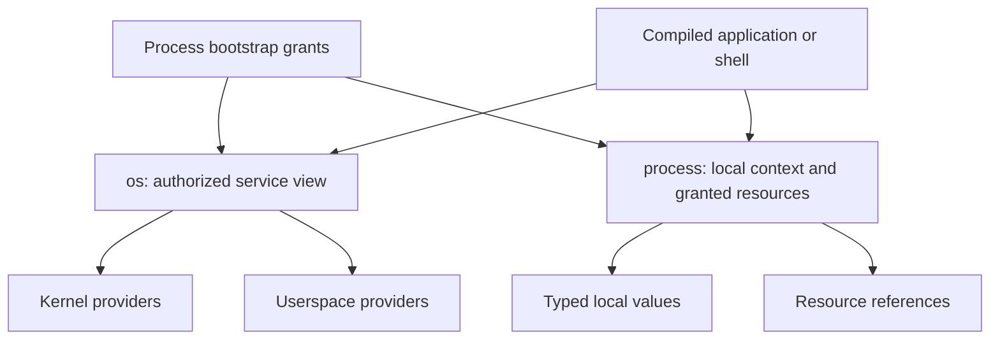

# Reflective OS object hierarchy

Option B was selected on 2026-11-07: a reflective object hierarchy, separate from the shell language.
This document records the accepted architectural direction and the remaining protocol proposals.
Most names below remain proposed bindings, not assigned ABI records.
The [typed context slice](../shell/typed-context.md) implements local environment/path/fs views without general service reflection.



## Boundaries and authority

| Layer | Responsibility |
| --- | --- |
| [Object contract](object-contract.md) | Identity, rights, lifetime, calls, properties, events, and construction |
| This hierarchy | Service organization, process context, and discovery direction |
| [Implemented profiles](README.md#implemented-profiles) | Current wire formats, limits, and supported operations |
| [Shell command proposal](../shell/object-commands.md) | Text commands, aliases, conversion, and presentation |

An object need not occupy a separate process.
A local value object, a kernel resource, and a userspace service have different execution and failure boundaries.
Interface descriptions must identify operation behavior, including blocking, asynchronous completion, and failure semantics.
Discovery names do not determine provider placement.
Hardware drivers remain in the kernel initially.

Each process receives an authorized view of the hierarchy.
Names and metadata grant no authority; explicit acquisition returns authorized resource or service references.
A PID, path string, or integer field cannot substitute for a capability.
Enumeration must respect disclosure policy as well as acquisition policy.
Class code continues to select fresh or existing objects; callers receive no creation-policy override.

## Proposed roots

The roots are language-independent bindings, not a serialized C++ class layout.
The exact member catalog remains open.

```text
os
  system
    memory
    processors
    clock
  fs
    root
    mounts
  devices
  storage
    devices
    partitions
  net
    interfaces
    routes
    sockets
  services
  processes
process
  environment
    path
    cwd
    <application-defined values>
  streams
    input
    output
    error
  memory
  application
  lifecycle
```

`os.system.memory.layout` would describe system memory.
`process.memory.mappings` would describe the caller's address space.
An explicit method such as `map_region` would change mappings.
This naming separates observation from mutation.

`os.devices` describes hardware and driver bindings.
`os.net.interfaces` describes network interfaces and their supported operations.
Both can reference the same underlying device without duplicating its driver or authority.

The hierarchy is not a second filesystem.
Service discovery and file lookup retain separate protocols, even when both support child enumeration.
The same object can appear under multiple names; a discovery path is not stable object identity.

## Hardware reflection and functional objects

The [hardware architecture](hardware-objects.md) selects one inventory with topology and class views.
Drivers will publish typed functional objects with separate operation authority.
The [first reflection profile](abi/hardware-reflection-abi.md) exposes cached records through live discovery and Tab navigation.
Keyboard, Pointer, Display, and BlockDevice interfaces remain accepted designs.

## Mapping the current system

| Proposed location | Existing foundation | Missing public contract |
| --- | --- | --- |
| `os.system.memory` | Memory manager and allocator observations | Typed system memory snapshots |
| `process.memory` | Address spaces and executable mappings | Public mapping inspection and mutation interfaces |
| `os.system.processors` | CPU and SMP observations | Native processor descriptions |
| `os.system.clock` | Measurement clock and scheduling deadlines | Discoverable clock interfaces with distinct domains |
| `os.fs` | Initrd, tmpfs, ext2, File and Directory operations | Native initrd adapter, mount lifecycle, scoped root discovery |
| `os.devices` | PCI/ACPI observations and driver bindings | Device interfaces and lifecycle |
| `os.storage` | Virtio/USB block access and partition parsing | Public BlockDevice and partition interfaces |
| `os.net` | Virtio network driver and ARP probe | Sockets, routing, and network configuration protocols |
| `os.services` | Hosted providers, sessions, scoped Counter activation | General authorized publication and discovery |
| `os.processes` | Launch, exec, wait, and observation | Coherent Process inspection and control interfaces |
| `process.environment` | Bounded startup strings and explicit grants | Heterogeneous typed environment and local object reconstruction |
| `process.streams` | Standard descriptors, Console, File | Named runtime bindings |

This mapping does not rename current syscalls or expand implemented authority.
The [roadmap](roadmap.md#current-foundation-and-gaps) records transport limitations and subsystem dependencies.

## Reflection and child discovery

Two reflection functions must remain distinct: interface description and instance content enumeration.
A type can expose methods without exposing children.
A record can expose fields without implementing arbitrary methods.

| Proposed operation | Result |
| --- | --- |
| `describe_interfaces` | Supported interface identities and versions |
| `describe_interface` | Member IDs, schemas, descriptions, and invocation behavior |
| `enumerate_children` | Bounded descriptions of currently visible children |
| `resolve_child` | A child description selected by name |
| Explicit read or acquisition | A value snapshot or an authorized reference, subject to its contract |

Default inspection, completion, and enumeration must not invoke arbitrary property getters or constructors.
Remote enumeration can itself require IPC and can fail.
Dynamic collections need bounded pages and a defined snapshot or generation rule.
A listed child can disappear before acquisition; enumeration does not reserve it.
Service activation requires an explicit operation and must remain distinct from inspection.

Offline ELF descriptions and runtime descriptions should use compatible type and interface identities.
Metadata describes behavior; it does not contain an executable method implementation.
The [ELF profile](elf-interface.md) remains authoritative for implemented offline metadata.
The [fixed runtime profile](context-discovery.md) implements bounded reflection over grants and copied environment data.
General runtime provider reflection remains planned.
The [context diagnostics proposal](context-diagnostics.md#live-context) details live-only enumeration and shell completion without activation.

## Typed process environment

The selected initial environment is a heterogeneous bag of plain data objects, conceptually similar to a JSON object.
It contains no capabilities, service proxies, pointers, or executable method implementations.
This data-only scope was selected on 2026-11-07.
It contains no compatible `PATH` text representation.

The selected `os.path` concept exposes `list`, `add`, `remove`, and `search` over an ordered list of directory strings.
The environment stores the list; the runtime supplies its local object methods.
Initial entries are `/bin`, then `/disk/bin`; custom configuration files are deferred.
Its final public type spelling remains open; types and interfaces may use UpperCamelCase.

`cwd` remains a string, paired with a directory capability in the launch context.
Standard streams remain separate named grants.

```text
process.environment
  cwd: String
  path: List<String>
  terminal: Record { width: UInt32, color: Boolean }
  build: Record { jobs: UInt32, targets: List<String> }
  workspace_name: String
```

The proposed binary representation uses a versioned header, bounded entry tables, and relative payload offsets.
Entries identify names, types, schema versions, and payload locations.
Payloads contain scalars, strings, records, lists, optional values, enums, and variants.
Capability grants remain separate from the environment and use their own validated launch mechanism.
Start with acyclic value trees; arbitrary graph serialization is outside the first scope.
Exact sizes, depth limits, and error codes require an ABI design.

On child launch, inherit environment data through an independent copy.
Copy-on-write storage is a possible later optimization; observable mutation must remain independent.
The launcher explicitly delegates selected capabilities with permitted rights.
Duplicated resource references can still share underlying state, including an open cursor.
The child's runtime provides known local object views over inherited data.
It does not copy pointers, vtables, or executable code from its parent.

Initially, local object methods can reside in each program's linked runtime library.
A future shared library can share code pages without introducing one process per object.
Unknown structural types can remain inspectable data; invoking unknown local behavior requires an implementation or an authorized provider.
Arbitrary service references cannot bypass current attachment topology restrictions.

The cwd string and its directory grant must change together through a validated operation.
Failed validation preserves the old pair.
Direct generic field mutation must not bypass this rule.
The accepted [navigation profile](../shell/file-utilities.md#navigation) retains directory identity and reports unreachable paths explicitly.
Its bounded parent-traversal extension is implemented in the [namespace ABI](abi/initrd-vfs-abi.md#typed-environment-and-namespace-extension).

Application resources belong to the launched application's identity, not automatically to its parent's application context.
Bundle layout, mutable configuration, data, and cache locations remain separate design decisions.

## POSIX interoperability

POSIX compatibility should map onto native resources and preserve required behavior.
A complete compatibility layer is not implemented.

| POSIX family | Native direction |
| --- | --- |
| File open, creation, removal | Directory and File operations |
| Read, write, seek | Stream and seekable interfaces |
| Current directory | Process filesystem context |
| Process creation and wait | Launch context and Process lifecycle |
| Memory mapping | Address-space operations |
| Sockets | Network resources |
| Poll and readiness | Waitable resources and retained Operations |

Names alone cannot establish compatibility.
Each adapter must define errors, partial progress, cursor sharing, inheritance, cancellation, and signal interactions where applicable.
Pure local library functions do not require remote objects.

## Decisions before implementation

| Decision | Selected constraints and remaining recommendations |
| --- | --- |
| Bootstrap | Explicit `os` service-view grants plus a private process context; no global privileged resolver |
| Context schema | Plain inherited data selected; define version, bounds, and validation before child publication; capabilities remain separate |
| Local methods | Compiled runtime implementations for known value types; structural inspection for unknown records |
| Discovery | Fixed authorized service table first; bounded descriptions and explicit acquisition |
| Collection consistency | Snapshot or generation-checked pages; define stale-cursor behavior and budgets |
| Cwd semantics | Accepted utility profile: retained directory identity, bounded parent traversal, and explicit unreachable-path reporting |
| Search policy | Selected: `/bin`, then `/disk/bin`; ordered search, explicit-path bypass, and not-found-only fallback; numeric limits remain open |
| Search result | Selected: retained executable reference, preventing a second name lookup from selecting a different image |
| Context inheritance | Child data copies selected; define exec behavior and limits; resource delegation remains separate |
| Interface evolution | Stable type/member IDs, schema versions, optional-member behavior, and bounded unknown-field handling |

The shell has [separate syntax decisions](../shell/object-commands.md#decisions-before-the-first-shell-slice).
Choose concrete limits and test authority, lifetime, malformed records, and allocation failure before assigning new ABI layouts.
General service registration, full POSIX support, and application bundles need not block the first context/filesystem slice.

## Documentation impact and validation

This architecture supports GOALS “Native system interface,” “Kernel model,” and “Terminal-first operating system.”
The object contract remains authoritative for ownership and bootstrap authority.

| Scope | Status |
| --- | --- |
| Typed context and local path/fs views | Implemented in the [first shell stage](../shell/typed-context.md) |
| Startup transport | Version 3, bounded plain-data environment and separate explicit grants |
| General discovery and service roots | Proposed; no public reflective service hierarchy yet |
| Runtime impact and checks | Recorded in the [implementation plan](../shell/typed-context-plan.md) |

The original architecture discussion changed documents only.
The first-stage implementation now supplies separate runtime, resource, and review evidence.
