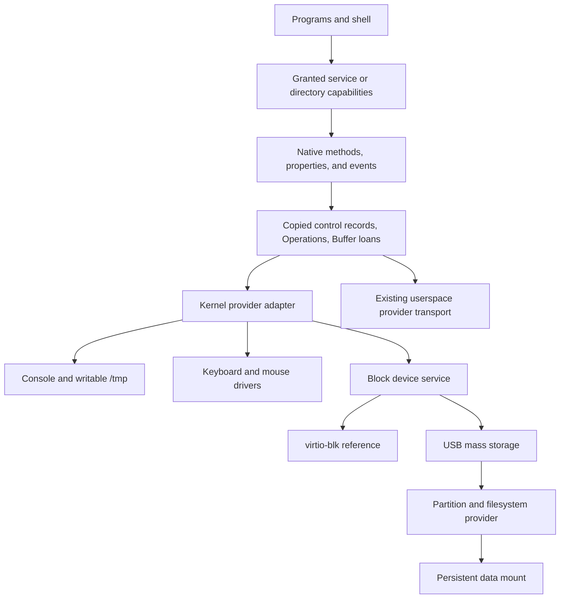
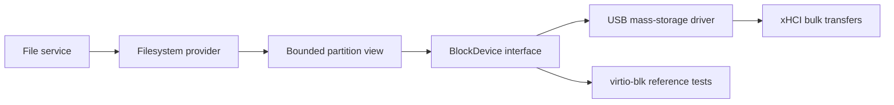

# Native API service roadmap

This roadmap connects the implemented Native API to writable storage and device services.
Source baseline: `5da388a67355a614014bf04f7c7c3197a77b715a`, reviewed on 2026-11-05.
The user selected an in-memory filesystem at `/tmp` and kernel-resident hardware drivers for these milestones.
Except for the linked Console v1 profile, the interfaces below remain proposed contracts without assigned ABI records.

## Current foundation and gaps

| Area | Implemented | Work still needed |
| --- | --- | --- |
| Object authority | Process descriptors, rights, shared open instances, explicit launch grants | Service-specific method policy and scoped discovery |
| Calls | Copied sync/async requests, retained Operations, reply receipts, peer failure, kernel Console dispatch | Kernel Buffer borrowing and additional service protocols |
| Events | Bounded volatile broadcast subscriptions, future events only, unsubscribe, drop reporting | Device-state recovery after loss and device removal |
| Shared state | Independent sessions and bounded admission; class-controlled Counter singleton | Reusable service bootstrap and lifecycle beyond the scoped Counter example |
| Typed metadata | Offline interfaces; bounded rich constructor/method inputs and CLI conversion | Stable service schemas; broader output/event descriptions and generated bindings later |
| Bulk data | Exclusive zero-copy Buffer loans, returned input identity, distinct output objects | Kernel-service integration; separate DMA ownership and quiescence rules for devices |
| Files | Immutable initrd, per-open cursors, capability-relative lookup and enumeration | Writable nodes, mutation rights, mounts, quotas, and persistent storage |
| Devices | Internal block requests; xHCI boot-keyboard input | Native device endpoints, usable mouse events, USB storage, broader hardware qualification |

The descriptor decision no longer blocks VFS, sockets, PTYs, or redirection at the foundational level.
Each subsystem still needs its own semantic contract and implementation.
The [ABI index](README.md#implemented-profiles) identifies the current transport and resource contracts.

Current constraints affect service design:

- One user thread runs per process. Kernel services must still handle concurrent clients and SMP completion.
- IPC control payloads are bounded at 256 bytes. Larger data requires Buffer ranges or bounded enumeration batches.
- Capability and Buffer envelopes are separate. No combined envelope is currently defined.
- A borrowed Buffer cannot enter another Operation. Transparent forwarding through userspace filesystem and block services therefore needs additional design.
- Buffers contain at most 64 KiB. A receiver gains access to the whole Buffer, even when a method names a smaller range.
- Request attachments allow only strictly newer client connections than the carrying connection.
- Provider endpoints, Operations, and subscriptions cannot travel as ordinary capability attachments.
- Session quotas include retained results and subscriptions. Closing a client does not immediately refund every retained resource.
- Timeout ends a wait. It does not cancel accepted work or prove that a mutation did not occur.

The [capability rules](abi/shared-activation-abi.md#copied-capability-attachments) constrain arbitrary callbacks and service graphs.
The first service examples must prove their actual connection topology within these rules.
A combined attachment envelope is needed only when a concrete operation requires both kinds simultaneously.
General graph transfer must not become an implicit requirement for simple file operations.
The proposed first filesystem providers run in the kernel alongside their driver adapters.
Internal filesystem-to-driver work can retain one top-level loan until all accesses end, without a second cross-process loan.
Do not add hidden payload copies to work around unsupported forwarding.
Use dedicated Buffers when a smaller authorized data range must remain isolated from unrelated bytes.

## Shared service foundation

The first kernel-hosted adapter now exposes [Console v1](abi/kernel-console-abi.md).
It binds existing console grants and dispatches copied requests through one bounded worker queue.
General service discovery, kernel Buffer borrowing, and broader lifecycle control remain planned.
Keep hardware drivers in the kernel, as selected by the user.
Native object interfaces describe the public boundary; they do not require a process boundary for every driver.
Existing user providers retain their current transport.

| Contract | Proposed first scope |
| --- | --- |
| Dispatch | Same interface/member identity, bounded records, Operations, and error classification for kernel and user providers |
| Authorization | Granted endpoint plus method-specific authority; metadata descriptions never grant access |
| Bootstrap | Explicit service-directory capability passed by trusted startup; scoped lookup returns attenuated client capabilities |
| Construction | Class code selects new or existing object identity; each client receives independently authorized session state |
| Publication | Publish only initialized services; distinguish unavailable, ready, stopping, and removed states |
| Lifetime | Accepted requests retain service, session, and Buffer references until access ends |
| Scheduling | Defer blocking driver work and completion delivery outside IRQ context and global IPC/table locks |
| Compatibility | Existing descriptor operations remain usable while native interfaces are introduced incrementally |

Start with a fixed registration table for the required services.
Do not require a universal class registry, a reflective loader, or a new shell language.
A service name alone must not bypass the caller's directory grant.
Limit registration, replacement, shutdown, raw storage access, and input injection to explicit control authority.
Specify per-client and aggregate quotas before publication.
Kernel services can use compiled interface descriptions; separate driver ELF files are not required for this first boundary.
Endpoint interface/version checks and offline schema validation must agree.

Current Buffer borrowing identifies a provider process.
The kernel adapter needs an explicit internal borrower lifetime instead of impersonating an unrelated user process.
It must retain revocation, access completion, and failure cleanup before restoring caller authority.

A duplicated file reference shares its open cursor; a separate open creates separate cursor state.
A new service session does not automatically mean a new underlying object.
Construction failure, parameter conflicts, service shutdown, and restart must have explicit results.
Do not replay failed mutating calls automatically: their outcome can be unknown.

Acceptance: two processes use one kernel service through sync and async calls.
Verify denied methods, quota exhaustion, retained completion, close races, failure rollback, and SMP wakeups.
Use handwritten C++ wrappers and fixed metadata first.
Keep illustrative SDK syntax separate from compiled examples.

## Milestone 1: writable RAM filesystem

Implement an in-memory filesystem at `/tmp`, not a block device formatted with another filesystem.
This is the selected meaning of the temporary RAM disk.
Its contents disappear on reboot; it makes no durability promise.
Keep the initrd immutable.

| Surface | Required semantics |
| --- | --- |
| Directory methods | Create, open, enumerate, remove, and rename within granted namespace authority |
| File methods | Read, write, seek, truncate, and inspect size/type |
| Open state | Independent cursors for separate opens; shared cursors for duplicates |
| Mutation authority | Separate read, create, write, remove, and rename authorization; define descendant-grant ceilings |
| Namespace behavior | Define atomic create/rename, concurrent enumeration, and open-file behavior after unlink |
| Storage bounds | Explicit byte/node/open-instance quotas; checked offsets, lengths, and allocation arithmetic |
| Delivery | Partial progress and cursor updates follow successful delivery; failures preserve defined state |
| Bulk I/O | Copied small requests and exclusive Buffer ranges for larger transfers |
| Mount integration | Trusted startup mounts `/tmp`; child root/cwd grants retain existing confinement rules |

Define whether sparse writes zero-fill gaps and when quota charges are released.
An unlinked open file must remain valid until its last retained reference ends.
For the first slice, propose disabling execution from `/tmp`.
Writable executable loading requires a separate immutable-image or snapshot contract.
This restriction remains a proposal until the implementation plan fixes its scope.

Acceptance: create, write, read, list, rename, truncate, and remove through native service clients.
Test two clients, access denial, quota exhaustion, allocation failure, unlink with open handles, and teardown during accepted I/O.
Reboot must clear `/tmp`; initrd contents must remain unchanged.
The same demo must run through UEFI and BIOS smokes.

## Milestone 2: keyboard and mouse services

Qualify the existing USB keyboard path and expose usable input objects.
[Issue #27](https://github.com/idevtm/os1/issues/27) remains the physical keyboard investigation.
Firmware input success does not establish kernel controller support.
Record the controller, USB topology, keyboard identity, and image revision before choosing a controller-specific fix.

Current xHCI code decodes keyboard reports into console characters.
Its mouse handler only counts reports; it does not deliver useful pointer input.
See [xHCI](../../src/kernel/drivers/usb/xhci.cpp) and [keyboard decoding](../../src/kernel/drivers/usb/hid_keyboard.cpp).

| Surface | Proposed first scope |
| --- | --- |
| Properties | Device identity, availability, supported input classes, current key/button state |
| Events | Key press/release, modifiers, pointer movement, buttons, and wheel where supported |
| Delivery | Volatile broadcast; every subscriber receives future events within its queue limits |
| Recovery | Sequence/drop indication plus a state snapshot with a defined synchronization boundary |
| Removal | Terminal device-state notification and a defined result for pending calls |
| Authority | Input-read grants separate from configuration and synthetic input injection |

Keep these events simple and volatile, as previously approved.
Unsubscribe must remain available; competing-consumer delivery is not required.
After event loss, clients must recover pressed-state consistency instead of retaining a stuck key or button.
Relative pointer movement can be lost; report that loss rather than inventing recovered movement.
The state-snapshot protocol must cover events racing with snapshot delivery.

The console consumes keyboard input through this service boundary.
A small event-printing client can validate mouse input without a compositor.
Acceptance includes independent subscribers, unsubscribe, overflow recovery, device removal, and console typing.
QEMU coverage complements physical tests; it does not close issue #27 by itself.
Controller and hub expansion depend on the identified hardware, not assumptions about its age.

## Milestone 3: persistent USB data

A persistent writable data partition needs more than writable file methods.
Keep the filesystem choice open until interoperability, metadata, recovery, and implementation-cost requirements are agreed.
Choose a dedicated data partition; do not mount the boot filesystem writable by default.

### Block contract and reference driver

Expose geometry, limits, Read, Write, and Flush through a native BlockDevice interface.
Define alignment, bounds, partial progress, queue limits, write ordering, and durable completion.
Current [block requests](../../src/kernel/storage/block_device.hpp) include Flush, but
[virtio-blk](../../src/kernel/drivers/block/virtio_blk.cpp) rejects it.
Successful current Write completion therefore does not promise durable storage.

Use virtio-blk to validate the contract before physical USB tests.
Keep raw write and partition-management authority separate from ordinary file access.
A partition view must validate every range against its own bounds.

Exclusive IPC Buffer ownership alone does not make memory safe for DMA.
Specify pinning, device access, cache synchronization, and completion ownership separately.
The device must stop accessing pages before the kernel restores caller mappings or releases those pages.
Timeout and unplug must not create use-after-free or premature Buffer return.
Keep IPC payload handoff zero-copy; any required driver bounce buffer must be explicit and measured.
Do not promise end-to-end zero-copy for hardware that cannot consume the supplied pages.

### USB transport and partition access

Add bounded bulk transfers and a USB mass-storage class driver.
Proposed first scope: Bulk-Only Transport with the required SCSI command subset.
Include identification, capacity, reads, writes, cache synchronization where supported, and command-status validation.
Define command recovery, unsupported capabilities, unplug behavior, and reconnect identity.
A reconnected device must not silently inherit outstanding authority from a removed device.

A direct root-port device can be the initial support target.
General hubs, UAS, AHCI, and NVMe are not prerequisites for that limited milestone.
Expand the controller or topology scope when actual hardware requires it.
Select and validate the supported partition-table format before physical writes.
Reject malformed, overlapping, overflowing, or boot-overlapping data ranges.

### Filesystem and durable behavior

Select the filesystem before implementing its disk format.
Decision criteria include host interoperability, size limits, permissions, crash recovery, and repair tooling.
First validate read-only mounting and malformed-media rejection.
Then add writes with explicit ordering, Flush behavior, and recovery expectations.
Do not equate a successful filesystem call with durable storage unless the contract promises it.
Do not format media automatically after a mount failure.

Acceptance: create and modify files, flush, unmount, reboot, and read the same contents.
Add controlled interruption tests consistent with the chosen filesystem's stated guarantees.
Verify bounds, full media, I/O errors, removal during I/O, and clean rollback before physical write qualification.

### Preserve data during image updates

The current USB menu writes a complete boot image, including its partition table.
Preserving the boot layout does not establish preservation of a future data partition.

Before storing valued data, add a partition-aware update mode.
It must preserve data-partition entries and contents while replacing only supported boot payloads.
Keep initial formatting separate from routine kernel/initrd updates.
Test a sentinel file across updates and subsequent boots.
Document which existing layouts support safe updates; reject incompatible layouts before writing.

## Other GOALS dependencies

| GOALS area | Native API dependency | Independent work still required |
| --- | --- | --- |
| Writable VFS and persistence | Kernel provider adapter, file/directory mutation, Buffer I/O, block failure contract | Filesystem implementation, USB storage, partition parsing, durable writes |
| Shell redirection and pipelines | Writable streams, pipe endpoint semantics, readiness, close/EOF behavior | Shell syntax and process orchestration; generated bindings are unnecessary |
| Networking and sockets | Endpoint interfaces, packet ownership, backpressure, deadlines and cancellation semantics | IP/UDP/TCP, addressing, DNS, driver buffering |
| PTYs and SSH | Terminal/session objects, streams, process control, credential-aware grants | Authentication, cryptography, entropy, permissions, network stack |
| Input and compositor | Input events, recovery snapshots, display authority | Mouse decoding, hardware qualification, rendering and focus policy |
| Service supervision | Scoped bootstrap/discovery, readiness, lifetime and restart outcomes | Supervisor policy and process cleanup |
| SMP and reliability | New services must obey existing lifetime, wait, and lock rules | IRQ affinity, lock-order checks, process reclamation, remaining hardware failures |

[IPC deadlines](abi/counter-events-abi.md) and the [measurement clock](../kernel/measurement-clock-abi.md) already exist.
Networking and device cancellation still need operation-specific guarantees.
Credentials are required before multiuser or remotely exposed services, not before an explicitly granted private `/tmp` demo.
A broad service directory must not make privileged methods available to every process.

## Deferred work and graduation criteria

Generated C++ bindings, client `.so` packaging, general runtime reflection, and the reflective shell remain later tooling work.
Live read-only Buffer aliases, cooperative writers, permanent moves, and shared-memory rings remain deferred transport options.
Userspace drivers require additional DMA, interrupt, device-ownership, and isolation contracts.
None of these extensions blocks the selected kernel-driver milestones.

Each implemented service needs a bounded schema, authority model, lifetime/error contract, runnable client, and failure tests.
Assign numeric layouts in its ABI document only when implementation and checks establish the contract.
Promote individual proposal sections to implemented status with links to source and validation.
This document promotion does not imply ABI stability or approval of every illustrative object in the older catalog.

## Immediate implementation slice

The [kernel console slice](kernel-console-plan.md) establishes dispatch, independent authority, retained completion, and bounded admission.
Next, define writable namespace rights and implement `/tmp` through that boundary.
Add kernel Buffer borrowing when a concrete bulk-data method requires it.
Keyboard diagnosis can proceed independently; input-service integration reuses the same adapter.
Persistent USB data follows the block, partition, durability, and update-preservation contracts above.

## Original roadmap impact assessment and evidence

This section records the earlier documentation-only promotion.
The [console implementation record](kernel-console-plan.md) contains the subsequent runtime impact and validation.

| Area | Assessment |
| --- | --- |
| Scope | Aligns GOALS “Native system interface”, “Storage and filesystems”, “Driver model”, and Milestones D–G with concrete vertical slices. |
| Architecture | Clarifies existing descriptor/IPC paths and the proposed kernel service adapter; changes no runtime responsibility today. |
| Boot/platform | Both boot paths remain unchanged. Future persistent data requires partition-aware updates; current hardware evidence remains limited. |
| Memory/isolation | Records Buffer/DMA lifetime, grants, quotas, and writable namespace limits; no allocator or mapping code changes. |
| Concurrency | Records SMP service completion, lock boundaries, event races, and timeout limits; no scheduler or IRQ changes. |
| Interfaces | Promotes document locations and status; assigns no new syscall, wire record, or numeric right. |
| Resources | Runtime latency, memory, image size, and disk I/O are unchanged by this documentation-only task. No new benchmark is appropriate. |
| Validation | Source checks, local-link validation, historical-evidence preservation, and independent review; no kernel build or QEMU run for documentation alone. |

The user reports successful fresh-image boot and repeated `buffercheck` completion on the ASUS laptop.
This supports that tested boot path; it does not qualify every controller or resolve the earlier firmware failure's cause.
The photographed measurements use HPET and distinguish copied calls from Buffer calls.
They are not a pure memory-copy comparison because large copied operations require multiple IPC calls.
No new numerical benchmark claim or exact image-hash attribution is made here.

The complete ASD-STE100 Issue 9 standard and dictionary were unavailable for this review.
Prose was checked against the repository's stated rules; full standard compliance is not established.
