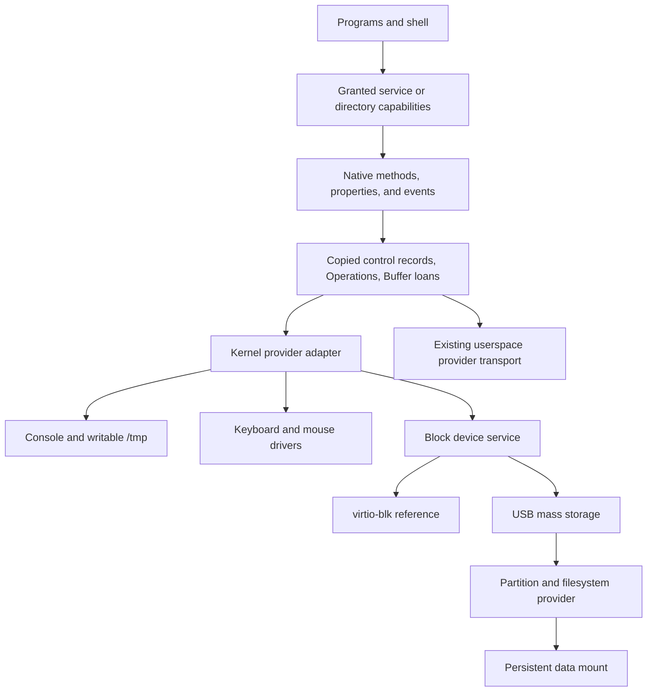
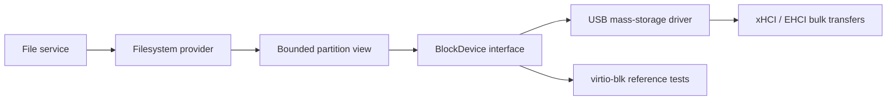

# Native API service roadmap

This roadmap connects the implemented Native API to writable storage and device services.
Original review baseline: `535ee54951b68c9858bf32b7577d4f121a64ab57`, reviewed on 2026-11-06.
The [project review](../reviews/2026-11-06-review.md) records evidence and remaining risks.
The 2026-11-08 status update includes merged PRs 35–40 and the proposed context and diagnostic work below.
Milestone numbers below retain their original design order; they do not imply unfinished storage implementation.
The user selected an in-memory filesystem at `/tmp` and kernel-resident hardware drivers for these milestones.
Console v1 and [Directory/File v1](abi/tmpfs-abi.md) now have implemented ABI records.
Other service interfaces below remain proposed contracts.

## Current foundation and gaps

| Area | Implemented | Work still needed |
| --- | --- | --- |
| Object authority | Process descriptors, rights, shared open instances, explicit launch grants | Service-specific method policy and scoped discovery |
| Calls | Copied sync/async requests, retained Operations, reply receipts, peer failure, kernel Console and filesystem dispatch | Kernel Buffer borrowing and additional service protocols |
| Events | Bounded volatile broadcast subscriptions, future events only, unsubscribe, drop reporting | Device-state recovery after loss and device removal |
| Shared state | Independent sessions and bounded admission; class-controlled Counter singleton | Reusable service bootstrap and lifecycle beyond the scoped Counter example |
| Typed metadata | Offline interfaces; bounded rich constructor/method inputs and CLI conversion | Stable service schemas; broader output/event descriptions and generated bindings later |
| Bulk data | Exclusive zero-copy Buffer loans, returned input identity, distinct output objects | Kernel-service integration; separate DMA ownership and quiescence rules for devices |
| Files | Immutable initrd, writable `/tmp`, persistent ext2, disk execution, native mutation, and capability-relative lookup | Kernel Buffer transfers, public mounts, larger ext2 profiles, and broader physical qualification |
| Devices | Internal block requests; xHCI keyboard/storage; EHCI storage and bounded high-speed hubs | Native device endpoints, usable mouse events, keyboard diagnosis, and broader hardware qualification |

The descriptor decision no longer blocks VFS, sockets, PTYs, or redirection at the foundational level.
Each subsystem still needs its own semantic contract and implementation.
The [ABI index](README.md#implemented-profiles) identifies the current transport and resource contracts.

Current constraints affect service design:

- One user thread runs per process. Kernel services must still handle concurrent clients and SMP completion.
- IPC control payloads are bounded at 256 bytes. Larger data requires Buffer ranges or bounded enumeration batches.
- Capability and Buffer envelopes are separate. No combined envelope is currently defined.
- A borrowed Buffer cannot enter another Operation. Transparent forwarding through userspace filesystem and block services therefore needs additional design.
- Buffers contain at most 64 KiB. A receiver gains access to the whole Buffer, even when a method names a smaller range.
- Request attachments allow only strictly newer client connections than the carrying connection.
- Provider endpoints, Operations, and subscriptions cannot travel as ordinary capability attachments.
- Session quotas include retained results and subscriptions. Closing a client does not immediately refund every retained resource.
- Timeout ends a wait. It does not cancel accepted work or prove that a mutation did not occur.

The [capability rules](abi/shared-activation-abi.md#copied-capability-attachments) constrain arbitrary callbacks and service graphs.
The first service examples must prove their actual connection topology within these rules.
A combined attachment envelope is needed only when a concrete operation requires both kinds simultaneously.
General graph transfer must not become an implicit requirement for simple file operations.
The tmpfs and ext2 providers run in the kernel through the same native adapter.
Internal filesystem-to-driver work can retain one top-level loan until all accesses end, without a second cross-process loan.
Do not add hidden payload copies to work around unsupported forwarding.
Use dedicated Buffers when a smaller authorized data range must remain isolated from unrelated bytes.

## Reflective hierarchy and shell context

Option B was selected on 2026-11-07.
The [hierarchy proposal](object-hierarchy.md) records roots, environment inheritance, discovery, and remaining decisions.
The [shell command proposal](../shell/object-commands.md) records separate syntax choices and short bindings.
The accepted [file utility profile](../shell/file-utilities.md) stages basic tools, recursive/search/metadata tools, then deferred permissions and links.
The [first stage](../shell/typed-context.md) implements native rooted lookup, retained cwd, and same-filesystem moves.
Metadata, traversal, recursive operations, text utilities, the pager, timestamps, and system lifecycle control are now implemented.
Permissions and links remain deferred.

| Stage | Scope |
| --- | --- |
| First context slice, implemented | Typed path, validated cwd, explicit stream grants, independent child state, and fixed filesystem bindings |
| Reflection, proposed | Bounded type descriptions, child enumeration, explicit acquisition, and output schemas |
| Broader services, proposed | Dynamic registration, device interfaces, and application resource contexts |

The minimal initrd and disk-program split is implemented; see its [record](../archive/filesystems/2026-11-06-minimal-initrd.md).
Current search defaults to `/bin`, then `/disk/bin`; local typed path operations can change the inherited list.
Startup ABI version 3 carries the typed context; no text `PATH` mirror is introduced.
The selected environment contains inherited plain data; capabilities remain separate explicit grants.
Existing service and hardware work does not require a complete reflective shell.

## Shared service foundation

The first kernel-hosted adapter now exposes [Console v1](abi/kernel-console-abi.md).
It binds existing console grants and dispatches copied requests through one bounded worker queue.
General service discovery, kernel Buffer borrowing, and service supervision remain planned.
System synchronization, shutdown, reboot, and top-level shell restart are implemented.
Keep hardware drivers in the kernel, as selected by the user.
Native object interfaces describe the public boundary; they do not require a process boundary for every driver.
Existing user providers retain their current transport.

| Contract | Proposed first scope |
| --- | --- |
| Dispatch | Same interface/member identity, bounded records, Operations, and error classification for kernel and user providers |
| Authorization | Granted endpoint plus method-specific authority; metadata descriptions never grant access |
| Bootstrap | Explicit service-directory capability passed by trusted startup; scoped lookup returns attenuated client capabilities |
| Construction | Class code selects new or existing object identity; each client receives independently authorized session state |
| Publication | Publish only initialized services; distinguish unavailable, ready, stopping, and removed states |
| Lifetime | Accepted requests retain service, session, and Buffer references until access ends |
| Scheduling | Defer blocking driver work and completion delivery outside IRQ context and global IPC/table locks |
| Compatibility | Existing descriptor operations remain usable while native interfaces are introduced incrementally |

Start with a fixed registration table for the required services.
Do not require a universal class registry, a reflective loader, or a new shell language.
A service name alone must not bypass the caller's directory grant.
Limit registration, replacement, shutdown, raw storage access, and input injection to explicit control authority.
Specify per-client and aggregate quotas before publication.
Kernel services can use compiled interface descriptions; separate driver ELF files are not required for this first boundary.
Endpoint interface/version checks and offline schema validation must agree.

Current Buffer borrowing identifies a provider process.
The kernel adapter needs an explicit internal borrower lifetime instead of impersonating an unrelated user process.
It must retain revocation, access completion, and failure cleanup before restoring caller authority.

A duplicated file reference shares its open cursor; a separate open creates separate cursor state.
A new service session does not automatically mean a new underlying object.
Construction failure, parameter conflicts, service shutdown, and restart must have explicit results.
Do not replay failed mutating calls automatically: their outcome can be unknown.

Acceptance: two processes use one kernel service through sync and async calls.
Verify denied methods, quota exhaustion, retained completion, close races, failure rollback, and SMP wakeups.
Use handwritten C++ wrappers and fixed metadata first.
Keep illustrative SDK syntax separate from compiled examples.

## Milestone 1: writable RAM filesystem

The bounded copied-transfer slice is implemented; [its ABI](abi/tmpfs-abi.md) defines current behavior.
The [implementation record](../archive/filesystems/2026-11-06-tmpfs-implementation.md) records tests and costs.
Exclusive Buffer transfers remain deferred, so the bulk-I/O row below is not complete.

Implement an in-memory filesystem at `/tmp`, not a block device formatted with another filesystem.
This is the selected meaning of the temporary RAM disk.
Its contents disappear on reboot; it makes no durability promise.
Keep the initrd immutable.

| Surface | Required semantics |
| --- | --- |
| Directory methods | Create, open, enumerate, remove, and rename within granted namespace authority |
| File methods | Read, write, seek, truncate, and inspect size/type |
| Open state | Independent cursors for separate opens; shared cursors for duplicates |
| Mutation authority | Separate read, create, write, remove, and rename authorization; define descendant-grant ceilings |
| Namespace behavior | Define atomic create/rename, concurrent enumeration, and open-file behavior after unlink |
| Storage bounds | Explicit byte/node/open-instance quotas; checked offsets, lengths, and allocation arithmetic |
| Delivery | Partial progress and cursor updates follow successful delivery; failures preserve defined state |
| Bulk I/O | Copied small requests and exclusive Buffer ranges for larger transfers |
| Mount integration | Trusted startup mounts `/tmp`; child root/cwd grants retain existing confinement rules |

Implemented sparse writes zero-fill gaps; final release refunds unlinked-node and data charges.
Unlinked files remain valid while retained references exist.
Execution from `/tmp` is disabled. The ext2 profile uses immutable executable files and stable snapshots; mutable executable loading remains outside this profile.

Acceptance: create, write, read, list, rename, truncate, and remove through native service clients.
Test two clients, access denial, quota exhaustion, allocation failure, unlink with open handles, and teardown during accepted I/O.
Reboot must clear `/tmp`; initrd contents must remain unchanged.
The same demo must run through UEFI and BIOS smokes.

## Milestone 2: keyboard and mouse services

Qualify the existing USB keyboard path and expose usable input objects.
[Issue #27](https://github.com/idevtm/os1/issues/27) is closed after the user confirmed keyboard input on 2026-11-06.
The affected desktop uses a Gigabyte H81M-S1 and Lenovo keyboard `17ef:6190`.
PR 33 corrects firmware ownership, Intel port routing, and control-transfer construction.
The [acceptance record](../archive/filesystems/2026-11-06-minimal-initrd.md#keyboard-hardware-acceptance) records the physical result and its limits.

Current xHCI code decodes keyboard reports into console characters.
Its mouse handler only counts reports; it does not deliver useful pointer input.
See [xHCI](../../src/kernel/drivers/usb/xhci.cpp) and [keyboard decoding](../../src/kernel/drivers/usb/hid_keyboard.cpp).

| Surface | Proposed first scope |
| --- | --- |
| Properties | Device identity, availability, supported input classes, current key/button state |
| Events | Key press/release, modifiers, pointer movement, buttons, and wheel where supported |
| Delivery | Volatile broadcast; every subscriber receives future events within its queue limits |
| Recovery | Sequence/drop indication plus a state snapshot with a defined synchronization boundary |
| Removal | Terminal device-state notification and a defined result for pending calls |
| Authority | Input-read grants separate from configuration and synthetic input injection |

Keep these events simple and volatile, as previously approved.
Unsubscribe must remain available; competing-consumer delivery is not required.
After event loss, clients must recover pressed-state consistency instead of retaining a stuck key or button.
Relative pointer movement can be lost; report that loss rather than inventing recovered movement.
The state-snapshot protocol must cover events racing with snapshot delivery.

The console consumes keyboard input through this service boundary.
A small event-printing client can validate mouse input without a compositor.
Acceptance includes independent subscribers, unsubscribe, overflow recovery, device removal, and console typing.
QEMU coverage complements physical tests; it does not close issue #27 by itself.
Controller and hub expansion depend on the identified hardware, not assumptions about its age.

## Milestone 3: persistent USB data

A persistent writable data partition needs more than writable file methods.
Ext2 is selected for the first persistence slice. The [QEMU profile](../filesystems/ext2.md) is implemented.
[USB transport](../hardware/usb-storage.md) now passes QEMU persistence, deployment, and removal checks.
Managed boot/data creation and preserving updates are implemented in the [USB menu](../hardware/usb-image-workflow.md).
One Asus EHCI hub path now has mounting and user-reported reboot-persistence evidence.
Broader physical failure testing and update-preservation qualification remain pending.
Choose a dedicated data partition; do not mount the boot filesystem writable by default.

### Block contract and reference driver

Propose a native `BlockDevice` interface with `info`, `read`, `write`, and `flush`.
These names define design scope; no public BlockDevice ABI is implemented yet.
Define alignment, bounds, partial progress, queue limits, write ordering, and durable completion.
The internal [block facade](../../src/kernel/storage/block_device.hpp) supports bounded reads, writes, and Flush.
The virtio reference driver implements Flush; native filesystem `sync` establishes durability.
A public native BlockDevice interface remains planned. USB removal retires the device until reboot.

Use virtio-blk to validate the contract before physical USB tests.
Keep raw write and partition-management authority separate from ordinary file access.
A partition view must validate every range against its own bounds.

Exclusive IPC Buffer ownership alone does not make memory safe for DMA.
Specify pinning, device access, cache synchronization, and completion ownership separately.
The device must stop accessing pages before the kernel restores caller mappings or releases those pages.
Timeout and unplug must not create use-after-free or premature Buffer return.
Keep IPC payload handoff zero-copy; any required driver bounce buffer must be explicit and measured.
Do not promise end-to-end zero-copy for hardware that cannot consume the supplied pages.

### USB transport and partition access

The implemented first scope uses Bulk-Only Transport with bounded bulk transfers and a SCSI command subset.
It requires writable 512-byte media and successful cache synchronization, or explicit write-through evidence after an unsupported initialization flush.
Status validation, bounded recovery, and device retirement handle failed requests.
Reconnect requires reboot and cannot restore old handles.
A reconnected device must not silently inherit outstanding authority from a removed device.

A direct root-port device can be the initial support target.
General hubs, UAS, AHCI, and NVMe are not prerequisites for that limited milestone.
EHCI now adds bounded high-speed hub discovery for USB 2 storage.
Its [implementation record](../archive/filesystems/2026-11-06-ehci-storage.md) records host/QEMU coverage.
The [Asus G74SX test](../archive/filesystems/2026-11-06-usb-hardware-validation.md) confirms one physical hub path and user-reported reboot persistence.
Expand the controller or topology scope when actual hardware requires it.
Select and validate the supported partition-table format before physical writes.
Reject malformed, overlapping, overflowing, or boot-overlapping data ranges.

### Filesystem and durable behavior

The implemented ext2 profile validates its supported format before mounting.
It supports writable files, disk-backed executables, explicit synchronization, and clean reboot persistence.
Its tests cover malformed media, allocation limits, I/O errors, and firmware-specific mappings.
General ext2 layouts and journal recovery remain outside this profile.
USB removal tests pass in QEMU; physical failure qualification remains pending.
Do not equate a successful filesystem call with durable storage unless the contract promises it.
Do not format media automatically after a mount failure.

Acceptance: create and modify files, flush, unmount, reboot, and read the same contents.
Add controlled interruption tests consistent with the chosen filesystem's stated guarantees.
Verify bounds, full media, I/O errors, removal during I/O, and clean rollback before physical write qualification.

### Preserve data during image updates

[Offline QEMU deployment](../filesystems/program-deployment.md) updates listed programs while preserving other files.
It requires a stopped guest and publishes a validated image copy.
The USB workflow uses the same validator on a snapshot before bounded physical writes.

The USB menu separates initial creation from boot updates, program deployment, and combined updates.
It accepts only its versioned managed layout and retains a backup before writing.

Boot updates preserve all data bytes. Program deployment preserves unlisted files and supported inode metadata.
Tests verify sentinel files across updates and subsequent BIOS/UEFI boots.
Foreign layouts are rejected; raw-device writes are not power-loss atomic.
Qualify the workflow on physical devices before treating QEMU evidence as hardware validation.

## Other GOALS dependencies

| GOALS area | Native API dependency | Independent work still required |
| --- | --- | --- |
| Writable VFS and persistence | Console/File/Directory adapter and copied mutations implemented; kernel Buffer I/O and public BlockDevice remain | Bounded ext2 and USB storage implemented; larger layouts, public mounts, and physical update/failure qualification remain |
| Shell and pipelines | File redirection, append, console EOF, and a line editor are [implemented](../shell/interactive-files.md). Pipes still need endpoint semantics and readiness. | Pipeline syntax and process orchestration; generated bindings are unnecessary |
| Networking and sockets | Endpoint interfaces, packet ownership, backpressure, deadlines and cancellation semantics | IP/UDP/TCP, addressing, DNS, driver buffering |
| PTYs and SSH | Terminal/session objects, streams, process control, credential-aware grants | Authentication, cryptography, entropy, permissions, network stack |
| Input and compositor | Input events, recovery snapshots, display authority | Mouse decoding, hardware qualification, rendering and focus policy |
| Service supervision | Scoped bootstrap/discovery, readiness, lifetime and restart outcomes | Supervisor policy and process cleanup |
| SMP and reliability | New services must obey existing lifetime, wait, and lock rules | IRQ affinity, lock-order checks, process reclamation, remaining hardware failures |

[IPC deadlines](abi/counter-events-abi.md) and the [measurement clock](../kernel/measurement-clock-abi.md) already exist.
Networking and device cancellation still need operation-specific guarantees.
Credentials are required before multiuser or remotely exposed services, not before an explicitly granted private `/tmp` demo.
A broad service directory must not make privileged methods available to every process.

## Deferred work and graduation criteria

Generated C++ bindings, client `.so` packaging, general runtime reflection, and the reflective shell remain later tooling work.
Live read-only Buffer aliases, cooperative writers, permanent moves, and shared-memory rings remain deferred transport options.
Userspace drivers require additional DMA, interrupt, device-ownership, and isolation contracts.
None of these extensions blocks the selected kernel-driver milestones.

Each implemented service needs a bounded schema, authority model, lifetime/error contract, runnable client, and failure tests.
Assign numeric layouts in its ABI document only when implementation and checks establish the contract.
Promote individual proposal sections to implemented status with links to source and validation.
This document promotion does not imply ABI stability or approval of every illustrative object in the older catalog.

## Remaining priorities

The selected storage and Console slices are implemented. Input services are the next functional implementation milestone.
This table records priority, acceptance, and dependencies without assigning new ABI numbers.

| Order | Work | Acceptance | Dependency |
| --- | --- | --- | --- |
| 1 | Physical update preservation | An existing user file survives boot-only and program-only updates, synchronization, and reboot; updated code also runs | Existing managed USB tooling; record image hash, disk identity, commands, and results |
| 2 | Minimal initrd and disk programs: implemented | Recovery and disk lookup checks passed; retain physical update acceptance | Typed context and configurable search are implemented; permissions and links remain deferred |
| 3 | Native keyboard/mouse objects | Two clients receive future events; unsubscribe, overflow recovery, removal, and console typing work | Input protocol and kernel adapter event support; controller additions follow observed hardware needs |
| 4 | Service discovery and lifecycle | Startup grants a scoped service directory; lookup attenuates authority; shutdown/restart outcomes remain explicit | Existing capabilities and sessions; prove supported connection topology |
| 5 | Kernel bulk I/O and BlockDevice | A real file/block client uses retained Buffer ranges; failure ends access before ownership returns | Internal kernel borrower lifetime; DMA pinning/quiescence only where device access requires it |
| 6 | Storage growth | A larger validated filesystem preserves files and executables through updates and reboot | Multi-group ext2, directory growth, and deployment-validator changes before using full-stick capacity |
| 7 | Streams and local security | Pipes define readiness/backpressure; credentials and permissions reject unauthorized access | Existing handles and grants; credentials precede multiuser or remote exposure |
| 8 | Networking and remote sessions | IP/UDP/TCP, addressing, DNS, sockets, then PTYs and authenticated SSH sessions | Packet ownership, operation-specific cancellation, entropy/cryptography, and security policy |

Hardware checks can run alongside design and implementation.
Retest the scheduler correction and the revised BIOS staging layout on physical hardware; retain each image identity.
Physical unplug, interrupted updates, and broader USB topology need separate qualification records.
The current ext2 profile has no journal; successful ordinary writes alone do not establish power-loss durability.

Keep drivers in the kernel for these milestones.
Use `snake_case` for methods, properties, and events; types and interfaces may use `UpperCamelCase`.
Class code retains creation policy; clients receive no fresh/shared-instance override.
Input events remain volatile broadcast with explicit unsubscribe and state recovery after loss.

## Context discovery and diagnostics additions

The user requested live context discovery and staged kernel/shell logs on 2026-11-08.
The [design proposal](context-diagnostics.md) records options and acceptance criteria; it assigns no new ABI.

| Addition | Required direction | Proposed first scope |
| --- | --- | --- |
| Live context discovery | Inspect available `os` and `process` members without object creation | Fixed authorized descriptions, bounded child enumeration, and shell completion |
| Kernel diagnostics | Capture system, API, and device records in bounded memory; failures must not stop the system | Structured records, query filters, explicit loss, and command correlation |
| Shell history | Keep timestamped command records in a shell-owned memory ring | Command start/result records and optional filters |
| Staged exports | Kernel: memory, `/tmp`, USB; shell serialization: `/tmp`, USB | Bounded files under `/tmp/log` and `/disk/log`; independent export failures |
| Hardware automation | Correlate commands, kernel work, and device observations | Export build identity, boot identity, clock quality, records, and loss evidence |

The [first memory logging slice](abi/memory-log-abi.md) implements bounded capture and command correlation.
The [fixed discovery slice](context-discovery.md) implements live descriptions and Tab completion.
General provider discovery and staged persistence remain planned.
The existing native input milestone and hardware acceptance remain active.
Keep full API tracing configurable until its overhead and retention costs are measured.

## Immediate implementation slice

Complete physical update acceptance when hardware is available. Issue #27 now has user-confirmed keyboard recovery.
In parallel, define native input records and the snapshot/event synchronization boundary described in [Milestone 2](#milestone-2-keyboard-and-mouse-services).
Implement an event-monitor client before compositor work.
General reflection and generated C++ bindings do not gate this slice.
Add kernel Buffer borrowing for a concrete bulk-data method after the input milestone, unless that method becomes an earlier requirement.

## Original roadmap impact assessment and evidence

This section records the earlier documentation-only promotion.
The [console implementation record](kernel-console-plan.md) contains the subsequent runtime impact and validation.

| Area | Assessment |
| --- | --- |
| Scope | Aligns GOALS “Native system interface”, “Storage and filesystems”, “Driver model”, and Milestones D–G with concrete vertical slices. |
| Architecture | Clarifies existing descriptor/IPC paths and the proposed kernel service adapter; changes no runtime responsibility today. |
| Boot/platform | Both boot paths remain unchanged. Future persistent data requires partition-aware updates; current hardware evidence remains limited. |
| Memory/isolation | Records Buffer/DMA lifetime, grants, quotas, and writable namespace limits; no allocator or mapping code changes. |
| Concurrency | Records SMP service completion, lock boundaries, event races, and timeout limits; no scheduler or IRQ changes. |
| Interfaces | Promotes document locations and status; assigns no new syscall, wire record, or numeric right. |
| Resources | Runtime latency, memory, image size, and disk I/O are unchanged by this documentation-only task. No new benchmark is appropriate. |
| Validation | Source checks, local-link validation, historical-evidence preservation, and independent review; no kernel build or QEMU run for documentation alone. |

The user reports successful fresh-image boot and repeated `buffercheck` completion on the ASUS laptop.
This supports that tested boot path; it does not qualify every controller or resolve the earlier firmware failure's cause.
The photographed measurements use HPET and distinguish copied calls from Buffer calls.
They are not a pure memory-copy comparison because large copied operations require multiple IPC calls.
No new numerical benchmark claim or exact image-hash attribution is made here.

The complete ASD-STE100 Issue 9 standard and dictionary were unavailable for this review.
Prose was checked against the repository's stated rules; full standard compliance is not established.
