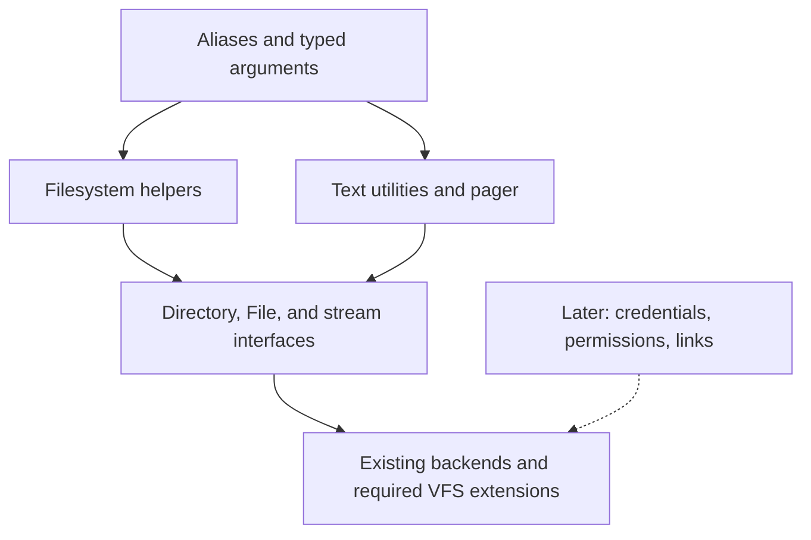

# File utilities and filesystem extensions

The user accepted this minimal command profile on 2026-11-07.
Permissions and links remain deferred to a later stage.
The [first stage](typed-context.md) implements basic context, navigation, and file operations.
The [second stage](filesystem-tools.md) implements metadata, traversal, recursive copy/removal, `find`, and `du`.
The [text utility profile](text-utilities.md) implements line selection, literal search, counts, and bounded file classification.
Timestamps and paging remain accepted direction.
This profile does not claim complete POSIX compatibility.



## Authority and boundaries

The [object-command proposal](object-commands.md) owns aliases, argument binding, copy defaults, and interpretation modes.
The [VFS contract](../native-api/vfs-contract.md) owns resource semantics and capability-relative lookup.
Current ABI profiles continue to define actual behavior until an implementation explicitly extends them.
The shell must not simulate unsupported filesystem guarantees through misleading command names.

`fs` is a local helper object over authorized native interfaces.
`text` and `pager` are user-space utility objects, not new kernel services.
Interactive text fallback remains warned; scripts use strict expressions by default.
Examples below quote literal paths and patterns so they work in either proposed mode.

## Accepted alias catalog

| Alias | Object operation or helper | Initial behavior |
| --- | --- | --- |
| `pwd` | `out.print fs.cwd` | Print current directory |
| `cd` | `fs.change_directory` | Require a path; home shortcuts deferred |
| `ls` | `fs.list` | List immediate children; default to cwd |
| `touch` | `fs.ensure_file`, then timestamp update | Create if absent; update access/modification times when timestamp support exists |
| `cp` | `fs.copy` | Create or replace destination; explicit recursion |
| `cat` | `fs.copy` | Default to append/output; preserve bytes |
| `mv` | `fs.move` | Atomic rename within one filesystem; cross-filesystem moves rejected initially |
| `rm` | `fs.remove_file` | Remove a file name; recursive alias form selects directory removal |
| `mkdir` | `fs.create_directory` | Create one directory; fail if it exists |
| `rmdir` | `fs.remove_directory` | Remove an empty directory |
| `find` | `fs.find` | Recursive name matching and kind filtering |
| `file` | `fs.identify` | Bounded content classification |
| `stat` | `fs.info` | Structured object metadata |
| `du` | `fs.usage` | Allocated storage beneath a path; optional logical size |
| `df` | `fs.space` | Space on the filesystem containing a path |
| `head` | `text.head` | First 10 lines by default |
| `tail` | `text.tail` | Last 10 lines by default |
| `grep` | `text.search` | Case-sensitive literal substring search |
| `wc` | `text.count` | Lines, words, and bytes |
| `less` | `pager.show` | Forward/backward paging and quit |

The table defines behavior, not numeric method IDs or a frozen metadata schema.
Aliases can compose operations or select a helper according to declared options.
A short command must preserve the helper's authority checks, errors, and partial-progress behavior.
Default output uses the invocation stream, including redirection.

## Navigation

Support absolute paths, relative paths, `.`, and `..` through the authorized process filesystem context.
Parent traversal must not escape the granted namespace root or acquire authority absent from the launch grants.
Do not implement parent traversal merely by removing string components before authorization checks.
`cd` validates a directory before replacing the cwd string/reference pair.
A failed change preserves the previous pair.

Cwd retains directory identity across rename.
Reconstruct its displayed path when possible.
If the directory becomes unreachable, report that state instead of presenting an old string as an authoritative path.
Directory removal and retained-reference behavior must remain explicit in the backend contract.
Path reconstruction requires a bounded, authorized native mechanism; names alone cannot establish ancestry.

## Alias options

Short options are declared by aliases and map to typed parameters.
The canonical methods do not need a separate option parser for every utility.

```text
cp -r "source" "destination"
fs.copy "source" "destination" recursive:true

rm -r "directory"
fs.remove_directory "directory" recursive:true
```

For `rm`, the recursive form selects directory-tree removal; the ordinary form removes files.
`rmdir` retains its empty-directory behavior.
Reject unknown options and duplicate parameter assignments.
`--` ends option recognition, allowing literal filenames that begin with `-`.
Alias defaults fill omitted parameters, while explicit options or named arguments supply actual parameter assignments.
An option and a named argument that both assign `recursive` are a duplicate, not an override.

## Copy, move, and recursion

| Concern | Accepted initial behavior |
| --- | --- |
| Existing destination directory | Put the source inside it using the source basename |
| Existing destination file | Replace for `cp` and `mv` |
| File/directory collision | Return an error |
| Recursive copy | Require `recursive:true`; reject copying a directory into its own subtree |
| Recursive removal | Require `recursive:true`; reject removing a namespace root or mount point |
| Mount boundaries | Stay within the starting filesystem during recursive traversal |
| Symbolic links | Do not follow them during recursion when future link support is added |
| Partial failure | Report failure and completed effects; do not claim whole-tree rollback |

Basename placement applies to path or named-file sources.
Anonymous stream sources have no basename; they require a file path or writable stream destination, not a destination directory.
The [copy contract](object-commands.md#copy-and-file-creation) defines path/object combinations and current-position stream behavior.
Prevent same-file source destruction before truncating a destination.
Recursive commands require bounded traversal state and must detect invalid ancestry or cycles.
They cannot obtain additional authority by crossing a path alias or reusing stale enumeration data.

`fs.move` extends rename across directories within the same filesystem.
Publication of the rename must be atomic, including permitted destination replacement.
This is namespace atomicity, not a claim of power-loss durability.
Reject cross-filesystem moves initially; copy-and-delete is a separate, non-atomic operation.
Nonempty destination directories are not implicitly deleted to make a move succeed.

## Metadata and timestamps

Use a common structured metadata result for listing, inspection, search, classification, and usage helpers.

| Field group | Required direction |
| --- | --- |
| Kind and identity | Object kind and stable filesystem-local identity, qualified by filesystem identity |
| Size | Logical byte size and allocated storage |
| Times | Supported timestamps with a defined clock domain and validity |
| Security, deferred | Owner, group, and permission fields when implemented |
| Availability | Explicit supported/unsupported fields; never fabricate values |

An identity token is not authority and must not become a raw pointer or globally trusted handle.
Define reuse and lifetime rules before using identities for recursive traversal or same-file checks.
`fs.identify` uses bounded reads in addition to available metadata; it must not read entire files to classify them.

`touch` composes ensure-file behavior with setting access and modification times to now.
`fs.ensure_file` itself continues to preserve existing file contents without promising timestamp changes.
Timestamp updates need a native mutation operation and a defined wall-clock source.
Until that support exists, the current `touch` remains creation-only and must be documented as limited.
Clock-unavailable behavior and exact timestamp representation belong to the implementation specification.

`du` reports allocated storage below its selected path; logical size is an optional alternative.
`df` reports total, free, and caller-available space for the containing filesystem.
For `/tmp`, report quota-backed capacity, not a fictitious physical disk size.
Accounting must identify its units and supported fields.
Hard-link deduplication becomes necessary only when hard links are implemented.

## Text, search, and pager profile

| Utility | Accepted minimal scope |
| --- | --- |
| `find` | Name patterns with `*` and `?`; file/directory kind filtering |
| `grep` | Literal substring matching, case-sensitive; regular expressions deferred |
| `head` and `tail` | Default 10 lines; one `lines` parameter |
| `wc` | Line, word, and byte counts; ASCII whitespace separates words initially |
| `file` | Known bounded signatures, text, or unknown binary data |
| `less` | Forward/backward paging and quit; search and follow mode deferred |

LF separates lines.
Head/tail selection treats an unterminated final fragment as a line.
The `wc` line count counts newline bytes instead.
Content output preserves bytes; display helpers must not confuse filenames or control characters with terminal commands.
Pattern matching belongs to `find`; no general shell glob expansion is implied.

The pager needs terminal dimensions and explicit ownership of interactive input.
Initially, reject noninteractive use instead of consuming redirected file data as pager commands.
Implement bounded reads and navigation state.
The [pager profile](pager.md) defines implemented controls, input restoration, and text-display escaping.
Other text helpers must process bounded chunks rather than assume every file fits in memory.

## Deferred permissions and links

The user explicitly deferred this stage.
Do not include these commands as working aliases until their required native contracts exist.

| Future alias | Direction |
| --- | --- |
| `chmod` | `fs.set_permissions` |
| `chown` | `fs.set_owner` |
| `ln` | `fs.create_link` |
| `readlink` | `fs.read_link` |

Retain the accepted design direction: user/group IDs and basic owner/group/other permissions first, with ACLs deferred.
Permission checks constrain capability acquisition; permission changes do not silently revoke existing handles.
Ownership changes require explicit authority; environment fields cannot establish caller identity.

Hard links are limited to regular files within one filesystem initially.
Symbolic links store path strings; relative targets resolve from the containing directory.
Bound resolution depth, detect loops, and preserve capability boundaries.
`readlink` returns the stored target without following it.
Current ext2 rejects links; later support requires explicit format validation and lifetime changes.

## Delivery sequence and current gaps

| Stage | Accepted scope |
| --- | --- |
| 1 | Typed context, navigation, aliases, basic file operations, and same-filesystem move |
| 2 | Recursive commands, search, metadata, and text utilities; timestamps and pager can proceed alongside |
| Later | Credentials, permissions, and links |

Current rooted lookup supports parent traversal within granted authority.
Tmpfs and ext2 support same-filesystem cross-directory moves with replacement.
The ext2 profile rejects retained-object removal; tmpfs permits unlinked files to live through open references.
The implemented traversal extension preserves these retained-object rules.
See the [tmpfs ABI](../native-api/abi/tmpfs-abi.md) and [ext2 profile](../filesystems/ext2.md).

The minimal feature choices are settled.
The [traversal profile](filesystem-tools.md) specifies implemented command behavior and resource bounds.
The [text profile](text-utilities.md) specifies implemented streaming behavior and limits.
The [pager profile](pager.md) specifies implemented paging.
Timestamp mutation remains the next implementation stage.
These specifications must preserve the accepted behavior; they are not permission to expand the feature set.
Custom configuration, user-defined aliases, String output methods, general expression operators, and a full scripting language can remain deferred.

## Impact and validation

This profile supports GOALS “Terminal-first operating system,” “Native system interface,” and “Storage and filesystems.”
It extends the direction in ARCHITECTURE “Native objects and OS services.”

| Area | Documentation impact |
| --- | --- |
| Scope | Defines minimal utilities and staged delivery; keeps permissions and links deferred |
| Interfaces | Records required path, rename, metadata, and terminal contracts; assigns no ABI values |
| Memory and isolation | Requires bounded traversal, explicit authority, and retained resource lifetime |
| Concurrency | Distinguishes atomic rename from partial recursive work and crash durability |
| Boot/platform/resources | No executable, firmware, image, allocation, scheduling, or runtime resource changes |
| Validation | Check links, proposal status, current source claims, examples, and independent review |

No runtime measurements or new physical-hardware results are claimed.
Kernel builds, QEMU tests, and benchmarks are unnecessary for this documentation-only change.
Future implementation checks must cover root confinement, retained cwd, rename replacement, recursion boundaries, partial failures, accounting, and terminal recovery.
Unsupported metadata and deferred commands must remain explicit.
