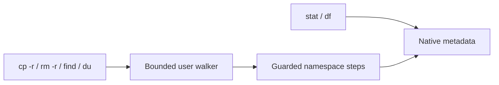

# Metadata and recursive filesystem tools

The shell implements metadata, bounded traversal, recursive copy/removal, `find`, and `du`.
Aliases and canonical methods use the same typed argument binder and native authority checks.



## Commands

| Alias | Canonical method | Parameters and defaults |
| --- | --- | --- |
| `stat` | `fs.info` | Required positional `path` |
| `df` | `fs.space` | Positional `path`, default `.` |
| `find` | `fs.find` | Positional `path`, default `.`; named `name:"*"`, `kind:any` |
| `du` | `fs.usage` | Positional `path`, default `.`; named `logical:false` |
| `cp -r` | `fs.copy` | Positional `source`, `destination`; named `recursive:true`, `mode:replace` |
| `rm -r` | `fs.remove_directory` | Required positional `path`; named `recursive:true` |

`find` accepts `kind:any`, `kind:file`, and `kind:directory`.
Patterns match basenames with `*` and `?`; matching is case-sensitive.
The starting object participates in matching and usage accounting.
There is no general shell glob expansion or regular expression support.
`rmdir` continues to remove empty directories only.

```text
stat "/tmp/note"
find "/disk" name:"*.txt" kind:file
fs.find "/tmp" kind:directory
cp -r destination:"/disk/backup" "/tmp/work"
fs.copy "/tmp/work" "/disk/backup" recursive:true
rm -r "/tmp/work"
du "/disk/backup"
fs.usage "/disk/backup" logical:true
df "/disk"
```

Named arguments can occur before or after positional arguments.
Positional slots retain their declared order; named assignments do not shift those slots.
`-r` assigns the Boolean `recursive` parameter only for `cp` and `rm`.
Duplicate assignments and unknown options fail before execution.
`--` ends option recognition.
Quoted paths work in both interactive and strict script modes.
Interactive unresolved text still produces a warning; strict scripts reject it.

## Output and accounting

All commands use the invocation output stream, including redirection.
`stat` prints labeled metadata fields.
`df` prints filesystem identity, total bytes, free bytes, and available bytes.
`find` prints one matched path per line.
`du` prints the selected byte count and path.
Output occurs in both interactive and script modes for these explicit commands.
Display paths escape whitespace, backslashes, and control bytes as `\xNN`.
File copy preserves content bytes.

The [native metadata ABI](../native-api/abi/filesystem-metadata-abi.md) defines exact fields and accounting.
Allocated usage includes ext2 directory and indirect blocks, but excludes tmpfs kernel-object overhead.
Initrd allocated usage is unsupported; use `logical:true` to count its file lengths.
Tmpfs `df` reports its data-page quota.
The [timestamp ABI](../native-api/abi/filesystem-times-abi.md) adds times and complete create-or-update `touch` behavior.
Permissions and ownership remain unsupported.

## Traversal and mutation limits

The walker holds at most 16 directory levels and visits at most 4096 objects.
Display paths have a 4096-byte limit.
Current shell input and backend limits can be smaller.
Each frame retains source and optional destination handles; frame storage is bounded.
File copy uses a 4096-byte buffer.
Traversal stays within the starting filesystem and does not follow future links.
A namespace-root search therefore excludes `/tmp` and `/disk`; select each mount explicitly.

An existing destination directory receives the source basename.
Recursive copies merge directories and replace destination files by default.
File/directory collisions fail.
Explicit `mode:append` appends file content.
Copies reject same-object destinations and destinations inside the source tree.
Copy redirection checks the retained source before truncation, including files inside a recursive source tree.
Copies create writable data files; they do not copy executable authority or future permission metadata.

Recursive removal requires a directory and rejects namespace roots and mount points.
It removes children before their parent.
Other retained ext2 references can prevent removal.
Tmpfs retains unlinked objects until their final reference closes.

The walker rejects stale namespace generations instead of reusing changed names.
Any concurrent namespace change can stop a command, including changes outside its tree.
File contents and accounting are not a whole-tree snapshot.
On error, the command reports visited objects, completed actions, and processed bytes.
Creation and completed file copies count as separate actions.
These counts describe confirmed progress; failed result delivery can leave an additional published creation.
Earlier effects remain; no automatic rollback or replay occurs.
For `du`, a failure reports partial accounting on the error stream instead of printing a complete total.

## Validation and remaining work

The [implementation record](../archive/shell/2026-11-07-filesystem-traversal.md) records checks, measurements, and independent review.
Tests cover BIOS and UEFI, persistent files, partial quota failure, subtree rejection, and depth limits.
Host tests cover authority, identity, stale names, sparse accounting, indirect blocks, and pointer faults.
Hardware behavior remains unmeasured for this stage.
The [text tools](text-utilities.md) implement line selection, literal search, counts, and classification.
Timestamps and the pager remain in the [accepted utility plan](file-utilities.md).
Permissions and links remain deferred.
