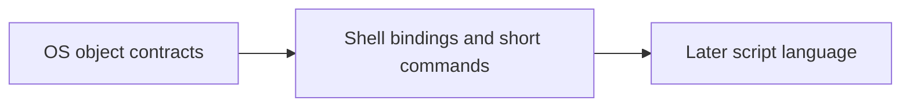

# os1 Shell Language and Runtime Profile

Status: revised later-stage proposal, 2026-11-07. **Illustrative language and API
syntax; the full reflective runtime and language ABI are not implemented.**

The [native contract](../native-api/object-contract.md) owns resource, authority,
process, and service semantics. The [VFS profile](../native-api/vfs-contract.md)
defines namespace behavior; the [ELF profile](../native-api/elf-interface.md) separates
image descriptions from executable loading and service invocation. Implement
the language after the implemented descriptor, console, launch, initrd, and bounded hosted-service foundations.
A full reflective shell remains a later client of those interfaces.
The [service roadmap](../native-api/roadmap.md) prioritizes OS services before this language.

The current bounded shell already supports [interactive files, redirection, and a line editor](interactive-files.md).
Those features do not implement the reflective language described below.

The selected [OS hierarchy](../native-api/object-hierarchy.md) owns object roots, environment inheritance, and discovery.
The [object-command proposal](object-commands.md) owns the settled first command slice and explicitly deferred language extensions.
It takes precedence over later-stage syntax sketches in this document.
Aliases apply to interactive commands and scripts; typed property arguments need no interpolation syntax.
Interactive commands allow warned text fallback after expression resolution; scripts default to strict expressions.
Declared positional arguments can mix with named arguments in any order.

The selected environment contains inherited plain data, with resource grants kept separately.



## 1. Purpose and design limits

The shell should make typed data and granted resources convenient to use while
keeping the cost and failure modes of remote work visible. Ordinary programs,
local libraries, and persistent services should each have a clear entry point.
A resource can expose a byte stream, a directory, or another supported interface
without pretending that every operation is file I/O.

Methods, properties, and events are language bindings over explicit protocols.
They do not require a universal kernel class hierarchy or recursive value ABI.
Start with typed bindings for fixed interfaces; generated codecs follow two
exercised protocols under the [IPC sequence](../native-api/ipc-transport.md). Add
interactive discovery and syntax only when they simplify a working workflow. Parsing, bytecode,
optimization, package resolution, and a general FFI remain separate design work.

## 2. Values, references, and ownership

| Language entity | Meaning |
| --- | --- |
| Value | A scalar or local structural record/array with defined copy or move behavior. A request record is data in the calling runtime. |
| Local object/reference | An object in the current process and a runtime reference to it. It is not a kernel descriptor and cannot be sent as a pointer to another process. |
| Owned descriptor wrapper | A runtime owner of one process-local descriptor entry. Closing it removes that entry once and invalidates that wrapper. |
| Borrowed descriptor reference | Temporary access through an owner; it cannot outlive that owner or be retained by asynchronous work without acquiring ownership. |
| Remote service proxy | A local wrapper around an authorized endpoint and its protocol/connection identity. Method calls cross a process boundary. |
| Process | A reference used for permitted process inspection, waiting, or control. Keeping it does not keep the process executing. |
| Operation | One accepted asynchronous action with persistent terminal success, failure, or confirmed cancellation. |
| Supervisor | An explicit policy owner for provider startup, shutdown, restart, and orphan handling. |

Assignment of an owned wrapper to another variable aliases the same runtime
owner; it does not duplicate its descriptor. `duplicate` is explicit, requires
`DELEGATE`, and can only retain or reduce rights. Aliases observe a closed owner
as closed. A separate duplicate remains valid when the original is closed.
The [descriptor contract](../native-api/object-contract.md#3-descriptor-lifecycle)
controls slot reuse: a stale raw fd can refer to a later resource, so wrappers
must not advertise generation protection that the integer ABI lacks.

```text
output = process.streams.output
alias = output                 # Same owner, not another kernel entry.
copy = output.duplicate(rights: [WRITE], flags: [CLOEXEC])
copy.close()                   # Does not close output or alias.
```

This example requires `DELEGATE` on the source grant. Runtime cleanup closes
owned entries exactly once. Explicit cleanup is preferred for bounded scopes;
finalization is a fallback, not a deadline, cancellation, or supervision policy.
The precise language rule for moving owners between scopes remains to be
specified before implementing closures or asynchronous tasks.

## 3. The injected `os` capability bundle

`os` is a runtime facade over the startup context and explicitly granted service
endpoints. It is not an ambient path to unrestricted kernel authority. Filesystem roots and process cwd use granted directory references.
`process.streams` contains the standard stream grants. Absolute-path
helpers resolve from that supplied root; changing syntax cannot obtain a more
powerful root. Startup environment strings and claimed user identities cannot
create capabilities.

The [authority rules](../native-api/object-contract.md#4-authority-and-bootstrap)
apply to all convenience methods. Opening a child requires the directory's
lookup authority, its descendant-grant ceiling, and the provider's allowed
rights. Listing names conveys information, not handles. A `can(...)` or feature
query is advisory; the real operation must check its current authority.

```text
entries = os.fs.read_directory(directory, max_records: 32)
for entry in entries.records {
    print(entry.name)           # A bounded record, not a child object handle.
}
file = os.fs.open_at(directory, "readme.txt", rights: [READ], flags: [CLOEXEC])
defer file.close()
```

This assumes a supplied directory with `ENUMERATE` and `LOOKUP`, and a ceiling
permitting `READ` on the child. An enumeration-only grant can list the name while
the open fails. The runtime must preserve that distinction. A future discovery
catalog similarly returns descriptions; acquiring a process, device, or service
handle is an explicit, separately authorized action.

Initrd is immutable; tmpfs and ext2 support their documented mutation profiles.
Runtime helpers must enforce the selected filesystem contract.
Parent traversal, links, and new cwd behavior require explicit contracts before use.
Object child discovery does not replace filesystem lookup.

## 4. Ordinary programs, services, and local modules

| Illustrative operation | Result and boundary |
| --- | --- |
| `os.spawn(image, argv, envp, grants)` | Starts an ordinary executable; returns a Process reference with explicitly granted observation/control rights. |
| `os.services.start(image, supervisor, grants, deadline)` | Starts a hosted provider; succeeds only after READY and compatibility validation. Its result identifies the endpoint and separately available process observation. |
| `os.services.connect(publisher, name, interface)` | Obtains an authorized connection to an already-ready service. It does not silently start a process. |
| `os.objects.create(class_ref, args)` | Invokes an authorized class construction hook; class code may create or reuse an object. The caller has no allocation/sharing mode. Provider activation can be managed on demand. |
| `inspect_image(image)` | Reads optional bounded descriptions without executing the image. |
| `import(module)` | A future local module mechanism; it executes under the caller's authority and does not imply process isolation. |

These names are syntax sketches. The ambiguous `os.load(path)` operation is
removed: ordinary executable launch, local loading, and hosted construction
have different authority and lifetime requirements.

### Ordinary process startup

The [process contract](../native-api/object-contract.md#7-process-creation-and-image-replacement)
requires an executable reference with `EXECUTE`, bounded argv/envp, and an explicit
source-to-child descriptor map. Every delegated source requires `DELEGATE` and
child rights cannot increase. Unlisted parent descriptors are not inherited.
Root/cwd are selected from that map. `CLOEXEC` defaults on for native descriptors;
it governs a later exec, not whether a listed descriptor enters the initial
child image. The runtime must validate the child's chosen startup context rather
than copy the parent's entire table.

```text
program = os.fs.open_at(os.fs.root, "bin/ls", rights: [EXECUTE], flags: [CLOEXEC])
defer program.close()
process = os.spawn(program, argv: ["ls", "/"], envp: [], grants: child_context)
defer process.close()
result = process.wait()
print(result.exit_status)
```

`child_context` here is an explicitly prepared, bounded grant map containing
standard streams and the desired root/cwd. Building it is an authorization
operation, not shorthand for ambient inheritance. `process.wait()` waits for
process termination; it is unrelated to service readiness or one method's
completion. No POSIX fork, signal, or full terminal model is implied.

### Schema-directed CLI values

The [parameter profile](../native-api/parameter-schema.md) owns the implemented bounded value
syntax and conversion rules for methods and constructors. Dot resolves fields
and variant cases from the schema; colon supplies the selected value:

```text
counter initial:10 ceiling:100
process source.text:"hello world" options.limit:10
process source.file:{path:"/disk/etc/motd", offset:0}
process source.file.path:"/disk/etc/motd" source.file.offset:0
process source.stdin
```

The last form selects a declared payload-free variant case. The generic names above
remain illustrative; runnable `paramdemo` constructor and `call paramdemo render`
examples are in the [rich ABI](../native-api/abi/rich-parameters-abi.md). Counter retains its scalar
`--name value` converter. Rich tails preserve single/double quoting, braces and dot
paths before whitespace tokenization loses structure. Resolution itself executes no
object code. Optional values, typed defaults, conflicts and diagnostics must
match the shared schema/codec rules, including explicit None versus an empty
string or defaulted value. Parameter and constructor descriptions feed help and
future automated discovery through the same metadata, not a second parser.

### Hosted startup and failure

A provider initializes through its assigned bootstrap endpoint and publishes an
authenticated READY record. Constructor failure, malformed/incompatible READY,
startup timeout, or exit before READY causes startup failure. The Supervisor
cleans up the unpublished provider and resources according to its explicit
policy. Initialization may already have produced external effects; failure
cannot promise general rollback.

The runtime returns no usable proxy before READY. Inspection never runs a
constructor to discover types. A ready service may still fail at any subsequent
call, and a retained dead proxy reports peer closure. Restart creates a new
provider generation; reconnect is explicit and does not replay prior calls.

### Class-controlled construction

A class binary can expose a construction hook with optional typed arguments.
The ordinary caller invokes it; **the class code decides what object to return**.
It can create a fresh instance, return a singleton, choose a cached object, or
return a session over shared state. No regular caller option forces fresh or
shared creation.

```text
processor = os.objects.create(text_processor_class, { locale: "C" })
defer processor.close()
result = processor.uppercase("hello")
```

`text_processor_class` is an authorized class reference, not arbitrary executable
registration. The hook validates arguments on each request. Per-instance
initialization occurs only for a newly allocated instance. The class contract
specifies how arguments affect reuse; they do not implicitly rewrite the
provider's process environment or grant access from path strings. An explicit
compatibility adapter can accept selected environment values.

A shared class provider can be activated by a manager and survive client exits.
Closing the proxy releases the client's grant, not the manager's Supervisor.
Cross-process singleton scope requires shared registry/lifecycle coordination;
a static local object is insufficient. Construction can fail or have an unknown
outcome, so retry needs the same care as other effectful calls. See the
[canonical construction rules](../native-api/object-contract.md#classes-and-class-controlled-construction)
and [C++ binding examples](../native-api/cpp-bindings.md).

## 5. Process, Operation, and Supervisor lifetimes

These types must not be collapsed into a generic `Job`. A future shell job-control
abstraction would need its own process-group and terminal policy.

| Action | Meaning |
| --- | --- |
| Close descriptor/proxy | Release this owner's entry or connection; accepted work may still hold references. It does not implicitly cancel work or kill a provider. |
| Wait for Operation | Observe its authoritative terminal result, optionally until a caller deadline. |
| Request cancellation | Ask for cancellation; success of the request is distinct from confirmed cancellation, and completion may win. |
| Wait for Process | Observe execution termination and retained exit status. Exit-status retention must not require keeping its address space alive. |
| Request termination | A separately authorized process-control operation with its own completion rules. |
| Shut down Supervisor | Apply an explicit policy to owned providers and wait or report incomplete shutdown as specified. It is not generic descriptor close. |

For a dedicated service, a script may explicitly create an exclusive-child
Supervisor and defer its `shutdown_and_wait` operation. A shared provider instead
survives individual client disconnects under its owner. Parent death, restart,
orphans, and client-session state follow the declared policy. Reference counting
alone cannot decide these questions or safely collect cross-service cycles.

A scope that exits while an Operation is pending must follow a declared policy:
retain the operation in a task scope, or request cancellation and join
its terminal result. Dropping a wrapper is not proof that work stopped. As with
spawn, runtime-owned scopes never grant control rights that were not supplied.

## 6. Methods, properties, and local argument records

A remote method uses a known interface version and operation ID with bounded
request/reply records. A generated binding can check local types, but the
provider validates all received fields and authority independently. Protocol IDs
are not ELF symbol addresses or names. Metadata supports discovery; it does not
freeze an arbitrary language object's layout into the kernel ABI.

A synchronous remote call waits for its own reply and **does not dispatch nested
language callbacks**. An asynchronous method returns an Operation whose terminal
result remains queryable. Neither form removes the need for admission limits,
request identity, deadlines, and provider-death handling.

Properties map to a getter and, optionally, a distinct setter operation. A getter
returns a snapshot or an explicitly described reference; it may fail or block.
A setter defines validation and atomicity. To keep interactive inspection
predictable, default printing, completion, and type inspection must not invoke
remote getters automatically. Users explicitly request a snapshot or value.

```text
value = counter.read()          # Explicit remote getter.
value = counter.add(1)          # One specified atomic method.
# counter.value += 1            # Rejected: no implicit remote read/modify/write.

request = { mask: "*.md", max_records: 32 }
request.mask = "*.txt"          # Ordinary mutation of a local request value.
page = listing.next(request)    # Bounded encoded copy; no shared struct pointer.
```

A property spelling such as `counter.value` could be offered as getter syntax,
with the same remote cost and errors. Compound assignment remains rejected
unless the interface explicitly binds it to an atomic operation. Assigning an
object-valued property replaces a reference only if a setter specifies that;
it never implicitly mutates the referenced object's contents.

Generated codecs initially cover fixed scalar fields, bounded strings/arrays,
and documented record types. A numeric fd in a record is data. Actual capability
transfer uses the kernel-validated attachment mechanism within the supported attachment profile, with explicit rights and ownership on success and failure. Arbitrary
local references, closures, and serialized exception instances cannot cross the
boundary by default.

## 7. Events and explicit dispatch

Remote events are bounded queued records. Callbacks are local runtime functions
invoked only on explicit event-loop or await turns; there is no cross-process
function pointer call. This prevents a blocked synchronous invocation from
silently reentering the script while its state or locks are half-updated.

```text
subscription = operation.events.subscribe(queue, filter: "progress")
defer subscription.close()
queue.on(subscription, fn(event) { print(event.completed) })
result = await operation.wait(deadline: deadline)  # An explicit dispatch turn.
```

The syntax is illustrative. An await turn may dispatch registered local
callbacks; a synchronous `operation.wait()` does not. The first runtime should
use one explicit dispatcher per script, with no implicit concurrent callback
execution. Callbacks should not perform blocking remote calls on that dispatcher;
a future async-callback model needs explicit task scheduling and cancellation.

Every stream specifies ordering and whether events are reliable, coalesced, or
lossy. Lossy progress needs a sticky overflow indication plus sequence/generation
information so the client can request a new snapshot. Terminal completion lives
in Operation state even when no notification arrives. Bulk results use bounded
pull reads or a backpressured stream; event callbacks are not an unlimited result
buffer.

Unsubscribing prevents future enqueue. Already queued records can remain and
carry subscription identity. The runtime marks its callback registration inactive
and drops those records instead of invoking a removed handler. An already
executing callback is allowed to finish; unsubscribe does not unwind its stack.
No new callback begins after local removal. Queue shutdown detaches subscriptions;
closing one duplicated queue descriptor must not shut down other owners' queue.
The later queue protocol must choose explicit shutdown or shutdown on the last
user-visible owner, independently of internal pins. Pending records/attachments
must be released without ownership cycles.

A callback exception is a local dispatch failure. It is reported to the owning
task's failure policy; it does not become a provider exception or retroactively
cancel an unrelated remote call. A long-running handler can delay the single
runtime dispatcher, so event work must be bounded. Queue quotas, pending-request
limits, and overflow behavior are part of the interface, not tuning left until
after implementation.

## 8. Errors and uncertain outcomes

Runtime exceptions wrap stable status codes; they do not replace them. Preserve
at least these categories:

| Category | Example and required treatment |
| --- | --- |
| Local validation / admission failure | Invalid record, denied right, or full request quota; report the documented pre-effect failure. |
| Provider-declared failure | A valid application result, such as a rejected counter increment, with protocol-specific effect semantics. |
| Confirmed cancellation | The Operation's terminal result confirms the cancellation contract; merely requesting cancellation is insufficient. |
| Deadline expired | The caller stopped waiting. The Operation/provider may still be active. |
| Peer failure / unknown outcome | The provider may have performed the effect before losing its reply. Preserve that uncertainty. |

Do not automatically retry a mutating call after an uncertain failure. An
idempotent method or explicit durable deduplication protocol may permit replay;
at-most-once dispatch alone does not provide exactly-once effects. Late replies
must not be delivered to an unrelated request after slot reuse, and discarded
replies must release attached capabilities.

Diagnostic text is bounded, optional, and never the error discriminator. Unknown
codes remain errors. A runtime may construct a local error value from a code,
request identity, and bounded text; it must not deserialize arbitrary remote
exception classes or allocate an unbounded cause tree. Even out-of-memory errors
need a reporting path that does not require allocating another error object.

## 9. OS roots and process context

The [OS hierarchy proposal](../native-api/object-hierarchy.md#proposed-roots) replaces this document's earlier OS catalog.
OS service organization is independent of command grammar.
`process.environment` contains typed inherited values; `process.streams` contains named standard stream grants.
`os.system.clock` is the proposed clock location.
Earlier `os.env`, `os.stdout`, `os.time`, and `os.sys` spellings are superseded catalog sketches.

| Concern | Owning proposal |
| --- | --- |
| Interface and child discovery | [OS reflection](../native-api/object-hierarchy.md#reflection-and-child-discovery) |
| Context copy and capability delegation | [Typed environment](../native-api/object-hierarchy.md#typed-process-environment) |
| Short commands and literal arguments | [Object commands](object-commands.md) |

Standard input/output/error remain real resource grants.
Console byte I/O does not establish a TTY, PTY, terminal session, or job-control model.
POSIX adapters use the shared resource table and documented semantic mappings.

## 10. Example workflows and acceptance

The first useful script workflow is bounded listing and reading through granted
directories, followed by ordinary process startup. A listing helper can filter a
page of local directory-entry records without starting a separate process or
subscribing to one event per filename. A future crop service receives an explicit
input/output authority set and fixed request, then exposes bounded output or an
Operation; it does not gain access merely from receiving path strings.

A hosted counter demonstrates the later boundary:

```text
started = os.services.start(counter_image, supervisor: supervisor,
                            grants: service_context, deadline: startup_deadline)
counter = started.endpoint       # Usable only after READY.
defer counter.close()
value = counter.add(1)           # May return an application error or unknown outcome.
print(value)
```

`counter_image`, `supervisor`, and `service_context` are explicit granted inputs.
This example closes the client connection only. A script that owns an exclusive
provider must also explicitly invoke its Supervisor's shutdown policy; a client
of a shared service must not terminate it merely by leaving scope.

| Gate | Acceptance cases |
| --- | --- |
| Fixed native bindings | Console/descriptor/VFS contracts pass before language work; owned aliases and duplicates close correctly, and stale raw fds are never treated as stable identities. |
| Startup context | Missing delegation and attempted rights amplification fail; child maps are explicit; bounded arguments and successful/failed exec preserve the documented entries. |
| Class construction | No client allocation-policy override; arguments validated on new and reused results; concurrent shared activation and per-client grants follow the class contract. |
| First service binding | READY gates use; constructor failure, timeout, provider death, reconnect, and no automatic replay preserve their distinct outcomes. |
| Remote properties and records | Local mutation changes only local data; remote compound assignment is rejected absent an atomic method; inspection triggers no provider execution. |
| Operation/event binding | Wait registration cannot lose completion; terminal state survives notification loss; callback dispatch occurs only at explicit turns; unsubscribe/queue shutdown release resources without treating one duplicate's close as shutdown. |
| Discovery/catalog growth | Names grant no child handles; resource exhaustion is bounded; denied inspection does not silently invoke a more privileged fallback. |

Before implementing a language parser, settle wrapper ownership across closures,
async scope exit, and explicit dispatch syntax with small runtime tests using the
first service protocols. The broad catalog and reflective metadata should grow
from those exercised interfaces rather than dictate the first kernel ABI.
