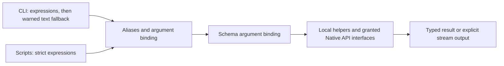

# Object commands and short shell bindings

This proposal separates shell syntax from the selected [OS object hierarchy](../native-api/object-hierarchy.md).
The decisions below were settled on 2026-11-07. Deferred extensions remain marked separately.
The [first stage](typed-context.md) now implements a bounded subset. Later examples remain proposals.



## Selected direction

| Decision | Selected direction |
| --- | --- |
| Aliases | Syntax sugar usable in interactive commands and scripts |
| Property arguments | `echo fs.cwd` passes the String value to `out.print`; no `${...}` expansion syntax |
| Interpretation | Interactive commands prefer expressions, then allow text fallback with a warning; scripts default to strict expressions |
| Arguments | Declared positional mappings; named and unnamed arguments can appear in any order |
| Copy | `fs.copy` accepts path or object sources/destinations; `cp` defaults to replace and `cat` to append |
| Creation | `touch` creates if absent and updates access/modification times; existing directories are supported |
| Expressions | String concatenation and formatting remain deferred extensions |
| Search | The boot context starts with an empty list. The disk startup profile adds `/bin`. |
| Search behavior | Ordered search, explicit-path bypass, not-found-only fallback, and retained executable references |
| Environment | Inherited plain data objects; independent child copies first, possible copy-on-write optimization later |

The [file utility profile](file-utilities.md) records the accepted command catalog and filesystem extensions.
Permissions and links are deferred to a later stage.

## One behavior with two spellings

Aliases provide convenient names for operations or small bound calls.
They apply equally to interactive commands and scripts.
They do not require a separate process.
The implementation should bind parsed operations and arguments, rather than paste raw text into another command.
See [startup configuration](typed-context.md#startup-configuration) for the implemented alias methods.

| Short command | Proposed binding | Behavior |
| --- | --- | --- |
| `echo "hello"` | `out.print "hello"` | Write a String and one newline to the selected output stream |
| `cat "a.txt"` | `fs.copy "a.txt" destination:out mode:append` | Copy bytes to the selected output stream |
| `cp "a.txt" "b.txt"` | `fs.copy "a.txt" "b.txt" mode:replace` | Create or replace the destination file |
| `ls` | `fs.list` | Enumerate cwd and present names; an optional path selects another directory |
| `cd "/tmp"` | `fs.change_directory "/tmp"` | Validate and update this shell's cwd string and directory reference |
| `pwd` | `out.print fs.cwd` | Explicitly print the cwd String |
| `touch "a.txt"` | `fs.ensure_file`, then timestamp update | Preserve contents; update access and modification times |

`pwd` binds a call with a property expression, not a constant captured when the alias is defined.
The property is evaluated when the alias runs.
`out` selects the current command's output stream, including redirection.
Without redirection, it uses `process.streams.output`.
`fs` is a local convenience object bound to process context and filesystem grants.
It is not a global singleton containing every process's cwd.

Alias equivalence includes arguments, results, errors, and authority checks.
Alias defaults fill omitted parameters; an explicit argument overrides a default without counting as a duplicate.
Aliases do not change the selected interpretation mode.
A child process cannot change its parent's context through `cd` or `path.add`.
Context-changing aliases therefore execute inside the current shell.
Explicit executable paths, such as `/bin/ls`, bypass aliases and program search.

## Copy and file creation

`cat` abbreviates “concatenate”: it combines file contents in sequence and writes them to output.
See the [GNU cat manual](https://www.gnu.org/software/coreutils/manual/html_node/cat-invocation.html).
`cat` and `cp` are aliases over `fs.copy`, with different defaults.

| Parameter | Accepted value | Positional mapping | Default |
| --- | --- | --- | --- |
| `source` | Path String or readable object | First unnamed argument | Required |
| `destination` | Path String or writable object | Second unnamed argument | Current output stream |
| `mode` | Copy policy, including `replace` and `append` | Named only | `replace`; `cat` supplies `append` |

The parameter names stay the same across overloads.
A String identifies a filesystem path; an object must provide the required interface and authority.
Overload selection uses evaluated argument types, not spelling or guessed filenames.
Without redirection, the current output stream is `process.streams.output`.
The alias `cat` defaults its destination to that output binding.

```text
fs.copy "a.txt" "b.txt"
fs.copy source:"a.txt" destination:out
fs.copy source:input_file destination:output_file
cp "a.txt" "b.txt"
cat "a.txt"
```

For a path destination, `replace` creates or replaces the file contents; `append` creates or appends to the file.
For an existing stream object, ordinary copying writes at its current position, subject to its open policy.
A console or pipe accepts bytes; copy policy must not request truncation or seeking on those objects.
Passing an object does not implicitly close or reopen it.
The copy implementation must prevent source destruction when both paths identify the same file.

Redirection prepares the output stream once before copying.
`cat "a.txt" > "log.txt"` creates or truncates the log through redirection, then writes into that stream.
`cat "a.txt" >> "log.txt"` opens the log for append, then writes into that stream.
The alias's append default must not undo redirection or cause repeated opens between chunks.
Detailed atomic append and concurrent-writer guarantees belong to the stream/filesystem contract.

`fs.copy` is a streaming helper over native File and stream interfaces, not a required kernel method.
It transfers bounded byte chunks without loading the whole file or adding labels and newlines.
A path source opens from the beginning; a supplied stream source uses its current position.
The helper releases resources it opens on success and failure; it leaves caller-supplied objects open.
A failure after partial output reports failure without claiming rollback or automatically retrying the copy.
Multiple sources remain deferred. `cat` preserves existing input-stream behavior when the source is absent or `-`.
The first stage does not claim complete POSIX `cat` compatibility.

`fs.ensure_file` creates an absent regular file and preserves an existing regular file's contents and timestamps.
It rejects directories and incompatible objects.
Creation must fail safely if another object acquires the name first.

`touch` creates an absent regular file or updates an existing file or directory.
It preserves contents and uses the [timestamp ABI](../native-api/abi/filesystem-times-abi.md) to update access and modification times.
`fs.update_times` performs the timestamp update without creation.

| Operation | Rule |
| --- | --- |
| `fs.create_file "a.txt"` | Fail if the name exists; never truncate an existing file |
| `fs.ensure_file "a.txt"` | Create if absent; preserve an existing regular file |
| `fs.create_directory "sub1"` | Fail if the name exists |
| `fs.remove_file "a.txt"` | Remove the name; retained references follow the filesystem contract |
| `fs.remove_directory "sub1"` | Require an empty directory; no implicit recursive deletion |
| `fs.cwd = "/tmp"` | Use the same validated update as `fs.change_directory` |

Directory mutation availability depends on each filesystem's implemented interface.
These examples do not add missing operations by changing command syntax.

## Typed expressions and strings

A property reference produces a typed value.
The argument binder checks that value against the selected parameter type.
Thus, both commands supply a String to the same operation:

```text
echo "hello"
echo fs.cwd
```

Quoted text is a string literal; `echo "fs.cwd"` prints the literal text.
The language uses one argument grammar with two default interpretation modes.
The interactive exception does not change aliases, positional mappings, or parameter types.

| Input | Interactive default | Script default: strict mode |
| --- | --- | --- |
| `echo fs.cwd` with a readable String property | Evaluate the property; no fallback warning | Evaluate the property |
| `cat a.txt` | Use the literal path | Use the literal path |
| `os.fs.copy(source:process.environment.filename)` | Evaluate the String property | Evaluate the String property |
| `cat "a.txt"` | Use the literal path; no fallback warning | Use the literal path |
| Resolved expression has an incompatible type | Type error | Type error |
| Getter fails or access is denied | Preserve that failure | Preserve that failure |

Path operands in short file commands use literal words.
The established stream names retain their stream meaning in short file commands.
Other expression operands resolve objects and properties before text fallback.
Fallback applies when a simple argument token cannot resolve as an expression, including an absent object or member.
Thus, a missing `txt` member on `a` can also produce the interactive fallback warning.
Fallback produces only a String; it cannot manufacture a stream object or capability.
The resulting String must still satisfy the selected parameter's type.
Quote filenames that contain spaces or shell punctuation.

Fallback is a lexical/name-resolution exception, not recovery from failed execution.
Do not retry a failed getter, method, permission check, or type conversion as a literal filename.
Do not reinterpret malformed compound expressions or structured arguments as one large string.
Discovering whether a member exists must not execute arbitrary getters or constructors.
If metadata cannot distinguish absence from denial or failure, preserve the error instead of assuming absence.

Emit a warning for each argument that needs text fallback.
The warning identifies the token and recommends quoting, for example: `interpreting a.txt as text; use "a.txt" for a literal`.
Write warnings to the error stream, so copied file bytes and redirected output stay unchanged.
A successful command remains successful despite the warning.
Strict scripts reject unresolved argument text before target invocation; quoting provides portable literal syntax in both modes.

Future configuration can disable interactive text fallback, producing strict behavior at the prompt.
A separate warning-visibility setting can suppress warnings without changing resolution semantics.
Neither setting's command syntax is assigned here; warnings remain enabled by default.
Mode selection must not silently relax a script because it was launched from an interactive shell.
The first stage applies these policies to typed bindings and plain executable arguments.
Legacy diagnostics, editor commands, and native parameter tails retain their documented adapters.

These expressions remain illustrative until an expression grammar is selected:

```text
echo "current dir: " + fs.cwd
echo fmt("CWD is {}", fs.cwd)
```

The parser must retain expression structure before binding arguments.
Whitespace inside an expression must not create extra arguments.
Formatting validates placeholder count and input types; it does not implicitly invoke arbitrary remote getters.
General arithmetic, overload resolution, and implicit object-to-string conversion are not selected by these examples.

## Output on strings

Use stream-owned output for the initial bindings.
String output methods remain a deferred convenience, not a prerequisite for this slice:

| Style | Example | Consequence |
| --- | --- | --- |
| Stream-owned output, recommended | `out.print fs.cwd` | Keeps destination and output failure visible |
| String convenience method | `fs.cwd.print destination:out` | Adds a local runtime convenience to String |
| String convenience with default | `fs.cwd.print` | Requires a documented invocation-output default |

A String output method would reside in the runtime, not in serialized environment data.
It needs an output reference from an explicit argument or invocation context.
It cannot create authority or embed a hidden stream handle in every String.
Both styles must define identical newline and error behavior if exposed as equivalent conveniences.
The selected `pwd` binding is `out.print fs.cwd`.

## Named, structured, and positional arguments

Use one argument grammar for command lines and scripts.
Named arguments use `name:value`; values can be typed expressions or structured literals.
Field and parameter names follow the public `snake_case` convention.

```text
object.method param_name1:value1 struct1:{field1:fv1, field2:fv2}
out.print text:fs.cwd
fs.copy source:"a.txt" destination:out
```

In strict scripts, names such as `value1` and `fv1` in this sketch must resolve to expressions.
Use quoted values when those names mean literal strings.
Record fields, parameter labels, and declared enum/variant case names are schema syntax, not unresolved expression references.

A method declares an ordered mapping for unnamed arguments.
One declared parameter remains the simple primary-parameter case; methods can declare multiple positional slots.
The first unnamed argument maps to slot 1, the second to slot 2, regardless of named arguments between them.
Named arguments do not consume slots or change that mapping.
Do not guess a positional target from an argument's type or the next unfilled parameter.

```text
out.print "text"
out.print text:"text"
fs.copy "a.txt" "b.txt"
fs.copy destination:"b.txt" "a.txt"
fs.copy "a.txt" mode:replace destination:"b.txt"
```

For `fs.copy`, slot 1 is `source` and slot 2 is `destination`.
All three copy examples supply the same source and destination.
Named arguments can appear before, between, or after unnamed arguments.
Supplying a parameter twice is an error, including once by name and once through its positional slot.
Thus, `fs.copy source:"a.txt" "b.txt"` supplies `source` twice and must fail.
Alias defaults fill omitted values only; explicit arguments can override those defaults.

Reject unknown names, excess positional arguments, duplicates, missing required arguments, and incompatible types.
Validate the argument mapping before evaluating expressions or opening redirection targets.
Evaluate expressions once in source order; argument evaluation itself can fail or perform explicitly requested calls.
Do not dispatch the target method until its evaluated arguments pass validation.
This does not roll back effects from argument evaluation.

A structured parameter can occupy a positional slot too:

```text
object.configure {enabled:true, limit:10}
object.configure options:{enabled:true, limit:10}
```

Lists use brackets and commas; record fields use braces and commas.
Explicit variants retain schema-directed case selection, such as `source.text:"hello"` and `source.stdin`.
The [parameter profile](../native-api/parameter-schema.md) remains authoritative for current CLI conversion.
Expression operands and schema field/case labels need distinct parser roles.
Positional metadata and expression evaluation are extensions, not features of the current input ABI.
Legacy executable argv conversion remains a separate adapter; existing programs do not automatically gain typed method invocation.

## Path and inherited data

`path` is a runtime object over the plain ordered list in `process.environment.path`.
The boot context starts with an empty list.
The disk startup profile adds `/bin`.
It is not mirrored into a `PATH` string.
See [startup configuration](typed-context.md#startup-configuration) for the profile and rollback rules.

```text
path.add "/bin"
path.list
path.search "textprocessor"
path.remove "/bin"
```

`add` appends a new entry; duplicate addition is a no-op.
`remove` removes an exact entry; absent-entry behavior and limits remain open.
`search` returns a retained executable reference without running it.
Explicit paths bypass search; errors other than not-found stop the search.
The caller releases the reference after launch or inspection.
The child inherits copied environment data; its mutations do not alter its parent's data.
The runtime supplies methods, while stream and directory capabilities remain separate launch grants.

## Decisions before the first shell slice

The first-slice language decisions are settled as described above.
This table separates them from deferred extensions and implementation specifications.

| Topic | Status |
| --- | --- |
| Aliases | Available in commands and scripts; defaults fill omitted parameters |
| Interpretation | Expression precedence; warned text fallback at the prompt; scripts strict by default |
| File helpers | `fs.copy` with path/object overloads; `cp` replace default; `cat` append/output defaults; `touch` ensure-file plus current-time update |
| Output | `out.print` and `pwd` as an explicit print call; String methods deferred |
| Arguments | Declared positional slots mixed freely with named arguments; duplicate assignments fail |
| Expressions | Concatenation, formatting, precedence, and escaping need a later expression grammar specification |
| Cwd | Accepted: bounded parent traversal, retained directory identity, and explicit unreachable-path reporting; see the utility profile |
| Environment | Plain inherited data selected; specify bounds and spawn/exec failure behavior |
| Search | Rules and initial directories selected; configuration files deferred |
| Diagnostics | Fallback warnings on the error stream; configuration syntax deferred |

Alias-definition syntax, limits, and script result presentation remain implementation specification work.
Defer loops, closures, pipelines, and asynchronous script dispatch from the first slice unless separately selected.
Their later semantics remain in the [language proposal](language-proposal.md).
A generic reflection client needs result and property schemas beyond the current bounded input profile.
Fixed known bindings can precede general reflection.

## Documentation impact and acceptance

This update supports GOALS “Terminal-first operating system” and “Native system interface.”
It refines the shell boundary linked from ARCHITECTURE “Native objects and OS services.”
It records language decisions without changing current UAPI records or executable behavior.
Boot, hardware, allocation, scheduling, and runtime resource use are unaffected.
The [hierarchy impact assessment](../native-api/object-hierarchy.md#documentation-impact-and-validation) covers the wider proposal.

Documentation validation covers local links, conflicting earlier recommendations, argument examples, and independent review.
No kernel build, QEMU run, or runtime benchmark is appropriate for this documentation-only update.
No new measurement or hardware result is claimed.

Future implementation acceptance must cover:

- Aliases and argument mappings in both interactive and script modes.
- Named arguments before, between, and after unnamed arguments; duplicate and excess arguments.
- Missing roots and members: interactive fallback warning versus strict script error.
- Bound-property precedence, quoted filenames, incompatible values, denied access, and getter failures.
- Warning isolation from output bytes, mode inheritance, and no fallback for malformed compound expressions.
- Path/object copy combinations, create/replace/append, redirection, retained stream positions, and same-file protection.
- Partial-copy failure, cleanup, child data isolation, failed cwd updates, and retained executable identity.

These are future acceptance cases, not runtime checks executed for this documentation change.
