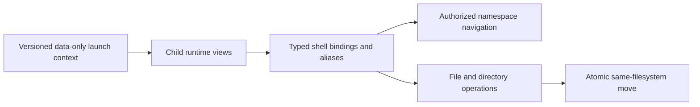

# Typed context and first shell stage

Implementation started on 2026-11-07 on `codex/typed-shell-context`.
This historical plan records the first stage of the accepted [utility profile](file-utilities.md).
Later stages now provide traversal, text tools, the pager, and [timestamps](../native-api/abi/filesystem-times-abi.md).
Permissions and links remain deferred.



## Accepted defaults and scope

Unhandled command failure stops a script; an interactive session reports the error and continues.
Interactive sessions present expression results automatically; scripts require explicit output.
Listing and content commands retain their explicit output in both modes.
The initial grammar supports literals, property references, structured arguments, method calls, and property assignment.
General expression operators, string concatenation, formatting, loops, and custom aliases are deferred.

Deliver a bounded plain-data environment inherited through launch, with independent child mutation.
Expose path list/add/remove/search and validated cwd through runtime bindings.
Retain standard streams and directory authority as separate grants.
Use the selected `/bin`, `/disk/bin` initial search order without a text PATH mirror.
Launch the retained executable selected by search instead of resolving its name twice.

Implement pwd/cd/ls, touch, cp/cat, mv, rm, mkdir/rmdir and their canonical object spellings.
At this stage, `touch` retained creation-only behavior; the later timestamp profile replaces that limitation.
Support scripts through the shell, strict expressions, mixed named/positional arguments, and interactive warned text fallback.
Preserve the existing editor, redirection, diagnostics, and provider commands.

## Implementation sequence

1. Add bounded typed context records, validation, runtime access, and launch inheritance.
2. Add authorized namespace navigation, current-directory reconstruction, and object comparison.
3. Extend tmpfs and ext2 for same-filesystem cross-directory moves and replacement.
4. Add schema-bound shell calls, aliases, strict scripts, and typed local context operations.
5. Add host contract tests and guest checks for both boot paths and persistent moves across reboot.
6. Measure resources, run independent review, correct findings, then commit, push, and open a PR.

## Impact assessment

| Area | Requirement and impact |
| --- | --- |
| Scope | GOALS “Terminal-first operating system,” “Native system interface,” and “Storage and filesystems”; bounded runnable utility slice |
| Architecture | ARCHITECTURE “Native objects and OS services” and “Process And Userland Architecture”; runtime views over copied data and granted handles |
| Boot/platform | Both entry paths launch the revised startup record; verify image capacity and UEFI/BIOS behavior |
| Memory/isolation | Validate bounded values before publication; retain namespace resources; reject authority amplification and invalid pointers |
| Concurrency | Serialize namespace updates and validate ancestry; preserve retained cwd and atomic move publication across SMP clients |
| Interfaces | Extend startup and VFS resource contracts; preserve existing fixed provider and descriptor profiles explicitly |
| Resources | Compare kernel/initrd/image sizes and comparable guest workload time and allocator observations with main |
| Validation | Host parsing/startup/VFS/ext2 tests, UEFI/BIOS command checks, reboot persistence, existing regression matrix, independent review |

The [object contract](../native-api/object-contract.md#4-authority-and-bootstrap) controls grants and ownership.
The [startup ABI](../native-api/abi/initrd-vfs-abi.md) and [VFS contract](../native-api/vfs-contract.md#3-roots-cwd-and-path-grammar) need implementation-specific updates.
The [tmpfs ABI](../native-api/abi/tmpfs-abi.md#namespace-and-storage-rules) and [ext2 profile](../filesystems/ext2.md#supported-disk-profile) define the baseline rename restrictions.

## Validation and resource evidence

Implementation, checks, and independent correction review are complete.
The [current command profile](typed-context.md) defines the implemented subset.
Do not treat QEMU evidence as physical-hardware validation.

### Implemented result

Startup ABI v3 carries 3216 bytes of bounded data, separately from resource grants.
The shell implements local context bindings, strict scripts, aliases, navigation, and basic file operations.
The kernel adds rooted lookup, current-path reconstruction, object comparison, and same-filesystem moves.
Native typed removal checks the target kind atomically.
Copy retains source and destination identities before truncation, including redirected output.
Ordinary external commands validate constructors and argv before stream redirection.
Legacy `exec` and `call` retain their own argument preparation after redirection.

### Checks and review

| Check | Result |
| --- | --- |
| Host suite | 454 passed, including context validation, argument binding, namespace authority, concurrent rename/describe, and ext2 replacement |
| Normal matrix | All 48 distinct checks passed across the full matrix and affected rerun |
| Final affected rerun | 11 passed: typed shell, file/editor, exec, no-UART, and monitor contracts |
| Diagnostic images | Three passed: UEFI keyboard, UEFI without keyboard, and BIOS keyboard |
| Persistence | Typed guest checks verify moved file contents and directory identity after reboot |
| Formatting | Changed owned C/C++ files formatted with clang-format; diff whitespace check passed |
| Documents | Local file links checked; ABI claims compared with headers and tests |
| Secret review | No credentials found; matches were code identifiers, paths, and existing password guidance |
| Independent review | Three review cycles; all confirmed findings corrected; final correction review passed |

The complete matrix initially passed 47 of 48 checks.
The no-UART test still typed obsolete split-quote syntax; its corrected command passed in the final affected rerun.
Earlier socket-based checks were blocked by the sandbox and passed with local socket access enabled.
A diagnostic test injected input while the shell printed its prompt, interleaving the expected marker.
It now waits for the full prompt before injection; all three diagnostic cases passed.
No expected functional assertion was removed.

Review found trailing-slash removal, filename-script heredoc input, and colon-based argv validation defects.
Corrections preserve mutation path requirements, pass the script Reader to heredocs, and inspect actual constructor metadata.
Regression checks verify that rejected commands preserve existing file contents.
Further review added empty-directory replacement, malformed resource requests, and concurrent namespace coverage.
The final stream-right check rejects an output-only source before file changes.

The reviewers inspected source, new files, contracts, tests, and correction interactions without editing the project.
Runtime evidence does not establish physical-hardware behavior; no USB device was written.
The full ASD-STE100 standard and dictionary were unavailable; language review does not establish complete compliance.

Exact build and check commands:

```sh
cmake -S . -B build/typed-context -G Ninja -DCMAKE_TOOLCHAIN_FILE=cmake/toolchains/x86_64-elf.cmake -DCMAKE_BUILD_TYPE=Debug -DOS1_KMEM_DEBUG=ON -DOS1_QEMU_DEBUGCON=ON
cmake --build build/typed-context -j8
cmake --build build-host-tests -j8
ctest --test-dir build-host-tests --output-on-failure -j8
ctest --test-dir build/typed-context --output-on-failure -j4
ctest --test-dir build/typed-context --output-on-failure -R 'typed_shell|files_|smoke_exec|smoke_no_uart|smoke_settle|smoke_monitor'
cmake -S . -B build/typed-context-diagnostic -G Ninja -DCMAKE_TOOLCHAIN_FILE=cmake/toolchains/x86_64-elf.cmake -DCMAKE_BUILD_TYPE=Debug -DOS1_KMEM_DEBUG=ON -DOS1_QEMU_DEBUGCON=OFF -DOS1_USB_KEYBOARD_DIAGNOSTICS=ON
cmake --build build/typed-context-diagnostic -j8
ctest --test-dir build/typed-context-diagnostic --output-on-failure -R '^os1_smoke_usb_keyboard_'
```

Local evidence is under `build/typed-context-evidence/`.
The main logs are `host-tests.log`, `final-guest-tests.log`, `final-affected-tests.log`, and `diagnostic-final-tests.log`.
These generated files remain outside version control.

### Resource comparison

Baseline is main `369db34ab93bd6ba8727315b9ae46bf0fcd5fece`, rebuilt from a clean archive.
Candidate is this branch's final implementation before its task commit.
Both builds use GCC 11.2.0, Debug configuration, kernel size optimization, KMEM_DEBUG on, and QEMU_DEBUGCON on.
The host uses macOS 26.6.2 on ARM64. QEMU 11.1.3 uses TCG, q35, four CPUs, and 128 MiB RAM.
UEFI uses Homebrew `edk2-x86_64-code.fd` and a fresh `edk2-i386-vars.fd` copy; BIOS uses bundled SeaBIOS.

The workload runs ten echo/write, cat, and ls cycles, plus disk sync and two allocator observations.
Each run uses a fresh program disk. Baseline and candidate alternate for three repetitions per boot path.
Reported times are medians. QEMU CPU time includes boot and workload, not only guest command execution.

| Property | Baseline | Candidate | Difference |
| --- | ---: | ---: | ---: |
| Stripped BIOS kernel | 377088 B | 385280 B | +8192 B (+2.17%) |
| Kernel text/read-only data | 344064 B | 352256 B | +8192 B (+2.38%) |
| Kernel writable data | 32768 B | 32768 B | 0 B (0%) |
| Kernel BSS | 180224 B | 180224 B | 0 B (0%) |
| Shell text/data/BSS total | 264912 B | 313637 B | +48725 B (+18.39%) |
| Initrd | 50688 B | 73728 B | +23040 B (+45.45%) |
| UEFI ISO | 4284416 B | 4315136 B | +30720 B (+0.72%) |
| BIOS raw image | 1474560 B | 1474560 B | 0 B (0%) |
| Program fixture disk | 34603008 B | 34603008 B | 0 B (0%) |
| BIOS boot | 0.410080 s | 0.435277 s | +0.025197 s (+6.14%) |
| BIOS workload | 0.717751 s | 0.685720 s | -0.032031 s (-4.46%) |
| BIOS QEMU CPU | 1.220041 s | 1.218756 s | -0.001285 s (-0.11%) |
| UEFI boot | 1.929936 s | 1.915023 s | -0.014913 s (-0.77%) |
| UEFI workload | 0.286522 s | 0.256598 s | -0.029924 s (-10.44%) |
| UEFI QEMU CPU | 2.244071 s | 2.224487 s | -0.019584 s (-0.87%) |
| Final kernel slab pages | 168 | 168 | 0 pages (0%) |
| Final live slab objects | 2332 | 2332 | 0 objects (0%) |

All runs report zero allocator failures.
Final slab accounting is equal; this does not measure transient allocations or complete process memory.
The shell's larger image includes local typed data, argument preparation, and binding code.
Basic cat/ls aliases avoid external program launches in this workload; timing differences do not isolate individual mechanisms.
BIOS boot increased by about 25 ms; no boot-latency threshold is assigned for this stage.
The kernel and initrd fit their revised 400 KiB and 160 KiB staging slots.
Move allocates 8192 scratch bytes for ext2; its runtime namespace guarantee does not add crash recovery.

Reproduce the workload with [the measurement helper](../../tests/scripts/measure_shell_context.py):

```sh
python3 -B tests/scripts/measure_shell_context.py --baseline build/typed-baseline/artifacts --candidate build/typed-context/artifacts --output build/typed-context-evidence/measurements --qemu /opt/homebrew/bin/qemu-system-x86_64 --code /opt/homebrew/share/qemu/edk2-x86_64-code.fd --vars /opt/homebrew/share/qemu/edk2-i386-vars.fd
```

`resources.json` records artifact hashes and section sizes. `measurements/measurements.json` retains every repetition and allocator observation.
The baseline archive used the same CMake options and shared, unchanged third-party dependencies.
